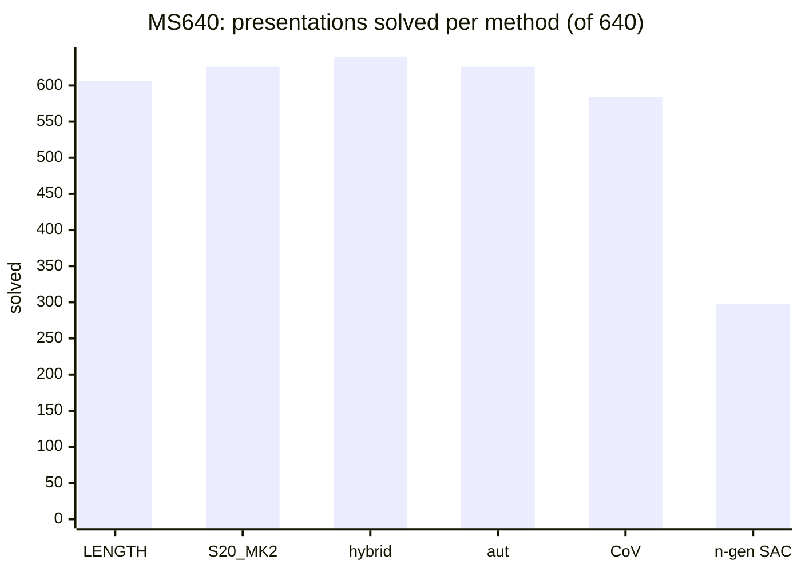

# AC-SolverX

**TL;DR.** AC-SolverX searches for Andrews-Curtis paths that reduce balanced presentations of the trivial group, such
as `<x, y | xxYYY, xyxYXY>`, to `<x, y | x, y>`. One command runs any of seven methods on a benchmark or your own file,
and captured solves are replayed on their rows before they are written. On MS640 the **hybrid solves 640 / 640** at 1,000 work
units a row; greedy search solves 626 (S20_MK2) and 606 (LENGTH) at 10,000 pops a row. Code and data for *The Two-Hump
Problem: Bridging the Difficulty Gap in Mathematical Reinforcement Learning* (ICML 2026;
[project page](https://icml.cc/virtual/2026/poster/64251), [arXiv](https://arxiv.org/abs/2606.21611)) and the stable
Andrews-Curtis follow-up.

## Install

```bash
python3.12 -m venv .venv && . .venv/bin/activate
pip install -e ".[dev]"          # editable: acx reads data/ and benchmark/; ".[rl]" adds PyTorch for the rl method
export NUMBA_NUM_THREADS=1       # one core per search; a config's `workers` solves rows in parallel
```

The first run compiles the numba kernels (under a minute) and caches them; editing any acx file that uses numba
recompiles them (`acx/jit_cache.py`).

## Run: `run.py` for every method

`python run.py --config configs/<method>.toml` runs one method row by row. **The config** (TOML) names the `method`,
the `benchmark` and the method's settings (budget, priority, cap); [`configs/template.toml`](configs/template.toml)
lists every key with its default. `--set key=value` overrides one key, `--rows 0:20` runs a slice.

```bash
python run.py --config configs/smoke.toml                                     # 20 MS640 rows, about a second
python run.py --config configs/s20_mk2_fast.toml --set benchmark=bench60      # a shipped benchmark by name
python run.py --config configs/hybrid.toml --pres "xxYYY, xyxYXY"            # one presentation -> results/hybrid_pres/
python run.py --config configs/hybrid.toml --input examples/presentations.csv # your file -> results/hybrid_presentations/
python run.py --config configs/greedy_fast.toml --input examples/presentations.csv     # the same file, another method
python compare.py results/greedy_fast_presentations results/hybrid_presentations --html compare.html
```

`--input FILE` reads your own `.txt`, `.csv` or `.jsonl` file ([`examples/`](examples/) has one of each), `--pres`
one typed presentation. A run writes `results/<name>/`: `paths.jsonl` (one record a row: `solved`, `kind`, `cost`,
`sub_moves`, `elem_moves`, the path, `verified`), `summary.json` and `config.json`, and rerunning it resumes.
`--set path=false` is a faster pipeline that counts solves but keeps and checks no path
([CPU saved](docs/PERFORMANCE.md#recording-the-path)); `--solved-from` decodes its solves later. Every flag, format,
config key and field: [docs/USAGE.md](docs/USAGE.md).

## Results on MS640



*The hybrid solves every row; CoV and the n-generator transform solve fewer than plain LENGTH greedy at the same
10,000 pops a row. Budgets and caps are in the table; rl ran on 30 rows only and is left out.*

From the shipped `results/ms640_*/summary.json`: fast backend, cap 24 (the hybrid has its own limits), every path
replayed. A row that misses spends its whole **budget**; cost covers every row. Kinds: plain `ac_path` / aut-assisted
`ac_path` / `stable_cert` (below). Path lengths are means per solve.

| method (config) | budget a row | solved / 640 | kinds | cost, total | mean per row | S-moves | elementary moves |
|---|---|---:|---|---:|---:|---:|---:|
| greedy, LENGTH (`greedy_fast`) | 10,000 pops | 606 | 606 / 0 / 0 | 576,053 pops | 900.1 | 20.0 | 189.5 |
| greedy, S20_MK2 (`s20_mk2_fast`) | 10,000 pops | 626 | 626 / 0 / 0 | 382,718 pops | 598.0 | 27.0 | 269.5 |
| hybrid (`hybrid`) | 1,000 work units | **640** | 128 / 512 / 0 | 25,064 units | 39.2 | 19.3 | 139.1 |
| aut, S20_MK2 on the Aut-min form (`aut`) | 10,000 pops | 626 | 11 / 615 / 0 | 408,174 pops | 637.8 | 27.2 | 1,258.4 |
| change of variables (`cov`) | 1,000 pops an image, 10,000 a row | 584 | 554 / 0 / 30 | 693,162 pops | 1,083.1 | 14.3 | 99.2 (the 554 `ac_path`s) |
| n-generator, SAC (`ngen_sac`) | 10,000 pops | 298 | 0 / 0 / 298 | 3,729,167 pops | 5,826.8 | 16.9 | 769.1 (stable moves) |
| rl, first 30 rows (`rl`, run `ms640_rl30`) | beam 256 x 150 steps | 30 / 30 | 30 / 0 / 0 | 9,650 evaluations | 321.7 | 4.4 | 28.2 |

A hybrid unit is not a pop: compare the two by CPU ([docs/PERFORMANCE.md](docs/PERFORMANCE.md#methods-side-by-side)).
[docs/RESULTS.md](docs/RESULTS.md) has every published run and its command, among them bench60, ladder200 and the
hybrid on all 72,779 AC19 Aut(F2) orbits (72,779 solved, 188 as `stable_cert`) and on all 1,136,154 raw AC1M
presentations (1,136,135 solved).

### Two stored studies

Two larger sweeps, run on their own branches, are stored under `results/stable_ac/`
([results/README.md](results/README.md#studies)). Both count the **best start known in advance** (an oracle): what a
start can do, not what a solver finds. `results/rank3_bf/` is acx's own rerun of rank 3, lengths 1 to 4 (equal cell
for cell), and `[cov] family = "suballpxyb8"` enumerates the CoV sweep's starts.

| study | searched (LENGTH greedy) | budget a start | solved of 640 |
|---|---|---|---|
| [n-generator brute force](results/stable_ac/rank3_bf/README.md) | `z = w` for every word `w` (rank 3), or two or three such generators (ranks 4, 5); cap 24; 40,098,032 searches | 1,000 and 10,000 pops | at 1,000: control 554, some word of length 1-10 578, best single word 528, rank 4 506, rank 5 416; at 10,000 (lengths 1-7): control 606, some word 608 |
| [CoV sweep](results/stable_ac/cov_all/README.md) | every change of variables of the family `suballpxyb8`: 114,042 starts; control at cap 24, a start at `max(24, longest relator + 16)`, up to 91 | 100, 1,000, 10,000, 100,000 pops | best start 555 / 604 / 626 / 640 against the control's 455 / 554 / 606 / 634 |

## AC path or stable AC

| method | `ac_path` (AC moves on the row) | `stable_cert` (stable AC) |
|---|---|---|
| greedy, rl | always: the S-moves decode to elementary AC moves | never |
| aut | always; `aut_assisted` when the row is not its own Aut-minimal form | never |
| hybrid | every step at rank two; `aut_assisted` when one is an automorphism | higher-rank steps (new generators, AC4/AC5) |
| cov | the row, or an image in its Aut(F2) orbit (`aut_assisted`), is solved | an image outside the orbit is solved; no elementary path (`elem_moves` null) |
| ngen | the SAC transform adds no generator | it adds generators (all 298 MS640 solves); lifted to elementary stable moves |
| rankn | | counts solves of stabilised starts, writes no certificate ([docs/RANK3.md](docs/RANK3.md)) |

**Automorphisms do not make a solve stable.** A solve found in another basis (the Aut-minimal form, a CoV image in the
orbit, the hybrid's Nielsen/pinch cascade) is carried back to the row (`acx/aut/transport.py` for aut and cov,
`acx/hybrid/elementary.py` for the hybrid) and replayed there: an ordinary `ac_path` of elementary moves with
`aut_assisted: true`. It needs `path = true`, or `--solved-from` after a high-speed run.

## Docs

- [docs/EXPERIMENTS.md](docs/EXPERIMENTS.md): setup, matched comparisons, resume, certificates and retained evidence.
- [docs/REVIEW_FOLLOWUP.md](docs/REVIEW_FOLLOWUP.md): the follow-up review of experiment integrity and avoidable work.

| doc | what |
|---|---|
| [docs/USAGE.md](docs/USAGE.md) | inputs, flags, run names and resume, config keys, output fields, comparing runs |
| [docs/METHODS.md](docs/METHODS.md) | moves, search, priorities, transport, decoder, every method, verification |
| [docs/RESULTS.md](docs/RESULTS.md) | every published number, its budget and the command that reproduces it |
| [docs/PERFORMANCE.md](docs/PERFORMANCE.md) | CPU and memory: `fast` against `spec`, node budget, recording the path, relator cap, methods side by side |
| [docs/CAP.md](docs/CAP.md) | the relator cap (`cap`, default 24, `"none"` = uncapped) and its counters |
| [docs/RANK3.md](docs/RANK3.md) | the rank-n brute force and the n-generator package |
| [docs/ARCHITECTURE.md](docs/ARCHITECTURE.md) | the module map and interfaces |
| [docs/PROVENANCE.md](docs/PROVENANCE.md) | where each file, number and run comes from |
| [docs/REVIEW.md](docs/REVIEW.md) | the October 2026 adversarial review: findings, fixes, limits |
| [benchmark/README.md](benchmark/README.md) | the evaluation sets and the difficulty ladder |
| [results/README.md](results/README.md) | run folders, the two stored studies and their manifests |

## Datasets (`data/`) and tests

- **`1190MS.txt`**: the 1,190 Miller-Schupp benchmark; **`ms640_solved.txt`**: the 640 (MS640) the length greedy
  solves at 1,000,000 pops. **`AC19_extended.txt`**: 156,762 presentations; **`AC19.txt`**: the 140,535 of length
  <= 19; **`AC19_extended_aut_min.csv`**: its 72,779 Aut(F2) orbits. **`AC1M.txt.gz`**: 1,136,154 presentations;
  **`AC1M_aut_min.csv.gz`**: its 71,283 orbits.
- **`ms_unsolved_reps/`**: the unsolved Miller-Schupp representatives and the 124 classes nobody has solved (U124);
  **`equivalence_classes/certificates.json`** joins their 261 presentations into the 124 classes.

`pytest` runs the default selection (a few minutes); `pytest -m ""` adds the slow parity and census sets. Install
`.[rl]` to include the policy/PPO tests; CI also runs them with CPU PyTorch.

## License

Code: [MIT](LICENSE). Datasets (`data/`, including AC-19 and AC-1M): [CC BY 4.0](LICENSE-DATA). Binary files kept on
purpose: the RL checkpoint `acx/rl/checkpoint/610model_1000.pt` (0.6 MB, the paper's step-1000 weights),
`benchmark/subsets/subset_coverage.png`, the eight graphs (`.png`) of the two studies under `results/stable_ac/`, and
the CoV sweep's budget-100,000 records `results/stable_ac/cov_all/cov_all_suballpxyb8_ms640_b100000.jsonl.gz` (4.1 MB,
the transform of every start). The studies' other raw files are not in git; each `MANIFEST.json` lists them with size
and sha256.

## Citation

```bibtex
@inproceedings{fagan2026twohump,
  title     = {The Two-Hump Problem: Bridging the Difficulty Gap in Mathematical Reinforcement Learning},
  author    = {Fagan, Lucas and Tarquini, Michele and Shehper, Ali and Manko, Maksymilian and Gruen, Angus and Huang, Coco and Butbaia, Giorgi and Passaro, Davide and Gukov, Sergei},
  booktitle = {Proceedings of the 43rd International Conference on Machine Learning (ICML)},
  year      = {2026},
}
```
