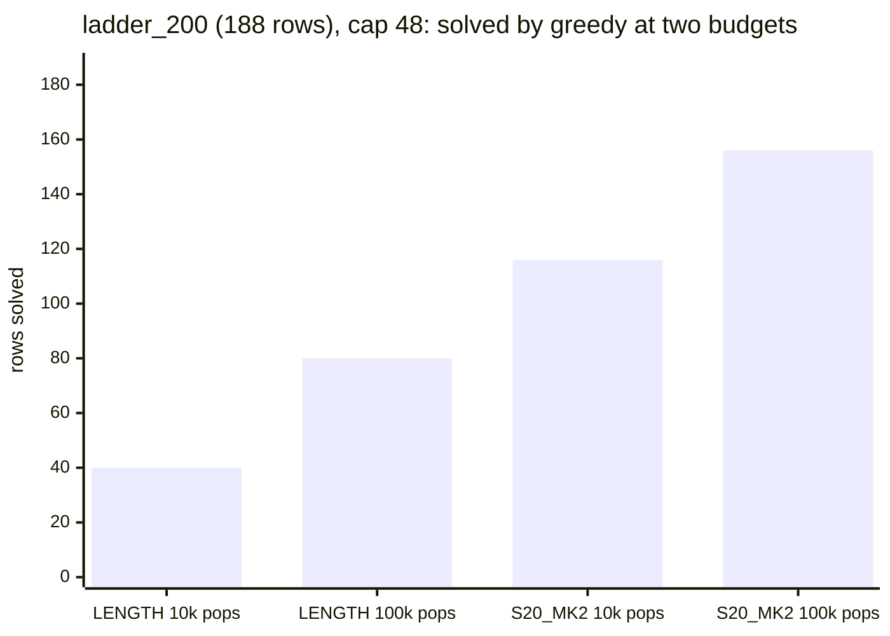

# The AC difficulty ladder

**TL;DR.** Ten levels of Andrews–Curtis presentations, from "solved in a few heap pops" to "only the cascades solve
it", graded by the node count of plain length-ordered greedy **on record**, in nested panels of 20 to 500 rows so a
method can be scored level by level. **Every ladder row is solved by something on record**; the 124 unsolved
Miller–Schupp classes ship apart in [`unsolved_124.csv`](unsolved_124.csv). Panels draw from two strata, **Aut-min
AC19 orbits and MS-640 rows**. **Subsets 60, 100 and 200 are the main testers.**

> **In this checkout**: the panel CSV/JSON files, `ladder_manifest.json` and this file; run a panel with `run.py`
> ([below](#running-a-panel)). The build and tester scripts (`build_ladder.py`, `grade_extra.py`, `run_ladder.py`,
> `report_ladder.py`), the run records in `runs/` and `sources/`, and `ladder_all.csv` (the full 73,464-row pool,
> 8.6 MB) stay on the ladder's source branch ([docs/PROVENANCE.md](../../docs/PROVENANCE.md)). Built 2026-09-10 by
> `build_ladder.py` (levels 9/10 split and the unsolved rows moved off on 2026-09-11); nothing was searched for it
> except the 21 rows of `grade_extra.py` and the S20_MK2 grading of the originals and MS-640 rows.

## Difficulty = plain greedy node count on record

`g` is the node count of the **plain length-ordered greedy** (`config=None`, the baseline every heuristic is measured
against), from the committed large-budget runs:

| rows | run | budget (pops) | cap |
|---|---|---:|---:|
| all 72,779 AC19 aut-min orbits | `ac19_autmin_10k` (leftover branch) | 10k | 48 |
| the 843 greedy left unsolved there | escalation rungs `hsearch_ac19_hard100k` → `leftovers_1m` → `leftovers_5m` → `ac19_10m` | 100k → 1M → 5M → 10M | 48, 48, 64, 64 |
| 12 of those 843 the record never escalated + 1 for S20 | `sources/unescalated_*` (`grade_extra.py`, run for this ladder) | 100k, 1M | 48 |
| the 40 originals of the hard orbits | `ac19_orig_10m` | 10M | 64 |
| 8 more originals (`ac19_orig_cascade`) | `sources/open8_greedy_mrl64.jsonl` (`grade_extra.py`) | 100k | 64 |
| all 640 MS-640 rows | `greedy_1000000_640_mrl24` (blob `525050dd`) | 1M | 24 |

`g` is exact for every solved row and censored at 10,000,000 for the 28 AC19 orbits that did not solve. Caps differ
across runs as they did historically; each row carries its `greedy_budget`, `greedy_cap` and `greedy_run`. Read solves
as primary and node ratios across caps as indicative ([RESULTS.md](../../docs/RESULTS.md), "How to read the numbers").
Levels 7–9 are **graded by record**: a 10M-pop greedy run needs ~50 GB, so they are not re-derivable on a 15 GB
machine (`run_ladder.py` refused budgets over 1M unless `LADDER_ALLOW_BIG=1`).

## The levels

| level | rule (`g` = plain greedy pops) | AC19 orbits | MS-640 | originals (pool only) |
|---|---|---:|---:|---:|
| 1 | `g < 1,000` | 66,082 | 554 | 6 |
| 2 | `1,000 ≤ g < 10,000` | 5,854 | 52 | 24 |
| 3 | `10,000 ≤ g < 31,623` | 394 | 20 | 2 |
| 4 | `31,623 ≤ g < 100,000` | 226 | 8 | 13 |
| 5 | `100,000 ≤ g < 316,228` | 98 | 4 | |
| 6 | `316,228 ≤ g < 1,000,000` | 37 | 2 | |
| 7 | `1,000,000 ≤ g < E` | 30 | | |
| 8 | `E ≤ g ≤ 10,000,000` | 30 | | |
| 9 | plain greedy **unsolved at 10,000,000**; S20_MK2 solves it | 19 | | |
| 10 | plain greedy **and** S20_MK2 unsolved at 10,000,000; only the cascades solve it | 9 | | |

- Panel-eligible rows are the first two columns: 72,779 aut-min orbits + 640 MS-640 rows = 73,419 of the pool's
  73,464. The originals are in `ladder_all.csv`, **never on a panel**.
- `E = 2,253,802` is the log-median of the 60 AC19 rows in [1M, 10M], so levels 7 and 8 hold 30 each (a fixed edge at
  3.16M would leave level 8 with 15). Every subset's JSON records `E` and `levels`. Levels 1–2 form the "< 10k" band,
  split at 1k so the easy end is graded too (subset 60's bins 0–6 all sit below 15k).
- **Levels 9 and 10** are the 28 orbits left by the whole greedy escalation, split by S20_MK2. Level 9 (19):
  `s20_mk2@10k` 6, `@100k` 2, `@1M` 8, `@5M` 3. Level 10 (9): `K3p_notable@1k` 7 (the table-free cascade),
  `K3p_c14aut@1k` 2 (only with the cap-14 backward table): `ac19_16286, 27254, 28131, 44381, 50841, 51034, 59576,
  65753, 7284`. `solved_by` says which on every row.

### The unsolved set (not on the ladder)

A benchmark row must be a problem somebody has solved, so the 124 unsolved Miller–Schupp classes ship beside the
ladder (same columns, `level = unsolved`, `solved_by = none`):

- [`unsolved_124.csv`](unsolved_124.csv): the 124 classes **in the form first found, before any μ-ladder reduction**
  (`data/ms_unsolved_reps/aca_124_initial.csv`, `aca_0..aca_123`): "the u124".
- [`unsolved_all_forms.csv`](unsolved_all_forms.csv): 1,059 rows with `form` set: the classes as `aca_best` (the
  μ-reduced pairs the u124 probes ran on, `acabest_N`), the 261 A-equivalent reps (`msrep_<name>`) and the 550 raw
  unsolved MS cells (`msraw_<line>`).

Evidence for "unsolved by everything": 0/261 reps at 1M greedy (cap 48), 0/124 at 10M S20_MK2 (cap 64,
`claude/ac19-theorem-strength-8v1wp6:research/residual_20260909/u124/`), 0/124 by every cascade probe at 10,000
units, 0/124 from any automorphic image within two Whitehead moves at 20k pops
(`claude/ac19-theorem-strength-8v1wp6:research/autchoice_20260910/applied/`). Run them like a panel:
`--input benchmark/ladder/unsolved_124.csv` (or `unsolved_all_forms.csv`).

## The originals: same orbit, different start (pool only)

45 rows have `form = original`: pre-Aut-min dataset presentations (`ac19x_<row>` = line of
`data/AC19_extended.txt`). Graded by their own greedy cost they land in levels 1–4 (509–52,143 pops, median 5,084),
while their aut-min representatives sit in levels 9–10 (40 of them, greedy-unsolved at 10M) or level 8 (the 5 open-8
reps, 2.3M–5M pops): **Aut-minimising can make a presentation much harder to search**
(`claude/ac19-leftover-solver-notebook-6yan6d:results/heuristic_search/ac19_autmin_screen/ORIGINALS_AT_10M.md`; second
study `claude/ac19-theorem-strength-8v1wp6:research/autchoice_20260910/`). [`ladder_pairs.csv`](ladder_pairs.csv)
lists the pairs; `pair_id` links them in every CSV. Three `ac19_orig_cascade` originals are also among the 40 and are
graded by the 10M run.

**Why they are not a stratum.** They are not a sample of `data/AC19_extended.txt` (45 of 156,762 lines, 0.03%): they
were selected by their *partner* (`build_ladder.py` asserts `assert p['orbit'] in greedy and not
greedy[p['orbit']][0]`: the orbit is one plain greedy cannot solve at 10M), 40 from `ac19_orig_10m` and 5 from
`open8_greedy_mrl64`, covering only **33 distinct orbits**. As a third stratum they took 20% of `ladder_20` and 12% of
`ladder_200`, and 21 of the 22 originals in `ladder_200` shared a panel with their own partner (one orbit scored
twice). So they are pool rows only: [`originals_45.csv`](originals_45.csv) (ordered by `(orbit, name)`; run with
`--input benchmark/ladder/originals_45.csv`), keeping their `s20_run = ladder100k` grade and `pair_id`. Panel sizes
and levels 5–10 are unchanged by this (no original was above level 4), and the S20-hard panels are identical
(`s20hard_key` never picked an original).

## Row schema (every CSV)

| column | meaning |
|---|---|
| `name` | `ac19_N` (aut-min orbit), `ac19x_N` (original), `ms_NNN` (MS-640 line); in the unsolved files `aca_N` / `acabest_N` / `msrep_*` / `msraw_N` |
| `r1, r2` | the relators, over `xXyY` (uppercase = inverse) |
| `level` | 1–10 (`unsolved` in the two unsolved files) |
| `source, form` | panels: `ac19/autmin`, `ms640/ms_raw`; pool-only: `ac19/original` (also `originals_45.csv`); unsolved files: `ms_unsolved/{aca_initial,aca_best,ms_rep261,ms_raw}` |
| `orbit, pair_id` | the aut-min orbit an original belongs to; `pair_id` links original ↔ representative |
| `greedy_solved, greedy_nodes, greedy_budget, greedy_cap, greedy_run` | the grading number and its run (`10k`, `100k`, `1M`, `5M`, `10M`, `extra100k`, `orig10M`, `open8_100k`, `ms640_1M`; `unsolved@10M` for level 9) |
| `s20_solved, s20_nodes, s20_run` | the S20_MK2 cost: the AC19 escalation on record (`10k`, `100k`, `1M`, `5M`, `extra100k`; `unsolved@10M` for the 9 rows only the cascades solve) and, for the 45 originals and the 640 MS-640 rows, `ladder100k`: `run_ladder.py` at 100,000 pops, cap 48 (`sources/s20_ms640_originals_b100000_c48.jsonl`, 685/685 solved and replayed) |
| `start_len` | `len(r1) + len(r2)` |
| `hump, hump_source` | peak total length − start along the cheapest **plain-greedy certificate on record** (100k rung `path_moves` replayed; 5M/10M `path`; the originals); blank where the record holds no path (all MS-640, AC19 levels 1–2 and 6) |
| `climb` | `max_relator_length_expanded − start_len` from the grading record (every graded row); the within-level spread axis |
| `solved_by` | cheapest solver on record: `greedy@…`, `s20_mk2@…`, `K3p_notable@1k`, `K3p_c14aut@1k`, `none` |
| `aut_class` | dedup key: the orbit for AC19, `ms_aut_<k>` (the 113 Whitehead classes) for MS-640 |

## The nested subsets

`ladder_{20,40,60,100,200,300,500}.csv` (+ `.json`), `size/10` rows a level, **nested** (`ladder_20 ⊂ ladder_40 ⊂ …
⊂ ladder_500`): every subset takes the first `k` of one fixed ranked list per level. Ranking inside a level:

1. rows solved at the root pop are left out (one, `ac19_347 = (Y, X)`);
2. **no Aut(F₂)-class dedup**, unlike `subsets/`: two automorphic presentations are two search problems with different
   costs (`aut_class` stays as information);
3. round-robin over the strata `ac19/autmin`, `ms640/ms_raw`, so both are present from k = 2;
4. inside a stratum, **farthest-point order** over rows sorted by `(log10 g, climb, name)`: the median, both
   endpoints, then the midpoint of the largest gap, so every prefix is a near-uniform grid of the level's difficulty.
   Level 9 sorts by S20_MK2 cost; level 10 (no pop cost) by `climb`, then start length.

Deterministic, no seed. Populations cap the top: levels 6 / 7 / 8 / 9 / 10 hold 39 / 30 / 30 / 19 / 9 rows, so
subsets up to 60 are exact, 100 has 99 rows, 200 has 188, 300 has 268, 500 has 377 (`per_level_actual` in the JSON).

### The S20-hard variant: `ladder_{20,40,60,100,200,300}_s20hard`

Same levels, strata and exclusions, but a level keeps the `k` rows **S20_MK2 finds hardest** (largest `s20_nodes`;
the 9 level-9 rows S20_MK2 cannot solve at 10M first; ties by greedy cost, then name), with no round-robin (level 3's
top four are MS-640 rows, level 4 has two, the rest AC19). Level 10 has no S20 cost and keeps the spread ladder's rows.
Nested, with the same shortfalls (100 → 99, 200 → 188, 300 → 268); the JSON's `variant: "s20hard"` tells the families
apart. It is the tester for a technique that already beats S20_MK2, which clears levels 1–8 of the spread ladder at
100k pops. S20_MK2 pops on the picks, mean (cheapest pick), per level and size:

| level | 20 (2/level) | 40 (4/level) | 60 (6/level) | 100 (10/level) | 200 (20/level) | 300 (30/level) |
|---|---|---|---|---|---|---|
| 1 | 7,665 (7,656) | 7,614 (7,563) | 7,595 (7,548) | 7,574 (7,537) | 5,781 (3,116) | 4,872 (3,018) |
| 2 | 15,784 (15,781) | 15,431 (14,377) | 15,080 (14,376) | 14,793 (14,362) | 12,955 (10,275) | 12,038 (10,168) |
| 3 | 33,834 (33,834) | 33,801 (33,768) | 33,648 (32,914) | 33,354 (32,913) | 28,720 (19,922) | 24,222 (13,770) |
| 4 | 38,131 (38,131) | 38,112 (38,089) | 36,816 (34,221) | 35,680 (33,976) | 34,533 (33,238) | 34,101 (33,238) |
| 5 | 89,220 (89,179) | 81,742 (64,874) | 74,219 (53,670) | 65,397 (48,090) | 43,629 (13,967) | 32,495 (8,713) |
| 6 | 95,928 (95,912) | 77,217 (43,912) | 60,348 (20,234) | 41,564 (6,132) | 23,135 (3,192) | 16,467 (3,092) |
| 7 | 1,383,279 (1,383,279) | 796,277 (158,725) | 583,316 (156,376) | 383,348 (30,933) | 202,113 (7,353) | 136,888 (2,378) |
| 8 | 252,412 (181,300) | 211,037 (169,589) | 195,853 (161,384) | 178,895 (149,792) | 119,954 (16,681) | 83,294 (6,988) |
| 9 | 1,298,683 (1,297,772) | 1,177,878 (816,736) | 1,045,835 (770,382) | 772,074 (229,165) | 422,461 (4,944), all 19 | 422,461 (4,944), all 19 |
| 10 | 2 rows | 4 rows | 6 rows | all 9 | all 9 | all 9 |

Levels 1–2 are still "greedy under 10k": the S20-hard rows there are where the ordering is *worse* than plain length
(greedy a few hundred pops, S20_MK2 7,500–15,000). Levels 6–8 run out of hard rows (39 / 30 / 30 in the pool), so from
100 rows up their cheapest picks fall to a few thousand pops; at 300 those levels are the whole pool.

## Running a panel

```bash
python run.py --config configs/ladder.toml                              # S20_MK2 on ladder_200, 10,000 pops
python run.py --config configs/greedy_fast.toml --set benchmark=ladder60 --set name=ladder60_length
python run.py --config configs/hybrid.toml --set benchmark=ladder200 --set name=ladder200_hybrid_mine
python run.py --config configs/ladder.toml --input benchmark/ladder/originals_45.csv
```

- Greedy and S20_MK2 count **heap pops**, the hybrid **work units**: never on one curve ([docs/USAGE.md](../../docs/USAGE.md)).
- A run uses one cap for every row (default 24); a row reproduces its `greedy_nodes` pop for pop only at its
  `greedy_cap` (`--set search.cap=48`).
- Every solve is replayed on its row before it is written. A record's `id` is the panel's `name`, and
  `acx.data.rows("ladder200")` gives each row's `level` in its `meta`. A search at budget B is the first B pops of any
  longer search, so one run grades every smaller budget.

## Reference runs

The source's `runs/` (not shipped) holds baselines on `ladder_200` (188 rows) and `ladder_200_s20hard` at **cap 48**;
the `run.py` runs at cap 24 are in [RESULTS.md](../../docs/RESULTS.md) section 0.



*S20_MK2 at 10,000 pops solves more rows than LENGTH at 100,000. The cascades (in work units, not shown) reach 167
and 188.*

Solved of 20 a level (19 at level 9, 9 at level 10):

| level | greedy @10k pops | greedy @100k pops | S20_MK2 @10k pops | S20_MK2 @100k pops | K3p_notable @1k units | K3p_c14aut @1k units |
|---|---:|---:|---:|---:|---:|---:|
| 1 | 20 | 20 | 20 | 20 | 20 | 20 |
| 2 | 20 | 20 | 20 | 20 | 19 | 20 |
| 3 | 0 | 20 | 13 | 20 | 15 | 20 |
| 4 | 0 | 20 | 14 | 20 | 19 | 20 |
| 5 | 0 | 0 | 12 | 20 | 20 | 20 |
| 6 | 0 | 0 | 18 | 20 | 19 | 20 |
| 7 | 0 | 0 | 7 | 14 | 18 | 20 |
| 8 | 0 | 0 | 6 | 14 | 18 | 20 |
| 9 | 0 | 0 | 6 | 8 | 12 | 19 |
| 10 | 0 | 0 | 0 | 0 | 7 | 9 |
| **all** | **40** | **80** | **116** | **156** | **167** | **188** |

Greedy solving exactly levels 1–2 at 10k and 1–4 at 100k is the grading's sanity check, not a result. Pops and
charged units are not comparable.

## Checks

Here, `tests/test_data.py` pins the panel sizes and nesting, the levels against the recorded greedy nodes, the rows
against their sources, the pairs table, the manifest's pool size, and the recorded pops of the easy rows at their
`greedy_cap`. At build time the source also checked:

- its `tests/test_ladder.py`: words over `xXyY`; levels follow the bands, 7/8 split at `E`; every pool row solvable;
  levels 9 (19, S20-solved) and 10 (the 9 named, cascade-only) are the greedy residue; the unsolved files hold exactly
  the 124 classes (four forms, 1,059 rows), none in the pool; pairs link original ↔ representative (originals ≤ level
  4, reps ≥ 7); subsets nest and match `per_level_actual` (20/40/60/99/188/268/377); rows are pool rows verbatim, two
  strata, no trivial root, **no panel carries a `form = original` row**; `originals_45.csv` is the 45 pool rows from 33
  orbits and matches `ladder_pairs.csv`; prefixes are spread; manifest hashes match the tree.
- Grading regression: `run_ladder --subset 60 --engine greedy --budget 10000` at `--cap 24` on the MS rows and
  `--cap 48` on the AC19 rows reproduces every recorded `greedy_nodes ≤ 10k` and solves none recorded above 10k.
- A rebuild is byte-identical (`ladder_manifest.json` modulo timestamp and git head).
- S20-hard: every eligible row below level 10 has an S20 grade; in each level no row left out has a larger S20 cost
  than the cheapest pick; level 9's picks are sorted by S20 cost; the six sizes nest; level 10 equals the spread
  ladder's; every S20-unsolved row is at level 10. The tester's S20_MK2 runs at 100k on both 200-row panels reproduce
  every recorded `s20_nodes ≤ 100k`.

The build inputs and their sha256 are in `ladder_manifest.json`; their branches and commits in
[docs/PROVENANCE.md](../../docs/PROVENANCE.md).
