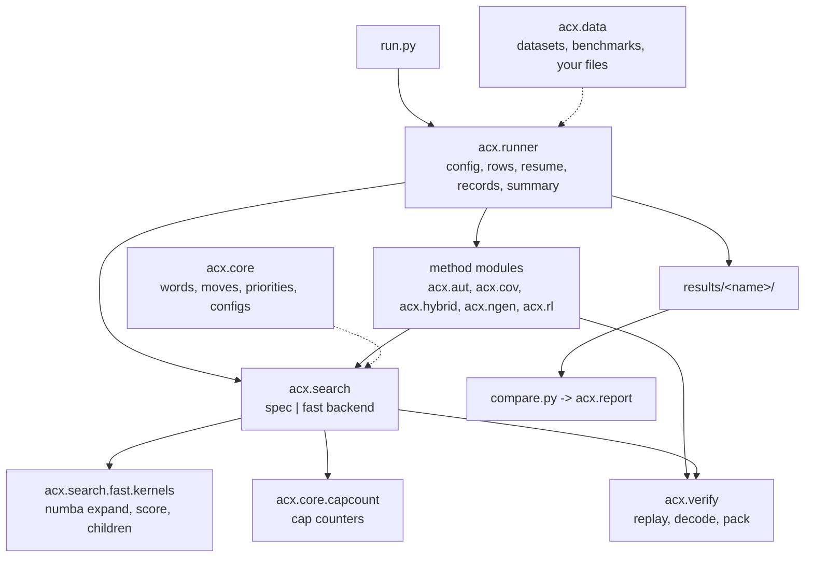

# Architecture

**TL;DR.** `run.py` hands a checked config to `acx.runner`, which runs one method module per row, replays every
solve through `acx.verify` and writes `results/<name>/`; `compare.py` reads those folders through `acx.report`. All
best-first searches share one engine (`acx.search`, with a pure-Python and a numba backend that pop the same states in
the same order) and one cap counter (`acx.core.capcount`). How to run it: [USAGE.md](USAGE.md); the tests named below
pin what is said here.

*Every path to `results/` passes through `acx.verify`: a record is written only after its path replays.*

| module | what | entry point |
|---|---|---|
| `acx.core` | words, presentations, digrams, moves, priorities, `SearchConfig`, the cap counter | `Presentation`, `Move`, `SearchConfig` (`step` in `acx.core.moves`, `CapCount` in `acx.core.capcount`) |
| `acx.search` | best-first search; `spec` (pure Python) and `fast` (numba) backends | `search(pres, cfg) -> Result` |
| `acx.search.fast.kernels` | reusable numba kernels: `encode`/`decode`/`decode_word`, `expand`, `score`, `children` | used by `hybrid` and `aut` |
| `acx.verify` | `replay` (the only judge), `decode` (S-moves to elementary moves), `pack` | `replay(pres, path)`, `ReplayError`, `abs_det` |
| `acx.aut` | Whitehead canonical form, numba twin, transport, equivalence-certificate checker | `aut_canon`, `solve_via_aut_min` |
| `acx.cov` | one-shot change of variables (family `subnc2pxysb`, or `suballpxyb8` with `[cov] family`) | `run_cov(pres, CoVConfig)` |
| `acx.hybrid` | cascade + rank-two/higher-rank best-first search, certified | `solve(pres, HybridConfig)` |
| `acx.hybrid_highspeedup` | the hybrid's backend `fast` beyond `acx.search.fast`: its higher-rank moves (`dynkernels`) and rank-two orbit and child layout (`r2kernels`) in numba, equal to the Python | used by `hybrid` |
| `acx.ngen` | n-generator search, SAC transform to relators of length <= 3, lift, rank-n sweep | `solve(pres, NGenConfig)`, `acx.ngen.sweep` |
| `acx.rl` | optional (torch): the paper's policy as a beam search | `acx.rl.solve.solve(pres)` |
| `acx.data` | datasets, benchmarks and splits by name, your `.txt`/`.csv`/`.jsonl` files, row selection; `MS(n, w)`, `AK(n)` | `rows(name_or_path)`, `select(rows, spec)`, `parse_presentation` |
| `acx.runner` | `run.py`'s config check, method records, the run folder and its resume, `summary.json` | `load_config`, `run` |
| `acx.report` | `compare.py`'s table and HTML page: `load`, `table`, `charts`, `page` | `load_run`, `markdown`, `html_page` |

Top level: `from acx import Presentation, Move, SearchConfig, search, Result, replay, ReplayError`.

## Words and presentations (`acx.core.words`)

- A **word** is a tuple of nonzero ints (`1=x, 2=y, 3=z, ...`, sign = exponent): `parse("xYy") == (1, -2, 2)`; `fmt`
  is the inverse (past the 26th generator: `g27`).
- `Presentation(n_gen, rels)` is frozen: `Presentation.parse("YYXyx", "Yx")`, `.from_flat(ints, n_rel=2)` (the dataset
  layout), `.strs`, `.reduced(cyclic)`, `.canonical()`, `.normal(cyclic)`, `.is_trivial()`. It requires a nonnegative
  integer rank and integer symbols (NumPy integers accepted; floats, strings and bools rejected).
- `reduce(w, cyclic=True)`: free reduction, then the cyclic tail; `free(w)`: free reduction only.
- **Canonical form**: each relator the least rotation of itself or its inverse in **Booth order** `Y < y < X < x`
  (`canonical_word`), relators sorted by `(length, Booth order)` (`canonical_rels`). `Presentation.normal(cyclic)`
  repeats `reduced(cyclic).canonical()` to a fixed point: a search starts there and replay normalises to it.
- **Key order** (the heap tie-break) is different, `X < Y < x < y`: `state_key(rels, n_gen)` (per-relator code tuples)
  and `state_bytes` (the same as bytes; what the cap counter and fast kernels compare).
- `conjugators(w, t)` yields every `(sign, c)` with `c^-1 w^sign c == t` (the witness for transport and certify).
  `as_presentation(pres)` parses relator strings; `rotate_left(w, k)` is `rotate(w, -k)`; `conjugate(w, c)` is
  `c^-1 w c`, reduced.
- `acx.core.digrams`: `digram(w, k)`, `digram_counts(words)` (cyclic digrams with their inverses), `tokenize(w, d, h)`
  (the shortest rewriting with `d -> h`), shared by the SAC transform and the hybrid.

## Moves (`acx.core.moves`)

- **S-move** `Move(i, j, s, k1, k2)` (0-based, `i != j`, `s = +-1`): `r_i <- rotate(r_i, k1) + rotate(r_j**s, k2)`,
  legal only if the seam cancels; `rotate(w, k)[m] == w[m-k]` (`np.roll`). The child is reduced per relator, then
  `canonical_rels`; indices refer to the canonical parent. `from_legacy(target, jsign, k1, k2)` reads the baseline's
  1-based tuple.
- `enumerate_moves(rels)` yields legal S-moves in the order `i -> j -> s(+1, -1) -> k1 -> k2` (the depth tie-break
  depends on it).
- **Elementary / stable moves** are dicts (1-based relators, free reduction only): `{"op":"invert","target":t}`,
  `{"op":"swap"[,"a":1,"b":2]}`, `{"op":"conjugate","target":t,"by":"x"}` (`r_t <- by^-1 r_t by`),
  `{"op":"multiply","target":t,"source":s}` (`r_t <- r_t r_s`), `{"op":"stabilize"}` (AC4: generator and relator
  `n+1`), `{"op":"destabilize"}` (AC5: drop the last generator and a relator equal to it).
- A **path** mixes `Move`s and dicts (`is_elementary(mv)`); `step(pres, mv)` applies one. `Trace(pres)` records
  elementary moves (`do`, `conj`, `invert`, `multiply`, `conjugated_multiply`) for the decoder, transport (`Emitter`)
  and the n-generator lift. JSON: `encode_path` (S-move to `[i, j, s, k1, k2]`), `decode_path`.

## Priorities and config (`acx.core.priority`, `acx.core.config`)

`length` = total length (int); `s20_mk2` = L + 20 S + 2 MK (float, two generators), accumulated in the fast engine's
order so both backends agree bit for bit ([METHODS.md](METHODS.md) section 6).

`SearchConfig` (frozen):

| field | default | meaning |
|---|---|---|
| `priority` | `"length"` | `"length"` or `"s20_mk2"` |
| `cap` | `24` | per-relator cap on generated children; `"none"`/`None` = uncapped ([CAP.md](CAP.md)) |
| `budget` | `10_000` | maximum pops |
| `backend` | `"spec"` | `"spec"` or `"fast"` (a `run.py` run defaults to `fast`) |
| `capture_path` | `True` | return the path of a solve |
| `cyclic` | `True` | cyclic reduction of children |
| `trace` | `False` | return the popped states (parity tests) |

`SearchConfig.load(toml_path, ["cap=none", "budget=1000"])` reads keys at top level or under `[search]`; unknown keys
raise. Other modules keep their own frozen config with a nested `SearchConfig`. Shared validators: `parse_cap` for
every cap (a positive int or `"none"`; `0` and bools raise; `slack` and `cap_headroom` may be 0), `require_bool` for
every switch (`"False"` raises), `require_int` for int knobs (`<name> must be an int >= <low>`), `is_finite_number`
for `dyn_ratio` and `rl.alpha`; `rankn.sample` is a number in [0, 1].

## Search (`acx.search.search(pres, cfg=None, **overrides) -> Result`)

The engine starts from `pres.normal(cfg.cyclic)`, calls the backend's `run(start, cfg)`, and **replays every returned
path** (`acx.verify.replay(pres, path, cyclic=cfg.cyclic, cap=cfg.cap)`). A start with `|det| != 1` is unsolved.

`Result` (frozen): `solved`, `pops` (the solving pop counts), `path` (tuple of `Move` or `None`), `start`, `end`,
`stats`, `trace`, `depth` (`None` unsolved), `path_length` (`len(path)`, or `depth` without a captured path).
`stats` keys both backends report **identically** (`PARITY_STATS`): `discovered` (states inserted, root included),
the six cap fields ([CAP.md](CAP.md)), `min_total` / `max_total`, `max_total_expanded`, `max_expanded`; plus `backend`
and `seconds` (not compared).

**The search, exactly** (what `fast` reproduces step for step):

1. Heap entry `(priority(state), depth, state_key(state))`, root depth 0; keys are unique, so the order is strict.
2. While the heap is non-empty and `pops < budget`: pop the least, `pops += 1`, update `max_expanded`, append to
   `trace`; stop solved if every relator has length 1.
3. For each move of `enumerate_moves(state)`: reduce the new relator. If the new relator **or any untouched relator**
   is over `cap`, count it (`cap_dropped += 1`, with its would-be heap key) and skip; this is before dedup, so an
   over-cap start counts every move once. Else canonicalise; skip a seen key; else record `(parent, move)` and push at
   `depth + 1` (first discoverer wins, no decrease-key).
4. `cap = None`: no rejection, no counting; the fast backend widens its buffers instead.
5. `cap_dropped` counts moves, not children; the fast kernel's cut-shift skip still counts the move. `discovered`
   includes states left in the heap.

## Cap counters (`acx.core.capcount`)

One small package every search calls with heap keys only; it knows no heuristic. `counter.py`: `CapCount(cap)` with
`drop(key, total, longest, ident)`, `pop(bar)`, `end(ran_dry, left)`, `record(prefix)`. `kernels.py` (`cc_drop`,
`cc_pop`) and `arrays.py` (`CapArrays`): the numba twin (parity in `tests/test_capcount.py`). `records.py`: `FIELDS`,
`PREFIXES` (`cap`, `dyn_cap`, `slack`), `blank()`, `combine()`, `summarize()` (the `caps` block).
`tests/test_cap_invariant.py` pins "count 0 means the same run at any larger cap" on both backends ([CAP.md](CAP.md)).

## Verification (`acx.verify`)

`replay(pres, path, cyclic=True, cap=None, normalize=True, require_trivial=True)` returns the states and raises
`ReplayError` unless every move is legal, `|det|` of the exponent-sum matrix is 1 throughout, no S-move child exceeds
`cap`, and the end is trivial (each relator one letter, all generators present). `normalize=True` starts from
`pres.normal(cyclic)` (search paths); raw elementary paths use `normalize=False`. `abs_det(pres)` is the checked
`|det|`. `decode(pres, path)` / `decode_and_replay` turn S-moves into elementary moves; `pack`/`unpack` are their JSON
form (`I`, `S`, `C`, `M`, `Z`, `D`).

## Fast backend (`acx.search.fast`)

`best_first.py` (the pop loop), `arrays.py` (the arena), `packing.py` (packed rows), `heap.py`, `dedup.py`,
`cap_stats.py`, `kernels/`. States are Booth symbols `b = 2 (n - |g|) + (g > 0)` (integer order is Booth order, `b ^ 1`
the inverse), one byte each in the kernels, packed in the arena (2 bits a symbol at two generators, 4 at three to
eight, 8 beyond), with an int32 heap and an FNV-1a dedup table; paths are int32 `(parent, move)`, so caps of 128 and
above work. Uncapped runs re-lay rows wider on demand. With a cap the engine counts in two stages (the least dropped
score per pop, then an exact replay of the few pops whose drops could win). numba's cache of every acx kernel carries a
digest of acx's numba source (`acx/jit_cache.py`): numba checks a cached kernel only against its own file, so an edit
to a helper inlined from another file (`canon_buf` into `expand`) would otherwise leave old machine code running.

## Other methods

Each keeps a frozen config and returns typed results; `acx.runner.methods` maps them to records ([USAGE.md](USAGE.md)).

- `acx.aut.solve_via_aut_min(pres, cfg) -> (Result on the representative, elementary path on pres or None)`;
  `transport(pres, phi, path, start)` carries a path through Aut(F2) and replays it (F2 only).
- `acx.cov.run_cov(pres, CoVConfig) -> CoVResult(outcomes, pops, stats)` of `Outcome(kind, image, result, path,
  cap)`; `acx.cov.verify(pres, outcome)`. Modules: `images.py` (`enumerate_images`, `class_key`), `family.py`
  (`FAMILIES`), `substitution.py`, `certificate.py` (`apply_steps`, `check_cert`), `run.py` (`run_cov`).
- `acx.hybrid.solve(pres, HybridConfig) -> HybridResult(solved, stage, units, steps, kind, path, stats)`; `path` is
  elementary (plus AC4/AC5 for a `stable_cert`), replayed with `normalize=False`; `stats` holds its three limits'
  counters. Exports `certify`, `Aut`, `encode_steps`, `decode_steps`. Modules: `steps.py`, `cascade.py` and `pinch.py`
  (stages A-C and the finishing gates), `search.py` (with `frontier.py`, `kernels.py`, `dynrank.py`), `capwatch.py`,
  `solver.py`, `elementary.py` and `frame.py` (`certify`). Backend `fast` runs `dynrank`'s moves and the rank-two
  orbit and child layout compiled, from `acx.hybrid_highspeedup`; `spec` runs the Python, with the same records.
- `acx.ngen.solve(pres, NGenConfig) -> NGenResult(solved, kind, search, sac, moves)`; a SAC solve is lifted to an
  elementary stable path. Modules: `sac.py`, `solver.py` (`solve`, `NGenConfig`, `NGenResult`), `lifting.py`
  (`lift`), and `sweep/`, the rank-n brute force ([RANK3.md](RANK3.md)).
- `acx.rl.solve.solve(pres, model, width, steps, alpha, cap) -> Result` (S-moves; `pops` = network evaluations; two
  generators, relators of length <= 24).

## Runner (`acx.runner`)

One job per module; it re-exports only `load_config`, `method_config`, `run`, `select` (from `acx.data`) and
`summarize`.

| module | job |
|---|---|
| `config` | `load_config` checks a config completely before anything is written; `SECTIONS` says which sections a method reads (greedy, aut `[search]`; cov `[search]` + `[cov]`; ngen `[search]` + `[ngen]`; hybrid `[hybrid]`; rl `[rl]`; rankn `[search]` + `[rankn]`); `method_config(cfg)` builds the settings and raises on anything else |
| `methods`, `output`, `caps`, `summary` | one solver per method (`SOLVERS`) returning a record; the `path` and `fields` options; a record's counters and the `caps` block; `summary.json` (`COST_UNIT`) |
| `storage` | output-name and symlink checks; atomic text/JSON replacement (written and flushed before `os.replace`) |
| `rundir` | `prepare` writes `config.json` and refuses another config, a `paths.jsonl` without its config, and a smaller run into a published folder (`write_config` is shared with the rank-n sweep); `iter_records` streams and `read_records` materialises `paths.jsonl` (an incomplete final line, even valid JSON without its newline, is skipped; earlier bad lines and bad identity or status types raise); `drop_changed` forgets rows that changed or left the input |
| `execute` | `run` selects rows, resumes (a record counts only for the presentation in its `pres`), skips repeated ids, solves AK(2) once untimed, and writes `results/<name>/`; `rankn` goes to `acx.ngen.sweep.run`, which refuses a row that is not two-generator two-relator, a run that would shrink a published summary, and a stored row that differs from the current input. A row with `\|det\| != 1`, or whose method raises, is recorded unsolved with an `error` |

## Data (`acx.data`)

`rows(spec)` resolves `DATASETS` (`ms640`, `ms_unsolved`, `1190ms`, `ac19`, `ac19_extended`, `ac1m`; flat-int
`.txt[.gz]`, `id` = line index), `BENCHMARKS` (CSVs: `bench10..60`, `ladder20..500`, `ladder20..300_s20hard`,
`ac19_autmin`, `ac1m_autmin`, `u124`), `SPLITS` (`ac1m_hard_holdout60`), or a `.txt`, `.csv` or `.jsonl` path
(optionally `.gz`). `parse_presentation("xxYYY, xyxYXY")` reads one line; each row is `Row(id, pres, meta)`.
`select(rows, spec)` picks a slice `a:b[:c]` or ids; `stem_of(path)` is the file name without the suffixes `rows`
reads (the run name of `--input`).

## Tests

`pytest` runs the default selection (a few minutes); `pytest -m ""` adds the `slow` tests (full parity sets, AC19
sample, speed). `tests/data/greedy_golden.json` is the baseline's golden file.
