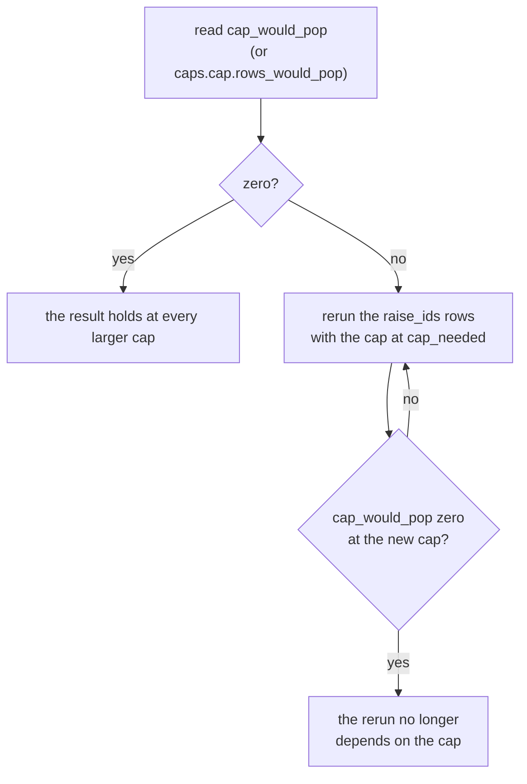

# The relator-length cap and its counters

**TL;DR.** A search keeps a child only if both relators have at most `cap` letters (default 24), so cap 24 and cap 48
are different searches. Every search counts what the cap dropped and whether a dropped state **would have been
popped** had the cap been larger. `cap_would_pop == 0` guarantees the same run at any larger cap; on the shipped runs
cap 24 changes **no solved count** ([RESULTS.md](RESULTS.md), "Relator-length cap"). Search details:
[METHODS.md](METHODS.md) sections 4 and 5; interfaces: [ARCHITECTURE.md](ARCHITECTURE.md).

## The cap is a config value

`SearchConfig.cap` (`cap = 24` under `[search]`, or `--set search.cap=48`) is a positive int or `"none"` (uncapped).
Every limit of the same kind is parsed the same way (`acx.core.config.parse_cap`): the hybrid's `r2_cap` (also
`"parent"`), `dyn_cap` and `slack`, CoV's `max_len` and `cap_headroom`, the RL beam's `cap`. `run.py` rejects a section
the method does not read, so a cap cannot be set and ignored. An uncapped run drops and counts nothing (`cap: null`,
`cap_dropped: 0`, other fields `null`/`0`) but searches a larger graph ([PERFORMANCE.md](PERFORMANCE.md#relator-cap)).

## Who counts

Whether a dropped child would have been popped depends only on the pop order, so the counting is one package,
`acx/core/capcount/`, that **knows no heuristic**. Every search (both backends of `acx.search`, the hybrid, CoV, the RL
beam, and the n-generator and rank-n searches through `acx.search`) calls it with heap keys only:

```python
cc = CapCount(cap)
cc.drop(key, total, longest, ident)   # the cap dropped a child; key = the heap key the search would have pushed it under
cc.pop(bar)                           # the search popped an entry with key `bar` (called before it expands)
cc.end(ran_dry, left)                 # the search stopped
cc.record()                           # -> the six fields below
```

`key` is the full heap key, e.g. `(priority, depth, state_bytes)`, compared with `<` only. The fast backend uses a
jitted twin (`acx/core/capcount/kernels.py`, driven by `CapArrays` in `arrays.py`), pinned to `CapCount` by
`tests/test_capcount.py`.

## The six fields

Every search record carries them (`acx.core.capcount.FIELDS`; the hybrid repeats them as `dyn_cap_*` and `slack_*`):

| field | meaning |
|---|---|
| `cap` | the cap watched (`null` = uncapped; the hybrid's `r2_cap` default is `"parent"`) |
| `cap_dropped` | children not pushed because a relator is over the cap, one per move |
| `cap_dropped_min_total` | the least total relator length among the dropped children (`null` if none) |
| `cap_would_pop` | distinct dropped states the search would have popped before it stopped |
| `cap_first_bind` | the pop (1 = the start) at which a dropped state would first have gone first; `pops + 1` if the queue ran dry; `null` iff `cap_would_pop` is 0 |
| `cap_needed` | the smallest cap at which the search changes: the least longest-relator among the would-pop states; `null` iff `cap_would_pop` is 0 |

`summary.json` has a `caps` block per prefix (`cap`; the hybrid also `dyn_cap`, `slack`): the cap(s), `rows`,
`rows_dropped`, `rows_would_pop`, `raise_ids` (rows where raising the cap changes the search, up to 100), the sums
`dropped` and `would_pop`, and `dropped_min_total`, `first_bind_min`, `needed_min`, `needed_max`. CoV adds
`cap_legs_bound`, the searches of its rows in which the cap bound.

## "Would have been popped", and the guarantee

The search pops in increasing key order, and a dropped child has the key it would have been pushed under. It **would
have been popped** if that key sorts before a pop that happened, or, when the queue ran dry, if it would have filled
the remaining budget. Keys end in the state, so there are no ties; a state is judged once, under the key of the first
move that dropped it (as the search dedups on first discovery).

For the `spec` and `fast` searches:

- **`cap_would_pop == 0`**: any larger cap pops the same states in the same order and returns the same path.
- **`cap_would_pop > 0`**: the run at a cap of at least `cap_needed` differs; below `cap_needed` it is the same run.

The guarantee is about the run, not the outcome: on MS640, S20_MK2 row 527 solves in 7,458 pops at cap 24
(`cap_would_pop` 21, `cap_first_bind` 1,653, `cap_needed` 25) and in 7,479 pops at cap 25 or uncapped, with the same
path length 120.

## What to do when the count is non-zero



*Raise only to `cap_needed`, the smallest value that changes the run, and repeat until the count is zero.*

For example `python run.py --config configs/s20_mk2_fast.toml --rows 527 --set search.cap=25 --set name=row527_cap25`
(hybrid: `--set hybrid.dyn_cap=13`). Quote a result at the cap it ran at and name the rows with `would_pop > 0` at
that cap. A non-zero count never makes a record wrong:
every path is replayed on its row under the cap it was found at; the counters only say whether the run depends on it.

## The hybrid's three limits

| prefix | limit | default | `_needed` is |
|---|---|---|---|
| `cap_*` | `r2_cap`, the longest relator of a rank-two child | `"parent"` | the child's longest relator |
| `dyn_cap_*` | `dyn_cap`, the longest relator a higher-rank product or elimination may create | 8 | the child's longest relator |
| `slack_*` | `slack`, how far above the root's total length a higher-rank state may be | 8 | the child's total minus the root's |

- `r2_cap = "parent"` (a child relator may not exceed the parent's total length) never rejects: a child relator has
  at most `l_i + l_j - 2` letters. An integer `r2_cap` rejects, and counting it is slower. `slack = "none"` lifts it.
- `*_dropped` counts classes of dropped children (a rank-two child once per signed-permutation orbit, plus the
  solving pop's tail moves); `*_would_pop` counts distinct canonical pairs; `*_first_bind` is a work unit of the
  search (the cascade's units before it are not counted).
- Two queues: a dropped child waits in a pool for its queue and is compared with that queue's pops; a dropped
  rank-two child the finishing gates would act on counts at once. The counts are first order: **zero in all three
  means the same run at any larger limit; non-zero means only that the run may change.**
- Example: `ac19_239` solves in 150 units with `dyn_cap_would_pop` > 0 (first bind at unit 110, `dyn_cap_needed` 11);
  at `dyn_cap` 11 it solves in 153 units and reads `dyn_cap_needed` 13; at 13 the count is 0 (154 units).

## CoV, RL, n-generator and rank-n

- **CoV** runs one search per image; the row's record sums `cap_dropped` and `cap_would_pop` over the legs, takes the
  least `cap_dropped_min_total` and `cap_needed`, and numbers `cap_first_bind` in the row's pops. `cap` is
  `search.cap`; images run at `max(cap, longest written relator + cap_headroom)`. `max_len` (no image of the family is
  longer than 239 letters) selects images; it is not a search cap and is not counted.
- **RL** has no queue: a picked child over the cap took a beam slot a larger cap would have used, so `cap_would_pop
  == cap_dropped`; `cap_first_bind` is the first such step. The cap is at most 24 (the policy's input width).
- **n-generator and rank-n** searches report the six fields unchanged. The rank-n sweep stores five counters per start
  (`-1` = none); its summary counts searches where the cap dropped a child and where it could bind
  ([RANK3.md](RANK3.md)).
