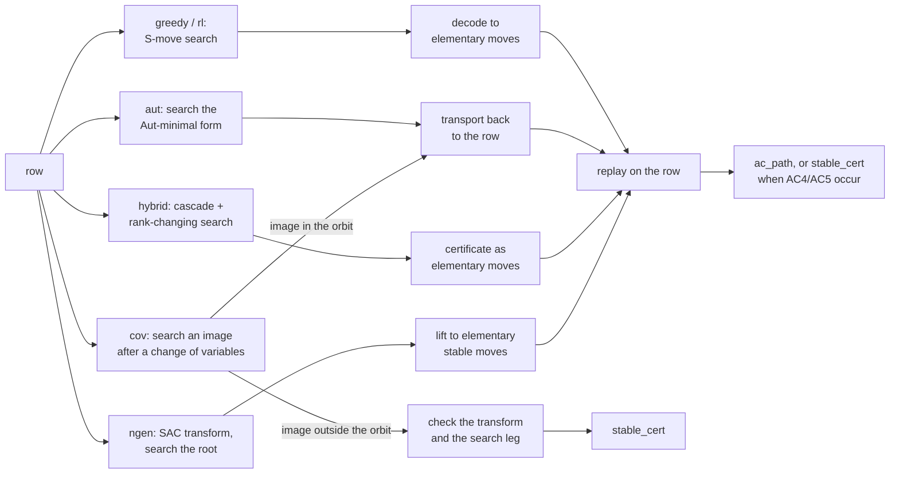

# Methods

**TL;DR.** What the code does and what its numbers mean: the moves, the best-first search and its two priorities,
the two backends (step-for-step equal), automorphisms and transport, the decoder, each method, and how a solve is
verified. The key rule: **no solve counts until its path replays on the row it claims to solve**, and path lengths
in different units (S-moves, elementary moves, work units) are never compared. Results: [RESULTS.md](RESULTS.md);
interfaces: [ARCHITECTURE.md](ARCHITECTURE.md); the cap: [CAP.md](CAP.md); the rank-n sweep: [RANK3.md](RANK3.md).
Every method runs as `python run.py --config configs/<name>.toml` ([USAGE.md](USAGE.md)).



*Every route ends in a replay on the row (or, for a CoV image outside the orbit, a check of its transform and search
leg) before a record is written.*

## 1. Presentations and words

A balanced presentation `<x, y | r1, r2>` has two generators and two relators. Lowercase is a generator, uppercase its
inverse (`xxxYYYY` is `x^3 y^-4`), or signed integers (`x = 1`, `y = 2`, `x^-1 = -1`). A relator is a **cyclic** word:
a rotation or an inversion is the same relation. The target is `<x, y | x, y>`.

A **state** is the pair after free and cyclic reduction, in canonical form: each relator is the least rotation of
itself or its inverse, and the pair is ordered. So rotating, inverting or swapping relators gives the same state;
renaming generators does not (that is a separate symmetry, section 8).

## 2. AC moves

- **AC1** replace a relator by its inverse; **AC2** replace `r_i` by `r_i r_j` (`i != j`); **AC3** replace `r_i` by
  `w r_i w^-1`.
- The decoder uses a finer set: invert, swap, conjugate by one letter, multiply one relator into the other.
- **Stable AC** adds **AC4** (add a generator `z` and the relator `z`) and **AC5** (its inverse). AC-trivial implies
  stably AC-trivial; the converse is open, and AK(3) is the standard test case.
- **Invariant.** Every move multiplies the exponent-sum matrix `M` by an elementary integer matrix, so `|det M|` is
  fixed, and the trivial presentation has `|det| = 1`. Every verifier checks it independently of the solver.

## 3. Substitution moves (Definition 2.1)

A substitution move (S-move) `(i, j, k1, k2)` is one composite AC move:

```
r_i  <-  rot_k1(r_i) . rot_k2(r_other ^ j)         (j = +1 or -1; "other" is the relator that is not r_i)
```

`rot_k` moves the last `k` letters to the front (`np.roll`); `r_i` is never inverted. A move is **emitted only if its
seam cancels** (the last letter of `rot_k1(r_i)` is the inverse of the first of `rot_k2(r_other^j)`); the product is
then reduced and canonicalised. Example on AK(3) = `<x, y | xxxYYYY, xyxYXY>`, target `r1`, `j = +1`, `k1 = 0`, `k2 = 5`:

```
rot_0(r1)       = xxxYYYY
rot_5(r2)       = yxYXYx            (xyxYXY rotated by 5)
seam            : Y | y  -> cancels
raw product     = xxxYYYY yxYXYx    (13 letters)
after reduction = xxxYYYxYXYx       (11 letters)
```

The new state is `(xxxYYYxYXYx, xyxYXY)`, total length 17. AK(3) has 42 legal moves (38 distinct children);
`tests/test_core.py` and `tests/test_spec.py` pin them. A rotation is a conjugation, so every S-move is "multiply `r_i`
by a conjugate `c^-1 r_j^j c` of the other relator", which expands to `|c|` single-letter conjugations, one
multiplication and the undoing conjugations. The seam rule is a pruning only, which is why a decoded path (section 9)
may use moves the search never emits.

## 4. The relator cap

A child is kept only if **both** relators have at most `cap` letters (`SearchConfig.cap`, default 24; `"none"` is
uncapped and slower). The cap limits the search graph, not the path: cap 24 and cap 48 are different searches.
Conventions in the results: 24 for MS640, 48 for AC19 and AC1M rungs, 64 for the largest budgets, and
`max(24, longest + 16)` for CoV starts. **24 and 48 in a results table are caps, never move counts.**

Every search counts what the cap dropped and whether a dropped child would have been popped (six record fields and a
`caps` block; `cap_would_pop == 0` means the same run at any larger cap). Every other limit is parsed the same way
(`parse_cap`: a positive int or `"none"`): the hybrid's `r2_cap` (default `"parent"`), `dyn_cap` (8) and `slack` (8,
`0` allowed), CoV's `max_len` and `cap_headroom`, the RL `cap` (at most 24). Details: [CAP.md](CAP.md).

## 5. Greedy best-first search

```
heap <- { (priority(start), depth 0, key(start)) }
while heap is not empty and pops < budget:
    pop the smallest entry; pops += 1
    if both relators have length 1: solved
    for each legal S-move: reduce the new relator; skip if over the cap;
        canonicalise; skip if the state has been seen; else record (parent, move) and push at depth + 1
```

- **Order.** The key is the packed state in symbol order `X < Y < x < y`, so `(priority, depth, key)` is a strict
  total order and pops do not depend on the heap. (The canonical form uses `Y < y < X < x`; never mix them.)
- **First discoverer wins**: no decrease-key, so a priority must be a pure function of the state.
- **Budget** counts pops, the solving pop included. A search at budget B is the first B pops of any longer one.
- **Path** = the parent chain, so its length is the discovery depth, not a shortest path.

Config `[search]` (`priority`, `cap`, `budget`, `backend`, `cyclic`): `greedy_fast.toml`, `s20_mk2_fast.toml`,
`baseline_spec.toml`.

## 6. Priorities

Lower pops first. **LENGTH** = `L`, the total length (the baseline). **S20_MK2** = `L + 20 S + 2 MK` (float, two
generators only). Features read relators as rings:

- **Block**: a maximal cyclic run of one generator (`x` and `X` count as one generator; a run across the seam is one).
- **Knots** of a relator: 0 for a pure power, else `max(#x-blocks, #y-blocks)`; **MK** is the larger of the two.
- **S**: the mean length of the `x`-blocks and of the `y`-blocks, pooled over both relators; the smaller mean (or the
  only nonzero one).

AK(3): `xxxYYYY` has one `x`-block (3) and one `y`-block (4); `xyxYXY` has three of each, length 1. `x`-mean 6/4 =
1.5, `y`-mean 7/4 = 1.75, so `S = 1.5`; `MK = 3`; `L = 13`; priority = 13 + 20 x 1.5 + 2 x 3 = **49**. `+20 S` prefers
a thinner generator in short, interleaved runs; `+2 MK` prefers a less tangled worse relator. Tested: LENGTH reproduces
the baseline pop for pop, and a priority is a pure function of the state.

## 7. Backends: spec and fast

- **spec** (`acx.search.spec`): pure Python (a heap and a dict), the readable reference.
- **fast** (`acx.search.fast`): numba. States are rows of Booth symbols (integer order is Booth order, `b ^ 1` the
  inverse), packed in an arena (2 bits a symbol at two generators), with an int32 heap and an FNV-1a dedup table. It
  skips a child that is a cyclic cut shift of the previous child of the same block (still counting the move);
  canonicalises a word as integers when it fits 64 bits, else by a two-pointer scan; any number of generators.

**Contract: step for step.** For the same start, priority, cap and budget, `fast` pops the same states in the same
order. `tests/test_fast.py` compares `solved`, `pops`, path, end state, the full popped trace, `discovered`, the six
cap fields, `min_total`, `max_total`, `max_total_expanded` and `max_expanded` on MS640 rows at budget 10,000 under both
priorities, at several caps and uncapped, with `cyclic=False`, at three generators and from a start over the cap.
`tests/test_spec.py` pins `spec` to the baseline's golden file. On all 640 MS640 rows `fast` reproduces the baseline's
pops and path lengths ([RESULTS.md](RESULTS.md) section 0). The kernels (`acx.search.fast.kernels`: `encode`,
`expand`, `score`, `children`) also drive the hybrid and the Aut-minimal form.

## 8. Automorphisms and transport

Two presentations related by an automorphism of `F2` are the same problem in other coordinates; AC-triviality is
constant on the orbit.

- **Whitehead canonical form.** 20 Whitehead automorphisms (8 signed permutations, 12 of the second kind such as
  `x -> xy`). Peak reduction lowers the total cyclic length to the orbit minimum; the lexicographic minimum of that
  level set is a complete invariant. `aut_canon(P)` returns `(total, rep, phi)` with `canon(phi(P)) == rep`. The numba
  twin (`acx.aut.fast`, `orbit_key(P, "fast")`) gives the same representatives but no witness, so only the pure form
  drives transport.
- **Equivariance.** `phi(r_i . c^-1 r_j^s c) = phi(r_i) . phi(c)^-1 phi(r_j)^s phi(c)`: a move maps to the same move
  with conjugator `phi(c)`. Rotation offsets `(k1, k2)` do not transport, so moves are first turned into conjugators.
- **Transport** (`acx.aut.transport`). A path solving `phi(P)` is carried to `P` move by move with `psi = phi^-1`,
  then a run of Nielsen moves (the Whitehead factors of `phi`, last first) returns the basis to `(x, y)`. Nothing
  searches; the result is elementary moves on `P`, replayed before it is returned. This makes the `aut` method and
  CoV images in the orbit **aut-assisted** `ac_path`s. A searched start equal to the row's own canonical form gives a
  plain `ac_path`.

**`aut` method** (`configs/aut.toml`, `[search]`): search the row's Aut-minimal representative, transport the path
back; the record keeps the S-move count and the elementary length on the row. If the row is its own representative,
the shorter of the transport and the decoded path is kept.

## 9. Decoder and units

**Decoder** (`acx.verify.decode`): an S-move path becomes elementary moves (invert `I`, swap `S`, conjugate by a
letter `C`, multiply `M`; stabilise `Z` and destabilise `D` pass through): rotate by conjugations, multiply, restore
the exact canonical form. Both conjugator choices per side are tried, the shorter kept. The output replays from the raw
row with `normalize=False`; it costs 6 to 10 elementary moves per S-move on MS640.

**Units: never compare numbers across them.**

| unit | counts | where |
|---|---|---|
| node / pop | heap pops of the search | every search budget |
| S-move | one substitution move (a conjugated multiplication) | `sub_moves` |
| elementary move | invert / swap / conjugate-by-letter / multiply (an S-move costs about `2\|c\| + 1`) | `elem_moves` |
| work unit | pops of the hybrid's search, plus Nielsen images evaluated, automorphisms accepted and S-moves applied in its cascade and gates | hybrid budget and cost |
| network evaluation | a state scored by the policy | rl cost |
| transformed-coordinate length | S-moves on the CoV-transformed pair | CoV results |

`sub_moves` is the search's S-moves (hybrid: the S-move steps of its certificate); `elem_moves` the replayed elementary
path on the row. A CoV `stable_cert` has no elementary path on the row (`elem_moves` null).

## 10. Hybrid solver

Deterministic, for balanced two-generator presentations; the number of generators can change during the search.
Config `[hybrid]` (`configs/hybrid.toml`): `budget` (work units), `penalty`, `dyn_ratio`, `dyn_cap`, `slack`,
`min_uses`, `r2_cap`, `backend`. A start with `|det| != 1` returns unsolved at 0 units.

1. **Rank two**: the fast kernel's seam-cancelling products plus four Nielsen maps (`x -> xy`, `x -> xY`, `y -> yx`,
   `y -> yX`), canonical under the eight signed permutations. A cascade (Nielsen descent, primitive deletion, pinch)
   runs first, and two finishing gates run at pop time: *relator descent* (shorten one relator by Nielsen maps; a
   relator that reaches length 1 deletes its letter from the companion) and the *pinch cascade* (`g^a h^p g^-a h^q` pinches the
   companion's `g` syllables when the exponent divides).
2. **`define`**: a cyclic digram `ab` occurring at least `min_uses` times becomes a new generator `h` with relator
   `h^-1 a b` (rank n to n+1).
3. **`eliminate`**: a generator occurring once in `R = g^e u` is solved for and substituted; `R` is deleted (rank n to
   n-1; rank 0 is solved).

`define` and `eliminate` are stable-AC composites (Lemma 11 of arXiv:2408.15332). `acx.hybrid.certify` writes every
certificate as elementary moves on the row (AC4/AC5 for `define`/`eliminate`) and replays it: without them it is an
`ac_path` (aut-assisted when any automorphism, Nielsen map or signed permutation occurs, so a relabelling alone counts),
with them a `stable_cert`.

**Frontier.** Two heaps: rank two by total length (dedup up to a signed permutation); higher rank by total length plus
`penalty` (5) per generator above two, also holding deferred `define` children. The higher-rank heap is served when its
top is no worse and its pops stay within `dyn_ratio` (0.5) times the rank-two pops plus 20. **Three limits**, each with
the six counters under `cap_`, `dyn_cap_`, `slack_`: `r2_cap` (`"parent"`, which can never reject), `dyn_cap` (8, the
longest relator a higher-rank step may create) and `slack` (8, the total-length ceiling above the root). The hybrid has
two queues, so its counts are first order: zero in all three means the same run at any larger limit; non-zero means it
may change ([CAP.md](CAP.md)).

## 11. Change of variables and stable AC

A **change of variables** (CoV) rewrites the presentation in another generating pair, then runs the unchanged greedy.
For a word `w(x, y)`:

1. **Stabilise**: add `z` and the relator `Z w`: `<x, y, z | r1, r2, Z w>`.
2. **Substitute** `z` (`Z`) for `w` (`W`) in `r1`, `r2` (cyclic windows, seam included; non-overlapping, left to
   right, then at most one wrap-around match); free-reduce.
3. **Isolate**: a relator where the chosen generator occurs exactly once and `z` occurs; rotate to `x^e s`, solve
   `x = s^-1` or `s`.
4. **Eliminate** the generator from the other two relators; drop the isolating relator. A relator that empties or
   exceeds 239 letters discards the branch.
5. **Relabel** the survivors to `(x, y)`.

```
start               r1 = xxxYYYY      r2 = xyxYXY        defining relator Z xy
substitute xy -> z  r1' = xxxYYYY     r2' = z x Z Y      (xy at the start of r2, YX = (xy)^-1 inside it)
isolate x in r2'    rotate to  x Z Y z   =>   x = (Z Y z)^-1 = Z y z
substitute x := Z y z in r1' and in Z x y:
                    r1'' = Z y y y z Y Y Y Y            defining'' = Z Z y z y
relabel y->x, z->y  new pair  (Y x x x y X X X X ,  Y Y x y x)    total 14, run at cap max(24, 9 + 16) = 25
```

**What a CoV solve proves.** The transform is a stabilisation, AC moves and a destabilisation, so a solved image
proves the original **stably** AC-trivial; its path is on a different presentation and its length is not a length for
the row. Hence two kinds:

- **`stable_cert`**: a replayed transform plus a replayed AC path on the image.
- **`ac_path`**: an image in the row's own Aut(F2) orbit (every one-substitution image, and most others) is
  transported back to the row (section 8): an aut-assisted `ac_path`.

Comparing a CoV arm with an untransformed arm is a cost comparison, and must hold the cap fixed (CoV images run at a
larger cap).

**Default policy** (`acx.cov.run_cov`; `configs/cov.toml`: `[search]` and `[cov]` with `total_budget`, `control`,
`cap_headroom`, `max_len`, `until`, `family`), one-shot: the row first (`control`), then the images in enumeration
order, each with at most `search.budget` pops (1,000) at cap `max(cap, longest written relator + 16)`, until
`total_budget` pops (10,000) are spent or one solves. No ranking, beam or ladder (RESULTS.md, "Tried"). An oracle (the
best image known in advance) is a lower bound, not a procedure (RESULTS.md section 5).

**The default family `subnc2pxysb`** (rules in `acx/cov/family.py`, word operations in `acx/cov/substitution.py`):

| letters | meaning |
|---|---|
| `sub` | `w` is a **sub**word: every cyclic window of length 2 or more of a cyclically reduced relator, seam included, `w` and `W` counted once |
| `nc2` | **n**o-**c**ollapse gate: drop a `w` whose substitution brings any relator it fires on to length 2 or less (`MIN_TRANSFORMED = 3`); the only length rule |
| `p` | **p**ure powers (`xx`, `yyy`, ...) are included |
| `xy` | both `x` and `y` are tried as the eliminated generator |
| `s` | cyclic-**s**eam matches count in the substitution |
| `b` | every isolating **b**ranch is its own image (`iso_index` tells `r1'` from `r2'`) |

Images that land on the same pair are searched once. The family substitutes in one pass over each relator in its
written rotation, so a rotated relator can give other images.

**`family = "suballpxyb8"`** is the exhaustive family of the MS640 sweep
([results/stable_ac/cov_all/](../results/stable_ac/cov_all/README.md)): `w` is any proper cyclic subword
(`2 <= |w| <= |r| - 1`, no `nc2` gate), **every** set of non-overlapping occurrences is substituted, and one image is
kept per class under relator order, rotation, inversion and the 8 signed permutations, the row's own class left out
(`acx.cov.images.class_key`). On MS640 it gives the sweep's 114,042 starts (the default family's images fall in 13,727
of those classes); as oracles both families solve the same rows at 100 to 100,000 nodes. Under the one-shot policy its
order is worse (all patterns of the shortest `w` first). Searching each `class_key` class of the default family once
would solve bench60 40 and MS640 586 under the shipped policy, against 39 and 584; the default keeps exact-pair dedup,
so the published numbers stand. (`zf3`, every word of length 2 to 4, was tried on research branches, not shipped.)

## 12. n-generator search and short-relator forms

CoV search now consumes `iter_images` lazily. `stats.images` counts the generated prefix and `images_exhausted` says
whether the entire family was consumed. The explicit `enumerate_images` API still returns the full family in the
same order; use it for a census independent of solver stopping conditions.

**n-generator search** (`acx.ngen`, on `acx.search`, either backend). The S-move takes a source index:
`r_i <- rot_k1(r_i) . rot_k2(r_j ^ s)` for `j != i`, enumerated `i, j, s, k1, k2` (at two relators the baseline's
order). Goal: every relator one letter and every generator present. `spec` and `fast` are trace-equal on triangle roots
of rank 4 to 6 (`tests/test_ngen.py`; MS640 roots have rank 4 to 11). Only LENGTH exists past two generators. Config
(`configs/ngen_sac.toml`): `[search]` and `[ngen]` (`sac`, default true; a solve is always lifted).

**Stable moves** are AC4 (`{"op": "stabilize"}`) and AC5 (`{"op": "destabilize"}`); a definition `z = w` is AC4 then
AC moves, so every stable certificate replays under `acx.verify.replay`.

**Transform to relators of length at most 3** (`acx.ngen.sac.triangulate`, then `acx.ngen.lift`): while a relator is
longer than 3, `define` the cyclic digram of a long relator with the most occurrences (ties: more in long relators,
then the smallest). The *triangle excess* `sum(max(0, |r| - 3))` strictly falls, so it ends. A solve of the root is
lifted to an elementary stable path on the input (a `stable_cert`, replayed). The transform matches the original
`triangulate` on all 142,365 rows of MS640, AC19 and 1190MS. As a one-shot preprocessing step it hurts; the gain comes
from `define`/`eliminate` interleaved with the search (RESULTS.md section 7). Definition, tie-breaks and the lift:
[RANK3.md](RANK3.md).

**Rank-n brute force** (`acx.ngen.sweep`, [RANK3.md](RANK3.md)): add `extra` generators `z_i = w_i` for every word up
to a length, search each start under the same cap and budget, compare with the control. It measures how much the right
stabilising word helps greedy; solves are "solved from the stabilised start", not certificates. Config: `[search]` and
`[rankn]` (`configs/rank{3,4,5}_bf.toml`).

## 13. Learned policy (RL, optional)

`acx.rl` is the paper's PPO policy (the step-1000 weights, `acx/rl/checkpoint/610model_1000.pt`, ported to PyTorch)
as a beam search: each step scores every legal S-move of every live state, keeps the top `width` by cumulative
log-probability, drops duplicates and visited states, and stops at a trivial state or after `steps` steps. Needs
`pip install -e .[rl]`. Config `[rl]` (`width`, `steps`, `alpha`, `cap`); two generators, relators of at most 24
letters (the policy's input width), else unsolved with `skipped`. `cost` is the number of states scored. Training code:
`acx.rl.env`, `acx.rl.ppo`. PPO's reward normaliser is the JAX trainer's `NormalizeVecReward` with its quirks: a step's
own `done` clears the return before its reward is added. Keep it, or training no longer reproduces the checkpoint's.

## 14. Verification

For RL, a nonzero `alpha` adds the current parent's value estimate when ranking its children. Only log probabilities
carry into the next step; past value bonuses do not accumulate. The default `alpha=0` keeps its reference behavior.
PPO validates settings, partitions every sample into exactly the requested number of minibatches and skips advantage
normalization for a singleton. Microbatches preserve gradient weighting. The intentional JAX reward-normalizer order
remains unchanged. A small CPU training example is in [EXPERIMENTS.md](EXPERIMENTS.md).

`pytest` runs the default selection (a few minutes), `pytest -m ""` adds the slow parity and census sets. With
`path = true` every solved record is replayed before it is written; `path = false` records are unverified counts.

To check a finished run again: `replay(pres, decode_path(rec["path"]))` for a plain greedy `ac_path`, and
`replay(pres, unpack(rec["elementary"]), normalize=False)` for a record with `elementary` moves (aut-assisted, hybrid,
n-generator, CoV), with `pres` from `acx.data.rows(benchmark)`.

`acx.verify.replay` checks every move is legal, `|det M| = 1` at the start and after every move, no S-move child over
the cap, and a trivial end. An aut-assisted solve counts after transport to the row; a CoV `stable_cert` replays its
search leg here and its transform in `acx.cov.check_cert`; hybrid and n-generator stable paths replay directly.
Replay is separate from the optimised kernels but shares Python word operations and move definitions with the
reference solver: it is not an independent formal proof checker.
