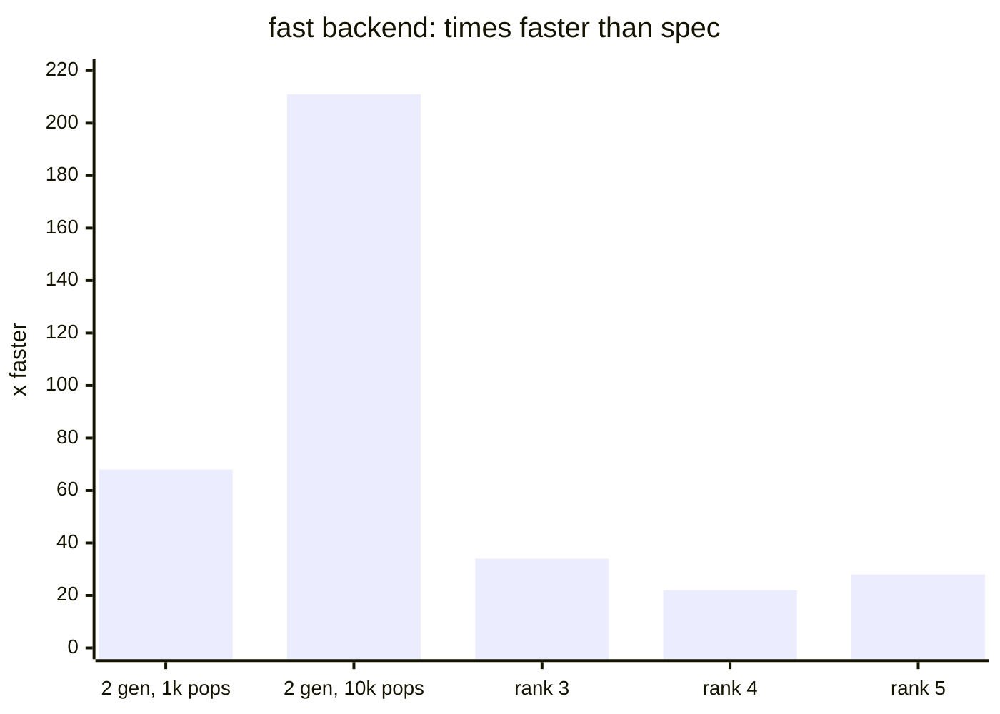
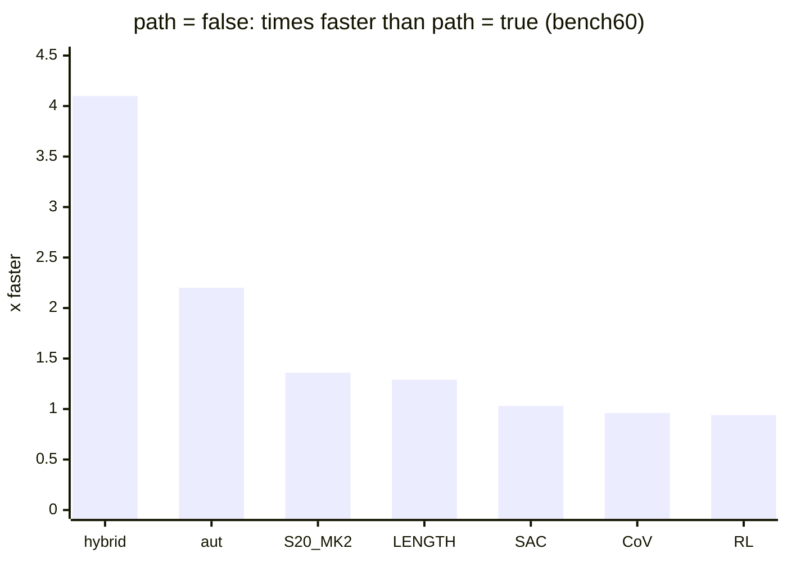
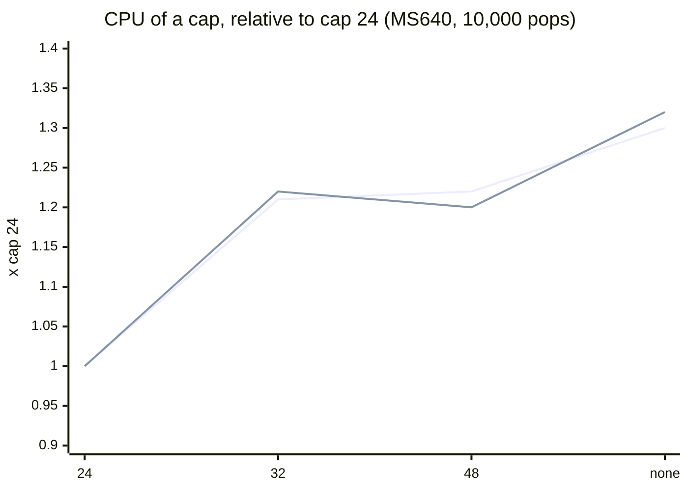
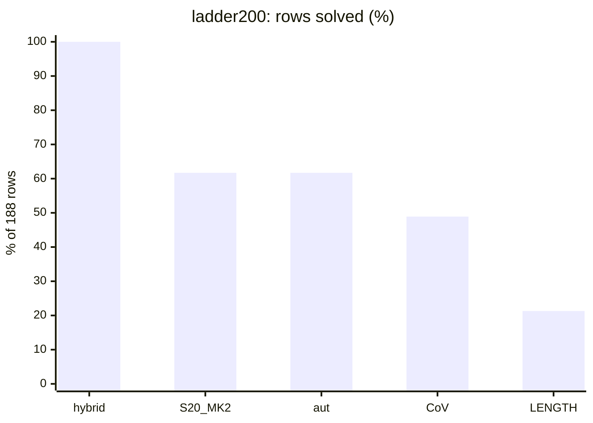

# Performance

**TL;DR.** The numba backend (`fast`) runs exactly the search of the pure-Python reference (`spec`) **68x to 211x
faster** on two generators, and **22x to 34x** in the rank-3 to rank-5 sweeps. `path = false` makes a run **1.3x to
4.1x faster** where certificates are expensive (greedy, aut, the hybrid) and changes nothing for CoV, SAC and RL.
Dropping the relator cap costs **1.3x** CPU at 10,000 pops and up to **3.3x** CPU and **3x** memory at 100,000 pops.
Every pull request is timed against `main` in CI (below), so these numbers should not silently get worse.

| setting | compared with | speedup | where |
|---|---|---:|---|
| `backend = "fast"` | `"spec"` | **68x to 211x** | 2 generators, 1,000 to 10,000 pops |
| `backend = "fast"` | `"spec"` | **22x to 34x** | rank 3 to 5 sweeps, 1,000 pops a search |
| `path = false` | `path = true` | **1.3x to 4.1x** | greedy, aut, hybrid (CoV, SAC, RL: about 1x) |
| `cap = 24` | `cap = "none"` | **1.3x**; **3.3x** | MS640 at 10,000 pops; rows the cap binds on at 100,000 |
| packed words (#30) | unpacked | **1.13x to 1.40x**, up to 33% less memory | the fast backend |
| compiled hybrid moves (#33) | Python moves | **1.4x to 6.3x**, up to 31% less memory | the hybrid on rows reaching 3+ generators |

**How it was measured.** One commit (`main` at `7245b6bd`), `run.py` with `workers = 1` and
`NUMBA_NUM_THREADS=1`, on a shared 4-vCPU VM (Xeon 2.8 GHz; Python 3.12.3, numba 0.63.1, numpy 2.1.3). The time is
the rows' **CPU seconds** from `summary.json` (start-up and compilation excluded); memory is the peak resident size,
about 150 MB of it Python and numba. One run per setting, three at a time, so differences under about 10% are noise.
Budgets are **node budgets**: heap pops per search, work units for the hybrid, network evaluations for RL.

## Backend: `fast` against `spec`

Both backends pop the same states in the same order (`tests/test_spec.py`); only the time differs.

| search | generators | budget | `spec` CPU s | `fast` CPU s | speedup |
|---|---:|---|---:|---:|---:|
| greedy LENGTH, MS640 rows 628, 636 (unsolved: every pop spent) | 2 | 1,000 pops | 13.5 | 0.20 | **68x** |
| same | 2 | 10,000 pops | 168.7 | 0.80 | **211x** |
| rank-3 sweep (`rank3_bf`), rows 0, 320: 58,023 pops | 3 | 1,000 pops a search | 117.3 | 3.43 | **34x** |
| rank-4 sweep (`rank4_bf`), rows 0, 80, 160, 240: 87,838 pops | 4 | 1,000 pops a search | 138.4 | 6.23 | **22x** |
| rank-5 sweep (`rank5_bf`), rows 0, 64: 116,297 pops | 5 | 1,000 pops a search | 199.0 | 7.00 | **28x** |



The gap grows with the search: a `spec` pop gets slower as the heap fills (6.8 to 8.4 ms), a `fast` pop does not.
The sweeps run thousands of short searches, so their Python set-up per search caps the gain near 30x.

## Node budget

`fast`, greedy LENGTH, cap 24, `path = false`, MS640 rows 628 and 636:

| budget | pops | CPU s | µs per pop | peak MB |
|---|---:|---:|---:|---:|
| 1,000 | 2,000 | 0.20 | 99 | 154 |
| 10,000 | 20,000 | 0.80 | 40 | 161 |
| 100,000 | 126,774 (row 628 solved) | 6.28 | 50 | 286 |

A pop costs least around 10,000 pops: below that the fixed cost of each row dominates, above it the heap and the state
table outgrow the cache. Memory grows with the states stored.

## Recording the path

`path = true` against `path = false`. `path = false` keeps no parent links, so nothing is replayed, decoded or
transported, and the records carry no certificate (`verified` is false). bench60 (60 rows; RL: the first 30 MS640
rows), default budgets:

| method | budget | `path = true` CPU s | `path = false` CPU s | speedup |
|---|---|---:|---:|---:|
| hybrid | 1,000 units | 4.92 | 1.19 | **4.1x** |
| aut | 10,000 pops | 28.5 | 13.0 | **2.2x** |
| greedy S20_MK2 | 10,000 pops | 17.1 | 12.5 | **1.36x** |
| greedy LENGTH | 10,000 pops | 26.6 | 20.6 | **1.29x** (`decode = false` alone: 1.16x) |
| SAC (`ngen_sac`) | 10,000 pops | 70.4 | 68.4 | 1.03x |
| CoV | 1,000 pops a leg, 10,000 a row | 28.3 | 29.5 | 0.96x |
| RL | 150 steps, width 256 | 27.0 | 28.8 | 0.94x |



The saving is the certificate: the hybrid's elementary path and aut's transported path are long, greedy's decoding to
elementary moves is a sixth of its run, and CoV, SAC and RL spend almost everything in the search. Quote results from
`path = true` runs; only those are replayed on their rows.

## Relator cap

All 640 MS640 rows, `path = true`, 10,000 pops. The solved rows never change: LENGTH solves the same 606 in the same
576,053 pops at every cap; S20_MK2 solves the same 626 (six of them a few pops later above cap 24).

| cap | LENGTH CPU s | x cap 24 | S20_MK2 CPU s | x cap 24 | peak MB (LENGTH / S20_MK2) |
|---|---:|---:|---:|---:|---:|
| 24 | 72.2 | 1.00 | 61.6 | 1.00 | 280 / 229 |
| 32 | 87.4 | 1.21 | 75.5 | 1.22 | 291 / 292 |
| 48 | 88.1 | 1.22 | 74.2 | 1.20 | 304 / 306 |
| none | 94.0 | 1.30 | 81.1 | 1.32 | 304 / 354 |

On rows where cap 24 drops children the gap widens with the budget (100,000 pops, `path = false`; LENGTH rows 568,
610, 628, 636; S20_MK2 rows 616, 622, 638):

| priority | cap 24 CPU s | none CPU s | x | cap 24 MB | none MB | x |
|---|---:|---:|---:|---:|---:|---:|
| LENGTH | 13.9 | 45.3 | **3.3x** | 424 | 1,277 | **3.0x** |
| S20_MK2 | 10.4 | 17.9 | **1.7x** | 315 | 521 | **1.7x** |



(Upper line at `none`: S20_MK2; lower: LENGTH.) A cap is never needed for correctness ([CAP.md](CAP.md)); it
trades the children it drops for CPU and memory. Keep 24 for long searches; its counters (`rows_dropped`,
`raise_ids`) name the rows where a larger cap would change the search.

## Methods side by side

`path = true`, default budgets, CPU per row over every row (misses spend their whole budget). bench60: 60 rows across
ten difficulty bins; ladder200: 188 rows on levels 1 to 10; MS640: all 640 rows.

| method | node budget | bench60 solved | ladder200 solved | MS640 solved | CPU ms/row (bench60 / ladder200 / MS640) |
|---|---|---:|---:|---:|---:|
| hybrid | 1,000 units | **60 / 60** | **188 / 188** | **640 / 640** | **82 / 257 / 18** |
| greedy S20_MK2 | 10,000 pops | 52 / 60 | 116 / 188 | 626 / 640 | 284 / 556 / 96 |
| aut | 10,000 pops | 52 / 60 | 116 / 188 | 626 / 640 | 476 / 651 / 160 |
| CoV | 1,000 pops a leg, 10,000 a row | 39 / 60 | 92 / 188 | 584 / 640 | 472 / 840 / 128 |
| greedy LENGTH | 10,000 pops | 40 / 60 | 40 / 188 | 606 / 640 | 444 / 727 / 116 |
| SAC (`ngen_sac`) | 10,000 pops | 8 / 60 | | | 1,173 / - / - |
| RL | 150 steps, width 256 | | | 30 / 30 (rows 0 to 29) | - / - / 899 |



The hybrid solves every row and is also the cheapest per row, although one of its units costs more than a pop
(0.47 to 2.2 ms against 0.09 to 0.25 ms). The other methods' units are pops, except RL (network evaluations).
`compare.py` prints these tables from the run folders; [`compare.html`](compare.html) charts an earlier set of the
same runs.

## Packed words

Since #30 the fast backend stores relators at 2 bits a symbol (two generators; 4 at three to eight) and
canonicalises words of up to 64 bits as integers. Results are identical record for record; `main` before
(`f4d5d211`) against after, two runs each on an idle machine, the faster:

| run | CPU s before | after | speedup | peak MB before | after |
|---|---:|---:|---:|---:|---:|
| LENGTH, cap 24, 10,000 pops, MS640 | 90.7 | 75.7 | **1.20x** | 330 | 278 |
| S20_MK2, cap 24, 10,000 pops, MS640 | 69.2 | 61.0 | **1.13x** | 259 | 228 |
| LENGTH, no cap, 100,000 pops, MS640 rows 568, 604, 620, 639 | 61.4 | 43.9 | **1.40x** | 2,506 | 1,689 |
| rank 3, 1,000 pops a search, 1,600 searches | 57.5 | 52.5 | 1.09x (noise 10%) | 177 | 171 |

## Compiled hybrid moves

Since #33 the hybrid's `fast` backend runs its moves on three or more generators and its rank-two expansion in numba
([`acx/hybrid_highspeedup`](../acx/hybrid_highspeedup)); `backend = "spec"` keeps the Python reference, and both pop
the same entries in the same order (`tests/test_hybrid.py`). Results are identical record for record; `main` before
(`c26e99bc`) against after, `configs/hybrid.toml`, `workers = 3`, one run each:

| run | rows | CPU s before | after | speedup | peak MB before | after |
|---|---:|---:|---:|---:|---:|---:|
| U124 (unsolved by every method) rows 0 to 120 step 8, 10,000 units, `path = false` | 16 | 751.2 | 119.2 | **6.3x** | 1,661 | 1,140 |
| ladder200, 1,000 units | 188 | 28.3 | 11.3 | **2.5x** | 200 | 192 |
| AC19 Aut-min (`ac19_autmin`), 1,000 units | 72,779 | 692.3 | 498.8 | **1.39x** | 383 | 380 |
| bench60, 1,000 units | 60 | 3.1 | 3.0 | 1.0x | 136 | 146 |
| MS640, 1,000 units, the fastest of three | 640 | 7.8 | 7.0 | 1.1x (noise 10%) | 137 | 151 |

The gain is in the rows that reach three or more generators, and it grows with the budget. MS640 and bench60 rows are
solved on two generators in a few units, so they gain nothing and carry the compiled module's 10 to 14 MB. Greedy, aut,
CoV, SAC and RL do not load these modules.

## Speed check in CI

`.github/workflows/speed.yml` runs `benchmark/speed.py` on every pull request and push to `main`: each config of
`configs/` on a slice of a few CPU seconds, with and without paths, on the base and on the change in turn, three times
each, in alternating order. It fails when one takes **more than 2% longer** than on `main`. Three runs on a runner
vary by up to 5% on identical code (10% for RL), so a pipeline more than 2% slower or faster is timed nine more times
and counts only when the fastest of its twelve runs is still beyond 2%. On a pull request it then comments one table,
updated on every push, of how much faster or slower each pipeline is (for example `20.0% faster`, `1.5% slower`), so
a reviewer can weigh the speed change before merging. Run it locally against any checkout:

```bash
python benchmark/speed.py ../main . --only hybrid aut      # all workloads when --only is left out
```

## Reproduce

Each row above is one `run.py` command; read `cpu_seconds` (`core_seconds` for rank-n) from its `summary.json`.

```bash
export NUMBA_NUM_THREADS=1 OMP_NUM_THREADS=1
python run.py --config configs/greedy_fast.toml --rows 628,636 --set path=false --set search.budget=10000 --out /tmp/p
python run.py --config configs/baseline_spec.toml --rows 628,636 --set workers=1 --set path=false --out /tmp/p
python run.py --config configs/hybrid.toml --set benchmark=bench60 --set path=false --out /tmp/p
python run.py --config configs/s20_mk2_fast.toml --set search.cap=none --out /tmp/p
python run.py --config configs/rank3_bf.toml --rows 0:640:320 --set workers=1 --set search.backend=spec --out /tmp/p
python compare.py /tmp/p/*                                  # the side-by-side table
```
