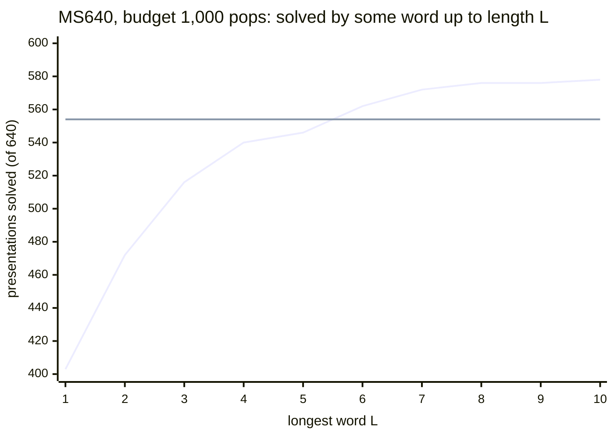

# Rank-n brute force and the n-generator package

**TL;DR.** Add a generator `z` and the relator `Z.w` to a two-generator presentation, for every freely reduced word
`w`, and search each start with the ordinary greedy. It answers one question: does the right word make greedy cheaper?
**Only as an oracle.** On MS640 at 1,000 pops a start, some word of length 1 to 10 solves 578 rows against the
control's 554, but no single word matches the control (the best, picked with hindsight, solves 528), and two or three
added generators do worse. acx's sweep (`acx/ngen/sweep/`, on `acx.search`) reproduces the stored study cell for cell
at lengths 1 to 4. The second half documents `acx.ngen`: the transform to short relators and the lift of a solve.



*Rising line: some word up to length L (an oracle: the best word for each presentation, known in advance); flat
line: the control's 554. The oracle passes the control only from length 6 on and ends at 578. Stored study,
[results/stable_ac/rank3_bf/](../results/stable_ac/rank3_bf/README.md).*

## What is searched

- **Start**: `<x, y, z | r1, r2, Z.w>` (rank 3); `<x, y, z1, z2 | r1, r2, Z1.w1, Z2.w2>` for every multiset of two
  words (rank 4); three words for rank 5. `extra` = 1, 2, 3 in `[rankn]`.
- **Words**: all freely reduced words of length `min_len..max_len` over `x, y, X, Y`, one of each pair `{w, w^-1}`
  (`2 * 3**(n-1)` of length `n`), in a fixed depth-first order (`reduced_words`). `inverse = true` searches `w^-1`
  instead (the same start up to renaming `z`; only heap ties can differ).
- **Control and null stabilisation**: per row the 2-generator search and the start with empty words (`Z1, .., Zk`)
  run too and must agree on (solved, pops, path length), else the row is refused.
- **Priority** LENGTH (the sweep refuses S20_MK2, which is two-generator only); the config's cap, watched by the cap
  counters ([CAP.md](CAP.md)).
- **A solve** is "solved from the stabilised start": it certifies *stable* AC-triviality only after a lift (below).
  The sweep never writes an `ac_path` or a `stable_cert`.

## Run

```
python run.py --config configs/rank3_bf.toml                  # MS640, words of length 1-4, budget 1,000, cap 24
python run.py --config configs/rank3_bf.toml --rows 0:40      # a smoke, seconds
python run.py --config configs/rank4_bf.toml --rows 7:640:40  # a rank-4 slice (a full run is ~2 core-hours)
python -m acx.ngen.sweep --config configs/rank5_bf.toml --verify 100   # the same config, then 100 cells re-run on both backends
```

`run.py` checks the config (method `rankn`, `acx.runner.method_config`) before writing, then hands the run to
`acx.ngen.sweep.run`. `[search]` is a `SearchConfig` (priority `length`, `budget <= 65535`, `1 + max_len <= cap`);
`[rankn]` holds `extra`, `min_len`, `max_len`, `inverse`, `sample`.

**Output**, `results/<name>/`: `config.json`, `rows/<id>.npz` (one atomic file a row, so a killed run resumes; a file
from another config is an error), `summary.json`, `summary.md`. A row file holds per start `nodes` (pops), `path_len`
(-1 unsolved), `min_total`, the five counters `cap_dropped`, `cap_dropped_min_total`, `cap_would_pop`,
`cap_first_bind`, `cap_needed` (-1 = none), the control and null records, and a deterministic sample of solved paths
(`sample`). **Row files are large: keep them out of git** (`results/*/rows/`). Row ids are percent-encoded in file
names (dots included; numeric ids unchanged), so `../row` or `ms:1` stay inside `rows/`; use `row_path(result_dir,
id)`. Older custom-id files whose names change under this encoding should be regenerated in a new folder. Resume
checks every stored row against the whole current input; `--fresh` keeps the inline `input.txt`.

**`summary.md`** has one row per word length (`L1`, `L2`, ...; ranks 4 and 5: one row, `all`). `solved` is a share of
all rows; `fewer`, `same`, `more` (pops against the control) and `lost` are shares of the rows the control solves and
add to 100%; `solved by some`, `gained`, `lost by every` and `some faster` count rows (`some faster` among
control-solved rows). A share over no row is `null` in `summary.json` (`-` in the table).

**Modules** of `acx.ngen.sweep`: `words` (the pool and the starts), `config`, `rows` (one row's searches and file),
`driver` (`run`), `summary`, `check` (`verify`), `cli`. `sweep.verify(dir, recheck=N)` (`--verify N`) checks control =
null stabilisation (counters included, scores shifted by `extra`), shapes and ranges, the counter rules, every stored
path through `acx.verify.replay`, and `N` random cells re-run on both backends. Measured here (3 workers): lengths 1-3
over MS640 (16,640 searches) 4.6 minutes, length 4 alone (34,560 searches) about 9 minutes; length 10 (37.8 M searches)
is a cluster job.

The sweep now captures only the deterministic path sample and the control's certificate; unsampled starts and the
null stabilisation retain depths/counters without replay. Combinations form a lazy indexable sequence in the original
cell order (`tuple(combos(...))` materializes it explicitly). Results fill compact NumPy columns directly, and summary
reads omit unused archive members. Word pools and result arrays still grow with the experiment, and a row checkpoints
only after it finishes. `provenance.json` provides the ordinary runner's source/runtime guard too.

## Reproduction of the stored study

Budget 1,000 pops, cap 24, MS640, fast backend; each cell against the study's `rank3_bf_ms640_b1000_cap24_*.npz` and
`rankn_bf_ms640_b1000_cap24_r{4,5}.npz` (not in git; listed in
[`results/stable_ac/rank3_bf/MANIFEST.json`](../results/stable_ac/rank3_bf/MANIFEST.json)), comparing `nodes`,
`path_len`, `min_total`, `cap_dropped`, `cap_dropped_min_total` and the control's solved / pops / path length:

| slice | cells | solved | mismatches |
|---|---|---|---|
| control, 640 rows (equal to the null stabilisation) | 640 | 554 | 0 |
| rank 3, lengths 1-3 | 16,640 | 11,438 | 0 |
| rank 3, length 4 | 34,560 | 23,696 | 0 |
| rank 3, lengths 1-2, `inverse = true` | 5,120 | - | 0 |
| rank 4, 16 rows (`--rows 7:640:40`) | 5,616 | 2,899 | 0 |
| rank 5, 16 rows (`--rows 0:640:40`) | 1,920 | 1,150 | 0 |

The summary tables agree too (some word up to length 1/2/3/4: 403 / 472 / 516 / 540; a random word solves 60.1% /
68.4% / 69.8% / 68.6% of its starts; lost by every word 151 / 82 / 38 / 18). The cap dropped a child in 4 of the
16,640 searches of lengths 1-3 (the study's 4 cells, the same smallest dropped total) and could bind in none. The
study's tip (`f2d53ced`) stores the counters of ranks 4 and 5 too: equal to acx's on the rank-5 slice and on 150
sampled rank-4 cells. The study's `cap_first_bind` is a conservative total-length test and acx's counters are exact
(full heap key, first-drop keys), so a study null implies an acx null.

**The stored study** (MS640, cap 24): at budget 1,000, lengths 1 to 10 (37,790,720 searches), the control solves 554,
some word 578 (24 gained, 0 lost), the best single word `yXYYYxyyy` 528; at budget 10,000, lengths 1 to 7 (1,399,040
searches), 606 and 608 (6 gained, 4 lost); at 1,000, ranks 4 and 5: 506 and 416 by some start. In all 40,098,032
searches the cap dropped a child in 2,331,711 and could bind in none.

**Differences from the study's code.** The search is `acx.search`, not `solvern` / `solvern_fast`: the same canonical
form, tie-break, move order and cap rule, pop for pop with cyclic reduction on (with `cyclic = false` acx re-reduces
untouched relators at every pop; the sweep ships `cyclic = true`). Not ported: the 2,187-word block shards, the
relator-subword arm, the shortlex, cross-validation and class-view analyses. Pops are stored as `uint16` (budget at
most 65,535), path lengths as `int32` (-1 unsolved), the minimum total exactly (the study clipped it to a byte).

## The n-generator package (`acx.ngen`)

`solve(pres, NGenConfig)` searches a presentation of any rank with `acx.search.search` (either backend), starting from
`Presentation.normal(cyclic)`; a presentation with no definition is searched as it is (with `cyclic = false` its
cyclic reduction could change relators by conjugation and the path would not replay on the input).

- `sac = true` (default): triangulate (`acx.ngen.sac`), search the root, lift a solve (`acx.ngen.lift`) to elementary
  stable AC moves: a `stable_cert`. Relators already of length <= 3 need no definition and give an `ac_path`.
- `sac = false`: search the presentation itself; a solve is an `ac_path`.
- Refused up front: SAC with a priority other than LENGTH (when the config is built, so `run.py` refuses
  `configs/ngen_sac.toml --set search.priority=s20_mk2` before writing), and a root of more than 127 generators
  (`acx.ngen.solver.MAX_GENERATORS`, a `ValueError`). Generators past `z` are `g27`, `G27` (its inverse), `g28`, ...

### The stable-AC transform (`acx.ngen.sac`)

A *definition* adds a generator `h` with relator `d^-1 h` for a cyclic digram `d = ab` and rewrites every relator,
replacing `ab` by `h` (`BA` by `H`) wherever that shortens it. Each definition shortens some relator longer than 3, so
the loop ends; the rank grows by one each time.

- The next digram has the most cyclic occurrences over all relators (ties: the most inside relators longer than 3,
  then the smaller digram).
- A relator is rewritten as its shortest rewriting (`acx.core.digrams.tokenize`, ties: the smaller word) over its
  rotations, oriented as the source's canonical form (the least rotation in int order of the relator or its inverse).
  This reproduces the source's tie-breaks on the MS640, AC19 and 1190ms rows (`tests/test_ngen.py` pins a sample).
- Relators keep their positions, so the lift can track them.

A definition is a stabilisation (generator `h`, relator `h`), the automorphism `h -> d^-1 h` and AC moves, so a solve
of the root proves *stable* AC-triviality of the source.

### The lift (`acx.ngen.lift`)

Let `t_k = d_k^-1 h_k` be the k-th defining relator, `U = (r.., h_1..h_m)` the source after `m` stabilisations and
`T = (r.., t_1..t_m)`. `beta` fixes the source generators and sends `h_k` to `beta(d_k) h_k`: an automorphism with
`beta(t_k) = h_k`, so `beta(T) = U`, and AC moves are equivariant under it. The elementary path from `T`:

1. **undefine**, definition by definition: in every relator invert and rotate as `sac.rewrite` chose, turn each `d`
   into `h_k` by multiplying with `Q^-1 t_k Q` (`Q` the rest of the word) and each `d^-1` into `H_k` with the conjugate
   of `t_k^-1`. This reaches `sac.root`.
2. **solve** the root with the search's S-moves, each expanded as in `acx.aut.emitter.Emitter` (align to the canonical
   form, conjugate the source, multiply, conjugate back). The end is the basis `(x, y, h_1, .., h_m)` up to `beta`.
3. **clean**: the relator of `h_j` is `beta(d_j) h_j`; delete its letters before `h_j` one at a time by multiplying
   with a conjugate of that letter's unit relator.
4. **destabilize** `m` times.

The moves are replayed on the source (`acx.verify.replay`, `normalize=False`) before they are returned. The path is long
(a conjugation costs a move per letter, and `beta(h_k)` grows with the nesting of definitions) but deterministic;
nothing searches.
