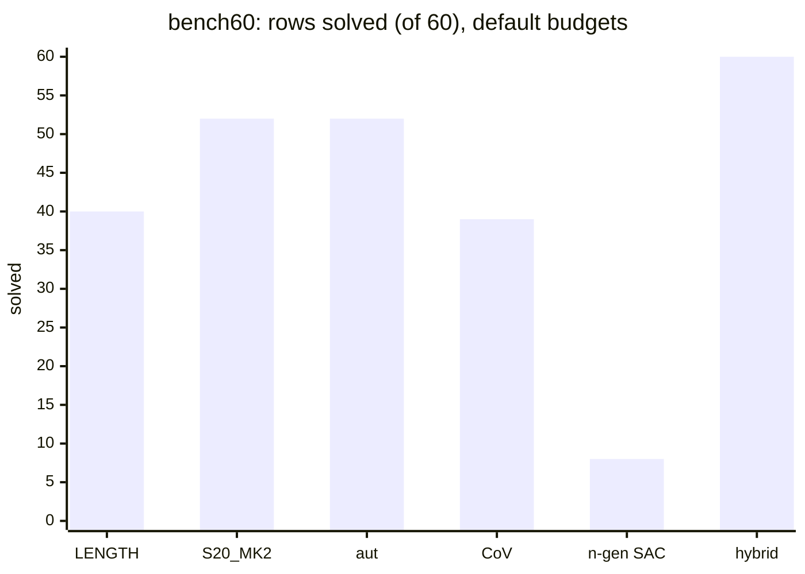
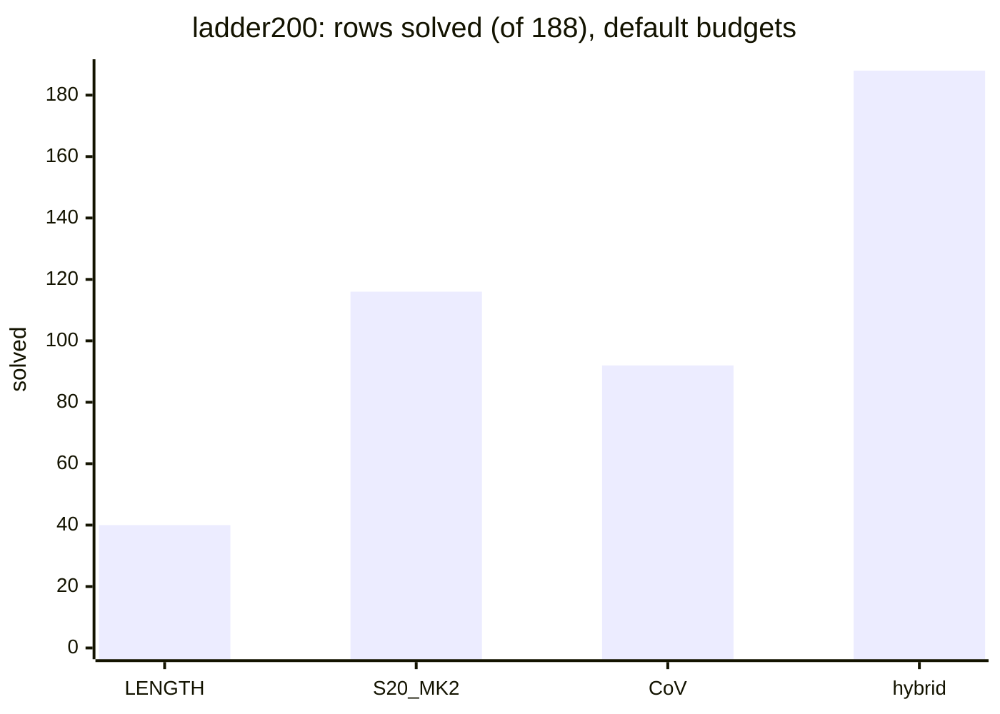
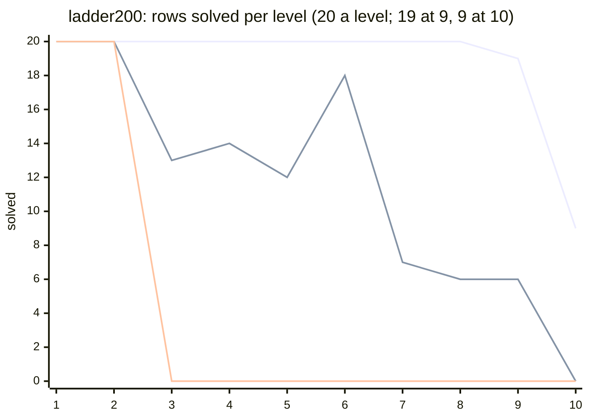
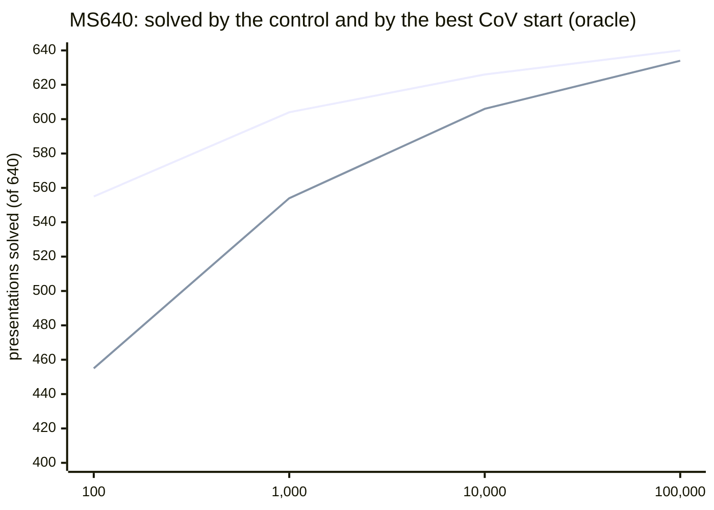

# Results

**TL;DR.** Every number here has its budget, cap and source. At 1,000 work units a row the **hybrid solves every
row** of MS640, bench60, the AC1M holdout, ladder60, ladder200 and all 72,779 AC19 Aut-min orbits, and 0 of the 124
unsolved classes (U124), as does every other method. At 10,000 pops a row **S20_MK2 beats LENGTH** (MS640 626 vs 606,
bench60 52 vs 40, ladder200 116 vs 40). A change of variables or an added generator helps only as an **oracle** (the
right start known in advance); as a policy at equal pops it solves fewer rows than plain greedy. **Cap 24 changes no
solved count** in any shipped run.

## How to read the numbers

- **Budget** is per row, in the method's unit: heap **pops** (greedy, aut, CoV, n-generator; "nodes" in the sources),
  **work units** (hybrid) or **network evaluations** (rl). A row that misses spends its whole budget. A search at
  budget B is exactly the first B pops of a longer search of the same row, cap and priority. **Units are never
  compared with each other.**
- **Cap** is the per-relator length limit on generated children. **24, 48 and 64 are caps, never path lengths**; only
  runs at one cap are matched comparisons.
- **Path length** is in S-moves unless a line says elementary ([METHODS.md](METHODS.md) section 9).
- **Kinds.** `ac_path`: replayed AC moves on the row as written (aut-assisted: found in another basis, then
  transported). `stable_cert`: proves *stable* AC-triviality and says nothing about an AC path's length.
- **Sources.** Section 0 and the cap section are measured in this repository with `python run.py`. Sections 1 to 10
  are read from source branches, written `branch:path`; the commit of each path is in [PROVENANCE.md](PROVENANCE.md).
  The two stored studies are in `results/stable_ac/` ([results/README.md](../results/README.md#studies)).
  **[survey]**: from the branch survey, not re-read at its source. **[rerun]**: reproduced with the unmodified original
  code (Python 3.12.3, numba 0.63.1, numpy 2.1.3, one single-threaded process per run); deterministic, and section 0
  matches them exactly.

## 0. Runs in this repository

Each row is the committed `results/<run>/summary.json` (and `config.json`) of
`python run.py --config configs/<config>.toml --set name=<run> <overrides>`; the certificates (`paths.jsonl`,
gitignored) regenerate with the same command, and `tests/test_published.py` pins the counts. Fast backend and cap 24
unless stated; one core per worker on a shared 4-core 2.8 GHz VM. Every record was written only after its certificate
replayed on the row, and the stored paths of all runs but `ac1m_hybrid` were replayed again from the files by a
separate script (77,723 records, 0 failures; the 103 CoV `stable_cert`s are checked by `acx.cov.verify` when
written). The 1,136,135 paths of `ac1m_raw_hybrid` were replayed the same way, each from its own AC1M line (0
failures).

**Budget a row**: greedy, aut and ngen 10,000 pops; CoV 1,000 pops an image and 10,000 a row; hybrid 1,000 work
units; rl a beam of width 256 for 150 steps. Path columns are totals over solved rows (median per row in brackets):
S-moves and elementary count `ac_path`s (aut-assisted included), the **stable** column counts `stable_cert`s (S-moves of
the search leg / elementary plus AC4/AC5 moves; a CoV `stable_cert` has no elementary path). CPU s sums per-row CPU.

*At 10,000 pops a row S20_MK2 (and aut, which searches with it) solves 12 more bench60 rows than LENGTH; CoV and the
n-generator transform solve fewer; the hybrid solves all 60 at 1,000 work units a row.*

*The same ordering on the difficulty ladder, with a wider gap: LENGTH solves levels 1 and 2 only (table below).*

| run | config, overrides | budget a row | solved | ac_path / aut / stable | cost | S-moves | elementary | stable S / elem | CPU s |
|---|---|---|---:|---|---:|---:|---:|---:|---:|
| `smoke` | `smoke` (S20_MK2, rows 0:20) | 1,000 pops | 20 / 20 | 20 / 0 / 0 | 102 pops | 82 (4) | 450 (21.5) | | 0.6 |
| `ms640_length_spec` | `baseline_spec` (`spec`, 4 workers) | 10,000 pops | 606 / 640 | 606 / 0 / 0 | 576,053 pops | 12,103 (8) | 114,828 (54) | | 2,023 |
| `ms640_length_fast` | `greedy_fast` | 10,000 pops | 606 / 640 | 606 / 0 / 0 | 576,053 pops | 12,103 (8) | 114,828 (54) | | 64 |
| `ms640_s20_mk2_fast` | `s20_mk2_fast` | 10,000 pops | 626 / 640 | 626 / 0 / 0 | 382,718 pops | 16,872 (9) | 168,702 (56.5) | | 51 |
| `ms640_aut` | `aut`, `benchmark=ms640` | 10,000 pops | 626 / 640 | 11 / 615 / 0 | 408,174 pops | 16,998 (9) | 787,744 (249) | | 84 |
| `ms640_cov` | `cov`, `benchmark=ms640` | 1,000 / 10,000 pops | 584 / 640 | 554 / 0 / 30 | 693,162 pops | 6,700 (8) | 54,944 (48) | 1,652 / - | 75 |
| `ms640_hybrid` | `hybrid` | 1,000 units | 640 / 640 | 128 / 512 / 0 | 25,064 units | 12,346 (10) | 89,055 (54) | | 12 |
| `ms640_ngen_sac` | `ngen_sac`, `benchmark=ms640` | 10,000 pops | 298 / 640 | 0 / 0 / 298 | 3,729,167 pops | | | 5,035 / 229,196 | 314 |
| `ms640_rl30` | `rl` (rows 0:30) | beam 256 x 150 | 30 / 30 | 30 / 0 / 0 | 9,650 evaluations | 133 (4) | 845 (25.5) | | 20 |
| `ac19_hybrid` | `hybrid`, `benchmark=ac19_autmin` (266 s wall) | 1,000 units | 72,779 / 72,779 | 36,811 / 35,780 / 188 | 2,489,726 units | 1,232,877 (11) | 7,341,111 (71) | 2,722 / 93,692 | 987 |
| `ac1m_hybrid` | `hybrid`, `benchmark=ac1m_autmin` (255 s wall) | 1,000 units | 71,281 / 71,283 | 34,649 / 36,508 / 124 | 2,384,509 units | 1,136,288 (11) | 7,239,114 (71) | 1,662 / 62,312 | 951 |
| `ac1m_raw_hybrid` | `hybrid`, `benchmark=ac1m` (4,360 s wall) | 1,000 units | 1,136,135 / 1,136,154 | 28,352 / 1,106,255 / 1,528 | 47,236,671 units | 17,023,238 (11) | 147,405,513 (96) | 20,308 / 1,001,262 | 14,226 |
| `bench60_length` | `greedy_fast`, `benchmark=bench60` | 10,000 pops | 40 / 60 | 40 / 0 / 0 | 248,227 pops | 1,475 (24) | 15,028 (217) | | 27 |
| `bench60_s20_mk2` | `s20_mk2_fast`, `benchmark=bench60` | 10,000 pops | 52 / 60 | 52 / 0 / 0 | 141,740 pops | 3,237 (31.5) | 34,173 (281) | | 19 |
| `bench60_aut` | `aut` | 10,000 pops | 52 / 60 | 0 / 52 / 0 | 147,767 pops | 3,214 (30.5) | 176,856 (1,035.5) | | 24 |
| `bench60_cov` | `cov` | 1,000 / 10,000 pops | 39 / 60 | 29 / 0 / 10 | 246,744 pops | 557 (16) | 4,972 (119) | 485 / - | 29 |
| `bench60_ngen_sac` | `ngen_sac` | 10,000 pops | 8 / 60 | 0 / 0 / 8 | 531,923 pops | | | 147 / 8,152 | 53 |
| `bench60_hybrid` | `hybrid`, `benchmark=bench60` | 1,000 units | 60 / 60 | 7 / 53 / 0 | 4,783 units | 3,382 (16.5) | 27,641 (170) | | 7 |
| `holdout60_length` | `greedy_fast`, `benchmark=ac1m_hard_holdout60` | 10,000 pops | 44 / 60 | 44 / 0 / 0 | 329,601 pops | 2,447 (44.5) | 26,589 (448) | | 31 |
| `holdout60_s20_mk2` | `s20_mk2_fast`, same | 10,000 pops | 50 / 60 | 50 / 0 / 0 | 165,049 pops | 3,069 (44.5) | 33,345 (457.5) | | 18 |
| `holdout60_length_1k_cap48` | `greedy_fast`, same, `search.budget=1000`, `search.cap=48` | 1,000 pops (cap 48) | 0 / 60 | 0 / 0 / 0 | 60,000 pops | | | | 7 |
| `holdout60_s20_mk2_1k_cap48` | `s20_mk2_fast`, same, `search.budget=1000`, `search.cap=48` | 1,000 pops (cap 48) | 33 / 60 | 33 / 0 / 0 | 41,953 pops | 1,465 (36) | 15,128 (342) | | 8 |
| `holdout60_hybrid` | `hybrid`, `benchmark=ac1m_hard_holdout60` | 1,000 units | 60 / 60 | 0 / 60 / 0 | 3,770 units | 1,697 (16) | 17,593 (223.5) | | 4 |
| `u124_s20_mk2` | `s20_mk2_fast`, `benchmark=u124` | 10,000 pops | 0 / 124 | | 1,149,399 pops | | | | 75 |
| `u124_hybrid` | `hybrid`, `benchmark=u124` | 1,000 units | 0 / 124 | | 124,000 units | | | | 566 |
| `ladder60_length` | `ladder`, `benchmark=ladder60`, `search.priority=length` | 10,000 pops | 12 / 60 | 12 / 0 / 0 | 508,744 pops | 644 (60.5) | 6,807 (604) | | 41 |
| `ladder60_s20_mk2` | `ladder`, `benchmark=ladder60` | 10,000 pops | 33 / 60 | 33 / 0 / 0 | 365,386 pops | 2,180 (64) | 24,343 (713) | | 32 |
| `ladder60_cov` | `cov`, `benchmark=ladder60` | 1,000 / 10,000 pops | 32 / 60 | 7 / 10 / 15 | 430,114 pops | 624 (26) | 31,515 (730) | 628 / - | 54 |
| `ladder60_hybrid` | `hybrid`, `benchmark=ladder60` | 1,000 units | 60 / 60 | 1 / 57 / 2 | 8,077 units | 2,882 (22) | 30,794 (293.5) | 30 / 1,726 | 17 |
| `ladder200_length` | `ladder`, `search.priority=length` | 10,000 pops | 40 / 188 | 40 / 0 / 0 | 1,551,196 pops | 1,991 (30) | 21,108 (276.5) | | 127 |
| `ladder200_s20_mk2` | `ladder` | 10,000 pops | 116 / 188 | 116 / 0 / 0 | 1,063,702 pops | 7,697 (55) | 86,172 (587.5) | | 90 |
| `ladder200_cov` | `cov`, `benchmark=ladder200` | 1,000 / 10,000 pops | 92 / 188 | 21 / 23 / 48 | 1,357,023 pops | 1,215 (17) | 60,321 (640) | 2,077 / - | 155 |
| `ladder200_hybrid` | `hybrid`, `benchmark=ladder200` | 1,000 units | 188 / 188 | 8 / 173 / 7 | 22,319 units | 7,612 (20) | 80,878 (301) | 117 / 6,051 | 38 |

Every run except the MS640 configs as shipped also sets `workers=4`; `ladder` already runs 4 workers.

*Top line: the hybrid (every row of every level); middle: S20_MK2; bottom: LENGTH, which stops after level 2 as the
levels are defined. Greedy at 10,000 pops, hybrid at 1,000 units a row.*

| ladder level | 1 | 2 | 3 | 4 | 5 | 6 | 7 | 8 | 9 | 10 | total |
|---|---:|---:|---:|---:|---:|---:|---:|---:|---:|---:|---:|
| `ladder60` rows | 6 | 6 | 6 | 6 | 6 | 6 | 6 | 6 | 6 | 6 | 60 |
| length greedy, 10,000 pops | 6 | 6 | 0 | 0 | 0 | 0 | 0 | 0 | 0 | 0 | 12 |
| S20_MK2, 10,000 pops | 6 | 6 | 4 | 4 | 2 | 6 | 3 | 0 | 2 | 0 | 33 |
| CoV (one-shot, length), 1,000 / 10,000 pops | 6 | 5 | 4 | 2 | 3 | 3 | 3 | 3 | 2 | 1 | 32 |
| hybrid, 1,000 units | 6 | 6 | 6 | 6 | 6 | 6 | 6 | 6 | 6 | 6 | 60 |
| `ladder200` rows | 20 | 20 | 20 | 20 | 20 | 20 | 20 | 20 | 19 | 9 | 188 |
| length greedy, 10,000 pops | 20 | 20 | 0 | 0 | 0 | 0 | 0 | 0 | 0 | 0 | 40 |
| S20_MK2, 10,000 pops | 20 | 20 | 13 | 14 | 12 | 18 | 7 | 6 | 6 | 0 | 116 |
| CoV (one-shot, length), 1,000 / 10,000 pops | 20 | 16 | 5 | 4 | 11 | 12 | 8 | 11 | 4 | 1 | 92 |
| hybrid, 1,000 units | 20 | 20 | 20 | 20 | 20 | 20 | 20 | 20 | 19 | 9 | 188 |

- **The summary files.** All 32 folders and the three rank-n runs were regenerated with `--fresh` once the cap
  counters existed. They predate the timing and cost keys: no `cpu_seconds`, `us_per_cost`, `cost_unit`, `cost_mean`
  or `cost_median`, and their `config` still holds `workers` (and `rows` in `smoke` and `ms640_rl30`); the same command
  today writes those keys. `ladder200_hybrid` alone was rewritten by the current code, whose `dyn_cap` counter finds 507
  would-pop states there. Every record of the 32 (150,492 rows: solved, pops or units, paths, certificates, stage)
  equals the earlier run except the 11 plain `ac_path` rows of `ms640_aut`, which now store the shorter decoded path
  of the same S-moves. The CPU s column keeps the earlier runs' idle
  timings. Runs split into row slices to stay under 15 minutes (`ms640_length_spec`, `u124_hybrid`, `ac19_hybrid`,
  `ac1m_hybrid`, `rank3_bf`) have a `wall_seconds` that sums the slices. `ac1m_raw_hybrid` is newer and has the
  timing keys. It ran in two parts, because the first ran out of memory at row 451,977, before the runner stopped
  holding paths in memory. Its `wall_seconds` (2,483) covers the second part only; the two parts together took
  4,360 s.
- **Parity with the original code.** `spec` and `fast` give identical records (solved, pops, both paths, the six cap
  fields) on all 640 MS640 rows, and the per-row pops and path lengths equal the original `greedy_baseline` /
  `heuristics` reruns (0 mismatches over 1,280 rows). The hybrid's per-row stage and units equal the original
  `hfhybrid` on all 640 rows (stages B / C / H = 98 / 328 / 214; the reference's 4,759 stage-H steps are 3,258 S-moves
  plus 1,501 automorphism steps here); on AC19 Aut-min it reproduces the source's 2,489,726 units and its 72,591
  rank-two / 188 stable split (72,591 = 36,811 + 35,780). On AC1M Aut-min it solves 71,281 of 71,283, as the source
  (misses `ac1m_54083`, `ac1m_68740`). On raw AC1M (`ac1m_raw_hybrid`), starting from each presentation as given,
  it solves 1,136,135 of 1,136,154 in one pass, again the source's count. The 19 misses are the 9 and 10 members of
  those two orbits. Run again with `--rows <the 19 ids> --set hybrid.budget=10000`, all 19 solve, using 1,040 to 1,153
  units, as in the source.
- **`fast` against `spec`**: 32x less CPU over the whole MS640 LENGTH run (64 against 2,023 CPU s: search, decoding and
  replay). On search alone the ratio depends on load; `tests/test_fast.py::test_speed` (slow; rows 322 and 466, 2,000
  pops under each priority) prints it and asserts more than 5x.
- **Ladder.** S20_MK2 solves 6 of the 19 level-9 rows at 10,000, as on record; the hybrid solves every row, 7 of
  `ladder200` as `stable_cert`. Levels 9 and 10 are graded at 10M pops by record, not rerun. Rows were graded at their
  own caps (24 to 64); these runs use cap 24 for every row.
- **CoV at equal pops loses to plain search.** At 1,000 pops an image and 10,000 a row, CoV solves 584 MS640 rows (554
  by the row's own first 1,000 pops plus 30 stable certificates) against 606 for one 10,000-pop search; bench60 39
  against 40. On MS640 and bench60 no image solve landed in the row's Aut orbit (aut 0); on the ladders 10 and 23 did.
- **Aut-assisted paths are long.** Through the Aut-min form MS640 gets the same 626 solves as S20_MK2 on the rows, with
  4.7x the elementary moves (787,744 against 168,702) for transport and its Nielsen tail. 11 are plain `ac_path`s: their
  row is its own Aut-minimal form (12 MS640 rows are; one is unsolved).
- **AC1M hard holdout.** At the published protocol (1,000 pops, cap 48, the S20_MK2 selection's spent holdout) 0 and 33
  reproduce the published 0/60 and 33/60 (section 2); at 10,000 pops and cap 24, LENGTH 44 and S20_MK2 50; the hybrid
  all 60.
- **RL** (`configs/rl.toml`, the step-1000 610model checkpoint, beam 256 x 150): 30 of the first 30 MS640 rows.

**Rank-n brute force** (`configs/rank{3,4,5}_bf.toml`, method `rankn`, [RANK3.md](RANK3.md)): generators `z = w` for
every word of length 1 to 4 (rank 3) or every multiset of words (ranks 4, 5), each start searched with **budget 1,000
pops**, cap 24, LENGTH; control = the plain 2-generator search. Each writes `rows/<id>.npz` (gitignored), `summary.json`
and `summary.md`; `rank3_bf` ran as `--rows 0:160`, `160:320`, `320:480`, `480:640`.

| run (budget 1,000 pops) | rows | starts per row | searches | control solves | solved by some start | the stored study |
|---|---:|---:|---:|---:|---:|---|
| `rank3_bf`, lengths 1-4 | 640 | 80 | 51,200 | 554 | 403 / 472 / 516 / 540 up to length 1 / 2 / 3 / 4 | the same; lost by every word 151 / 82 / 38 / 18 |
| `rank4_bf`, extra 2, lengths 1-3 (`--rows 0:201`, `207:640:20`) | 223 | 351 | 78,273 | 219 | 216 | a slice of the study's 506 / 640, not comparable |
| `rank5_bf`, extra 3, lengths 1-2 (`--rows 0:640:20`) | 32 | 120 | 3,840 | 28 | 21 | a slice of the study's 416 / 640, not comparable |

Ranks 4 and 5 are slices (a full rank-4 run is two to three core-hours here): `rank4_bf` is every 20th row from 7 plus
rows 0 to 200, where a full sweep stood when stopped at the 15-minute limit; those first rows are easy (control 219 of
223). The rank-3 run equals the stored study ([results/stable_ac/rank3_bf/](../results/stable_ac/rank3_bf/README.md);
a random word solves 60.1% / 68.4% / 69.8% / 68.6% of its starts at length 1 / 2 / 3 / 4).

## Relator-length cap

A search keeps a child only if both relators have at most `cap` letters; [CAP.md](CAP.md) defines the counters and the
guarantee (no would-pop row means the same run at any larger cap). Read from the `caps` block of each
`summary.json`; budgets as in section 0. *Rows dropping*: the cap kept a child out; *rows that would pop*: raising the
cap changes the search (ids in `caps.cap.raise_ids`, first 100); *children dropped*: sum of `cap_dropped` (one per
move); *would-pop states*: sum of `cap_would_pop`; `cap_needed`: the range of the smallest cap that changes a row;
*first bind*: the earliest pop at which a dropped state would have gone first.

### Searches under one cap

| run | budget a row | solved | cap | rows dropping | rows that would pop | children dropped | would-pop states | `cap_needed` | first bind (pop) |
|---|---|---:|---:|---:|---:|---:|---:|---:|---:|
| `smoke` | 1,000 pops | 20 / 20 | 24 | 0 | 0 | 0 | 0 | - | - |
| `ms640_length_spec` | 10,000 pops | 606 / 640 | 24 | 26 | 0 | 12,195,104 | 0 | - | - |
| `ms640_length_fast` | 10,000 pops | 606 / 640 | 24 | 26 | 0 | 12,195,104 | 0 | - | - |
| `ms640_s20_mk2_fast` | 10,000 pops | 626 / 640 | 24 | 74 | 20 | 10,128,166 | 801 | 25 | 309 |
| `ms640_aut` | 10,000 pops | 626 / 640 | 24 | 76 | 20 | 12,013,436 | 1,224 | 25 | 766 |
| `ms640_cov` | 1,000 / 10,000 pops | 584 / 640 | 24 | 26 | 0 | 1,278,976 | 0 | - | - |
| `ms640_ngen_sac` | 10,000 pops | 298 / 640 | 24 | 0 | 0 | 0 | 0 | - | - |
| `ms640_rl30` | beam 256 x 150 | 30 / 30 | 24 | 5 | 5 | 23 | 23 | 25-27 | 5 |
| `bench60_length` | 10,000 pops | 40 / 60 | 24 | 17 | 0 | 8,478,448 | 0 | - | - |
| `bench60_s20_mk2` | 10,000 pops | 52 / 60 | 24 | 27 | 10 | 4,614,938 | 387 | 25 | 474 |
| `bench60_aut` | 10,000 pops | 52 / 60 | 24 | 27 | 10 | 5,739,822 | 668 | 25 | 766 |
| `bench60_cov` | 1,000 / 10,000 pops | 39 / 60 | 24 | 12 | 0 | 727,750 | 0 | - | - |
| `bench60_ngen_sac` | 10,000 pops | 8 / 60 | 24 | 0 | 0 | 0 | 0 | - | - |
| `holdout60_length` | 10,000 pops | 44 / 60 | 24 | 21 | 1 | 8,233,266 | 1,518 | 25 | 6,708 |
| `holdout60_s20_mk2` | 10,000 pops | 50 / 60 | 24 | 38 | 6 | 9,041,088 | 687 | 25 | 221 |
| `holdout60_length_1k_cap48` | 1,000 pops | 0 / 60 | 48 | 0 | 0 | 0 | 0 | - | - |
| `holdout60_s20_mk2_1k_cap48` | 1,000 pops | 33 / 60 | 48 | 0 | 0 | 0 | 0 | - | - |
| `u124_s20_mk2` | 10,000 pops | 0 / 124 | 24 | 122 | 93 | 223,308,466 | 9,753,771 | 25 | 21 |
| `ladder60_length` | 10,000 pops | 12 / 60 | 24 | 35 | 1 | 25,777,196 | 7,647 | 25 | 9,214 |
| `ladder60_s20_mk2` | 10,000 pops | 33 / 60 | 24 | 49 | 31 | 29,109,358 | 14,692 | 25-26 | 335 |
| `ladder60_cov` | 1,000 / 10,000 pops | 32 / 60 | 24 | 24 | 0 | 1,983,514 | 0 | - | - |
| `ladder200_length` | 10,000 pops | 40 / 188 | 24 | 95 | 3 | 64,040,488 | 31,115 | 25 | 9,211 |
| `ladder200_s20_mk2` | 10,000 pops | 116 / 188 | 24 | 157 | 77 | 77,900,696 | 53,637 | 25-26 | 304 |
| `ladder200_cov` | 1,000 / 10,000 pops | 92 / 188 | 24 | 65 | 0 | 5,480,806 | 0 | - | - |

- **Cap 24 changed nothing** in every LENGTH run on MS640 and bench60, in CoV, in the n-generator search and in the two
  cap-48 holdout runs. LENGTH drops children in 26 of 640 MS640 rows; rerun uncapped, those 26 pop the same states in
  the same order (traces compared), so 606 holds at every cap. CoV reports `cap_legs_bound` 0 on all four runs. The
  n-generator search works on relators of length at most 3 and never reaches 24; the holdout never reaches 48.
- **The cap matters under S20_MK2**, which puts long relators early: drops in 74 of 640 MS640 rows, would-pop in 20
  (`aut`, same priority, the same 20). `cap_needed` is 25 in each of them on MS640, bench60 and the holdout (25-26 on
  the ladders). At cap 25 the count is 0 on MS640 and bench60 but not on 4 of the 6 holdout rows (`cap_needed` 26, 26,
  26, 27), so the study below goes uncapped.
- **LENGTH binds deep in the budget** on four rows, all unsolved at 10,000 pops with and without the cap:
  `holdout60_length` row 569291 (first bind at pop 6,708), `ac19_50892` (ladder60, ladder200), `ac19_14060` and
  `ac19_27187` (ladder200); first binds 9,211 to 9,886 on the ladders.
- **RL** has no queue: each of the 23 children the beam chose and the cap dropped took a slot, so `would_pop ==
  dropped` (5 of 30 rows). The policy reads at most 24 letters, so the cap cannot be raised; the 5 rows (6, 13, 18, 26,
  28) were all solved.
- **U124 under S20_MK2**: 122 of 124 rows drop children and 93 would pop. In 15 rows (`aca_99` to `aca_113`) the capped
  queue ran dry after 643 to 9,220 pops; uncapped, they spend all 10,000. None is solved either way.

### The hybrid (budget 1,000 work units a row)

Defaults `r2_cap = "parent"`, `dyn_cap` 8, `slack` 8 ([CAP.md](CAP.md)).

| run | solved | `r2_cap` dropped | `dyn_cap`: rows dropping / would pop | `dyn_cap` dropped / would-pop | `dyn_cap_needed` | first bind | `slack`: rows dropping / would pop | `slack` dropped |
|---|---:|---:|---:|---:|---:|---:|---:|---:|
| `ms640_hybrid` | 640 / 640 | 0 | 2 / 0 | 766 / 0 | - | - | 0 / 0 | 0 |
| `ac19_hybrid` | 72,779 / 72,779 | 0 | 409 / 344 | 4,704,033 / 8,010 | 9-13 | 3 | 11 / 0 | 33 |
| `ac1m_hybrid` | 71,281 / 71,283 | 0 | 290 / 238 | 3,540,728 / 5,807 | 9-23 | 4 | 19 / 0 | 81 |
| `ac1m_raw_hybrid` | 1,136,135 / 1,136,154 | 0 | 3,425 / 2,736 | 40,451,692 / 54,381 | 9-23 | 4 | 206 / 0 | 860 |
| `bench60_hybrid` | 60 / 60 | 0 | 1 / 0 | 383 / 0 | - | - | 0 / 0 | 0 |
| `holdout60_hybrid` | 60 / 60 | 0 | 0 / 0 | 0 / 0 | - | - | 0 / 0 | 0 |
| `u124_hybrid` | 0 / 124 | 0 | 123 / 118 | 18,884,638 / 84,093 | 9-15 | 3 | 103 / 0 | 26,807 |
| `ladder60_hybrid` | 60 / 60 | 0 | 7 / 7 | 273,121 / 192 | 9-13 | 54 | 0 / 0 | 0 |
| `ladder200_hybrid` | 188 / 188 | 0 | 23 / 21 | 606,830 / 507 | 9-13 | 14 | 1 / 0 | 8 |

A hybrid `*_dropped` counts classes of dropped children (plus the solving pop's tail moves), `*_would_pop` distinct
canonical pairs; counts are first order (zero: a larger limit pops the same; non-zero: the run may change).
`r2_cap = "parent"` rejected nothing; `slack` 8 never dropped a would-pop child. **`dyn_cap` 8 binds**: 344 AC19 and
238 AC1M rows would pop (`dyn_cap_needed` up to 13 and 23), yet the totals 72,779 / 72,779 (2,489,726 units) and
71,281 / 71,283 (2,384,509 units) hold at 8. On MS640 none would pop, so 640 / 640 in 25,064 units is independent of
the limits.

### Rank-n brute force (budget 1,000 pops a start)

The rank-n summary counts searches (one per start); counters are stored per start.

| run | rows | searches | cap dropped a child in | a dropped child would have popped in |
|---|---:|---:|---:|---:|
| `rank3_bf` | 640 | 51,200 | 8 | 0 |
| `rank4_bf` | 223 | 78,273 | 0 | 0 |
| `rank5_bf` | 32 | 3,840 | 0 | 0 |
| stored study, ranks 3 to 5 (budgets 1,000 and 10,000) | 640 | 40,098,032 | 2,331,711 | 0 |

No rank-n result depends on cap 24 (`results/stable_ac/rank3_bf/cap/cap_counters_cap24.md`). The study's test never
misses a bind that acx's exact counters find, so its null is an acx null.

### The 20 MS640 rows where S20_MK2 at cap 24 would pop

`ms640_s20_mk2_fast` (10,000 pops a row): rows 527, 529, 616 to 625, 628 to 630, 633 and 636 to 639, all with
`cap_needed` 25. Rerun at caps 24, 25 and uncapped, with the pop trace kept:

| row | solved | pops at 24 | pops at 25 | pops uncapped | `cap_would_pop` at 24 / 25 | `cap_first_bind` | pop where the traces part | S-moves |
|---|---|---:|---:|---:|---:|---:|---:|---:|
| 527 | yes | 7,458 | 7,479 | 7,479 | 21 / 0 | 1,653 | 1,653 | 120 |
| 529 | yes | 7,445 | 7,466 | 7,466 | 21 / 0 | 1,653 | 1,653 | 114 |
| 628 | yes | 7,074 | 7,092 | 7,092 | 18 / 0 | 693 | 693 | 117 |
| 629 | yes | 7,254 | 7,275 | 7,275 | 21 / 0 | 1,353 | 1,353 | 86 |
| 630 | yes | 7,208 | 7,229 | 7,229 | 21 / 0 | 1,353 | 1,353 | 79 |
| 633 | yes | 7,063 | 7,081 | 7,081 | 18 / 0 | 693 | 693 | 111 |
| 619 | no | 10,000 | 10,000 | 10,000 | 9 / 0 | 309 | 309 | |
| 623 | no | 10,000 | 10,000 | 10,000 | 9 / 0 | 474 | 474 | |
| 636 | no | 10,000 | 10,000 | 10,000 | 77 / 0 | 4,036 | 4,036 | |
| 639 | no | 10,000 | 10,000 | 10,000 | 9 / 0 | 2,152 | 2,152 | |

All 20 change at cap 25: each cap-24 trace departs from the cap-25 trace exactly at `cap_first_bind`, and the cap-25
trace equals the uncapped one. **The cap changes pops, not outcomes**: the 6 solved rows solve at all three caps, 18 to
21 pops later at the larger cap, with the same path; the other 14 stay unsolved. So 626 of 640 holds at every cap
from 24 up.

### Do the raise-the-cap rows change a count?

Every run with a non-empty `raise_ids`, those rows rerun uncapped at the run's budget (hybrid: `dyn_cap` 13, the
largest `dyn_cap_needed` there):

| run | rows rerun | solved | pops (units) before / after | S-moves of the solved rows |
|---|---:|---|---:|---:|
| `ms640_s20_mk2_fast` | 20 | 6 / 6 | 183,502 / 183,622 | 627 / 627 |
| `ms640_aut` | 20 | 6 / 6 | 185,090 / 185,222 | 684 / 684 |
| `bench60_s20_mk2` | 10 | 2 / 2 | 94,137 / 94,173 | 228 / 228 |
| `bench60_aut` | 10 | 2 / 2 | 95,030 / 95,074 | 228 / 228 |
| `holdout60_length` | 1 | 0 / 0 | 10,000 / 10,000 | |
| `holdout60_s20_mk2` | 6 | 1 / 1 | 51,450 / 51,451 | 88 / 88 |
| `u124_s20_mk2` | 93 | 0 / 0 | 839,399 / 930,000 | |
| `ladder60_length` | 1 | 0 / 0 | 10,000 / 10,000 | |
| `ladder60_s20_mk2` | 31 | 6 / 6 | 284,384 / 284,561 | 359 / 359 |
| `ladder200_length` | 3 | 0 / 0 | 30,000 / 30,000 | |
| `ladder200_s20_mk2` | 77 | 16 / 16 | 703,308 / 703,712 | 884 / 884 |
| `ladder60_hybrid` (`dyn_cap` 13) | 7 | 7 / 7 | 2,925 / 2,886 units | 146 / 157 |
| `ladder200_hybrid` (`dyn_cap` 13) | 21 | 21 / 21 | 7,202 / 6,960 units | 410 / 435 |

- **No solved count changed**, and no solved greedy row got a different S-move or elementary length; a solved row's
  pops move by +1 to +21. `u124_s20_mk2` spends more uncapped only because 15 capped queues had run dry.
- **The hybrid does change**, as its counters warned: at `dyn_cap` 13 the 21 `ladder200` rows still solve, in 3
  percent fewer units but with 25 more S-moves, and 36 states still would pop at 13.
- To redo one: `python run.py --config configs/s20_mk2_fast.toml --rows 527 --set search.cap=25 --set
  name=ms640_s20_mk2_row527_cap25` (hybrid: `--set hybrid.dyn_cap=13`). Give a new name: a published folder refuses a
  run of fewer rows.

## Corrections to the earlier survey

| survey line | correct reading |
|---|---|
| "bench60 at 10k: 52/60 vs 40/60, mean path 48 vs 24" | 48 and 24 are the arms' caps, not paths. A same-cap rerun at cap 24 reproduces 52/60 vs 40/60 and the node figures (section 2); mean paths are 62.25 (S20_MK2, own 52 solves) and 36.88 (length, own 40) S-moves. **[rerun]** |
| "37/60 vs 29 at 1k" | S20_MK2 against length-only, not a depth tie-break result |
| "221 vs 39 unsolved on hard rows at 100k" | the AC19 Aut-min hard tail (70,723 orbits, cap 48), not MS640 |
| AC19 Aut-min at 10k, 68,971 vs 68,412 of 69,224 | partly merged chunks; the complete run is **72,519 vs 71,936 of 72,779** |
| CoV cost | two costs, never interchangeable: a mean **172,867 nodes per presentation** (the full CoV portfolio at budget 10,000, 40 rows) and **about 2.2M** (finding the oracle start for the eight CoV-resistant rows at 20,000 nodes: 909 searches, 17,313,543 nodes) |
| CoV gains | carry a **cap confound**: transformed starts at `max(24, longest + 16)` (up to 41), controls at 24 |
| the cascade's 70,649 solves | 27,164 substitution-only certificates plus 43,485 aut-assisted |
| AC1M 1,136,135 | 1,056,357 solved in the final pass (of 1,056,376 rows run) plus 79,778 carried over |

---

## 1. Baseline: length-only greedy

Best-first by total relator length, Definition 2.1 S-moves.

| set | budget (pops) | cap | solved | detail | source |
|---|---:|---:|---:|---|---|
| MS640 | 1,000,000 | 24 | 640 / 640 | nodes min / median / mean / max 3 / 11 / 4,963.0 / 574,959 (total 3,176,297); path 2 / 9 / 36.77 / 708 S-moves | `claude/summer-results-docs-scoring-u6klsb:benchmark/BASELINE.md`, `benchmark/difficulty_bins.csv` |
| MS640 | 50,000 | 24 | 628 / 640 | | same |
| MS640 **[rerun]** | 10,000 | 24 | 606 / 640 | mean path 19.97, median 8; 576,053 pops | `work/reference/greedy_length_ms640_b10000_cap24.csv` (not in git) |
| MS640 **[rerun]** | 1,000 | 24 | 554 / 640 | mean path 12.09; 122,208 pops | `..._b1000_cap24.csv` (not in git) |
| bench60 | 1,000 | 24 | 29 / 60 | mean 176 nodes | `claude/heuristic-search-benchmark-e1f9l8:experiments/search/HEURISTICS.md` |
| bench60 | 10,000 | 24 | 40 / 60 | 48,227 pops on the solved rows **[rerun]** | same; `greedy_length_bench60_b10000_cap24.csv` |

- **Two-hump cost** (MS640 at 1M): bins 0 to 3 hold 529 of 640 rows and 0.69% of all nodes; the top six rows 66.8%,
  the top twenty 86.2%. The 640 rows fall in 113 Aut(F2) classes; class 106 spans 14,415 to 272,953 nodes, so cost is
  not an orbit invariant. Cost and certificate length disagree: rows 634/635 cost 574k nodes for an 80-move path, row
  623 59,710 nodes for 708 moves.
- **Test oracle.** A pure-Python specification (AC4/AC5, `|det| = 1`, general n-relator S-move) agrees with the numba
  baseline; 554 of 640 rows solve within 1,000 nodes (ladder level 1). `test/greedy-test-suite:experiments/greedy_tests/`,
  `golden/greedy_golden.json`.

## 2. S20_MK2 priority (L + 20 S + 2 MK)

One linear vector over three of 17 block/knot features. It replaced the withdrawn `RECOMMENDED` vector ("Tried").

- **Selection** (budget 1,000): picked on the `ac1m_hard_aut` train 120, evaluated on Aut-disjoint holdouts read once.
  Length-only: 0/120, 0/60, 0/60; S20_MK2: **54/120 (train), 33/60 (spent holdout), 27/60 (fresh holdout)**. The grid's
  top scorer `S28_MK2_F8` (57/120 on train) fell to 22/60 on the fresh holdout and was not shipped.
  `claude/heuristic-search-benchmark-e1f9l8:experiments/search/HEURISTICS.md`;
  `experiments/ppo:results/heuristic_search/smk_f_grid/HOLDOUT.md`; splits in
  `experiments/ppo:results/heuristic_search/splits/` (`splits_ac1m_hard_aut.json`, seed 20260729, 120 train / 60
  holdout; `splits_fft_fresh_holdout60.json`).
- **bench60, cap 24 [rerun]**: at 1,000 pops 37/60 vs 29/60 (mean nodes 153 vs 176); at 10,000 **52/60 vs 40/60**, a
  strict superset (McNemar 12 to 0), median nodes 86 vs 197 and mean 280.1 vs 1,205.7 on the 40 both solve. The
  published S20_MK2 column ran at cap 48, but the same-cap rerun reproduces every figure. Paths are longer: 62.25 vs
  36.88 S-moves on own solves, 36.08 vs 36.88 on the 40 shared. `work/reference/greedy_*_bench60_b10000_cap24.csv`.
- **MS640, cap 24 [rerun]**: at 10,000 pops 626 vs 606, a strict superset (20 to 0, 14 solved by neither), mean path
  26.95 vs 19.97, on the 606 shared 143,722 vs 236,053 pops; at 1,000 pops 574 vs 554 (24 to 4, 62 neither).
  `work/reference/greedy_*_ms640_b{10000,1000}_cap24.csv`.
- **MS640, 1,000,000 pops, cap 24**: 640/640 both; mean nodes **994.8 vs 4,963.0** (4.99x), total 636,670 vs 3,176,297,
  max 34,438 vs 574,959; the 14 rows over 10,000 nodes under both average 28,139 vs 96,150. Paths longer: 42.88 vs
  36.77. `results/ms640-s20-mk2-1m:results/heuristic_search/ms640_s20_mk2_1m/RESULTS.md`.
- **AC19 Aut-min, all 72,779 orbits, 10,000 pops, cap 48**: **72,519 vs 71,936** (unsolved 260 vs 843); within 1,000
  nodes 68,475 (94.1%) vs 66,086 (90.8%); mean path 25.9 vs 27.7. The archived 831 and 259 failure lists reproduced bit
  for bit. `claude/ac19-leftover-solver-notebook-6yan6d:results/heuristic_search/ac19_autmin_10k/RESULTS.md`.
- **AC19 hard tail, 100,000 pops, cap 48, 70,723 orbits**: unsolved **221 (length) vs 39 (S20_MK2)**; 182 recovered,
  none the other way. On the 70,502 both solve: mean nodes 563.3 vs 263.2, mean path 23.50 vs 26.57.
  `results/ms640-s20-mk2-1m:results/heuristic_search/hsearch_ac19_hard100k/RESULTS.md`.
- **Cost of the ordering.** The features are cached per state, so a weighted config runs within noise of pure length.
  At 1,000 pops on mid-difficulty rows the S-family arms lost a few easy rows (`s24` 1,364/1,372, `recommended`
  1,344/1,372, length 1,372/1,372); on 590 hard never-read AC1M rows: length 0, `recommended` 119, `s24` 204.
  `cursor/heur-12h-anti-overfit-a42e:results/heuristic_search/campaign_12h/RESULTS.md`.
- **Depth term** (`w * depth`, EXP-11): beat its zero-depth incumbent in 1 of 216 arms (`length` + 0.25 depth at
  budget 500: 18/40 vs 17/40), noise by the page's own reading.
  `cursor/heur-depth-tie-a42e:results/heuristic_search/runs/EXP11_depth.md`.

## 3. Fast engine (numba, packed states)

`hexpand` (fused expansion and scoring) plus `hcompact` (2-bit packed arena, int32 heap, open-addressing visited
table); every promoted change gated bit-identical against the Python oracle and the frozen engine.

| change | measured | where |
|---|---|---|
| 2-bit symbol packing | 83 to 51 B/state at cap width without paths (-38.6%); 56.4 to 44.4 at starting width; peak RSS -23% to -27% | `perf_lab/REPORT.md` |
| zero-allocation expansion kernel | 1.72x to 1.74x pops/s (4 rows, 50k pops) | same |
| integrated (2-bit + kernel) | median 1.742x, geometric mean 1.744x (6 rows, 100k pops) | same |
| cut-shift duplicate skip | 1.554x on aca_47 at 300k pops | `perf_lab/EXPAND_SPLIT.md` |
| + packed canonicalisation | 2.341x cumulative (the step's own factor 1.506) | same |
| campaign box, per pop | **941.6 to 209.8 us (4.49x)**, same search statistics (44,077,944 states, 331.7 candidates per pop) | `perf_lab/REPORT.md` |
| 10M-node rows | 4.4x to 5.2x faster per row (12,320-13,428 s to 2,350-2,839 s); about 23,000 nodes/s over six lanes vs about 5,400 | `results/heuristic_search/u124_10m/RESULTS.md` |

All on `codex/ac-elementary-decoder` (the `perf_lab/` pages under `experiments/heuristic_search/core/`).

- **Which ratios carry.** The lab's 1.7x did not carry to campaign-length relators (per lane 0.95x to 1.15x); that
  step's campaign gain was memory turned into lanes (4 to 6, about 1.46x a box). The 4.49x was measured on a Xeon
  6975P-C, the lab on a 2.8 GHz 4-core Xeon: ratios are the claim, not pops/s. At 2,140,016,900 states a lane reserves
  117.6 GiB instead of 181.4 GiB.
- **Other numba twins.** `solvern_fast` (n generators) 4.6x to 5.9x, bit-identical
  (`research/w5/stable-ac-escape:experiments/stable_ac/nocov/PIPELINE.md`); `autcanon_fast` about 15x end to end
  (`research/w5/stable-ac-escape:CLAUDE.md`, `tests/stable_ac/test_autcanon_fast.py`); `greedy_nrel` 364 to about
  3,300 nodes/s (`test/stable-ac-moves:CLAUDE.md`). The 2.78x "heavy solver" (177 vs 492 us/node, 400 runs, 0
  mismatches, `test/greedy-test-suite`) is superseded. `hcompact` returns a path only with `track_path=True` (8 B/state,
  about 8%).
- **`acx.search.fast`** ports the kernel, the arena/heap/dedup design, packed rows and packed canonicalisation at any
  number of generators (2 bits a symbol at two generators, 4 at three to eight, 8 beyond; a word with `b * length <= 64`
  canonicalised as integers). About 68 to 76 B per state at cap 24 with path capture (the int32 move is 20 of them),
  against 104 to 112 B at one byte a symbol and 52 to 68 B in `hcompact`. Speed and memory:
  [PERFORMANCE.md](PERFORMANCE.md#packed-words); against `spec`, 32x (section 0, measured before the packing).

## 4. Hybrid solver ("solve everything")

`hfhybrid`: rank-two best-first search on the `hexpand` kernel, four Nielsen maps, signed-permutation canonical form,
and `define`/`eliminate` on one frontier; a Python heap with block-sorted closed sets. **Budget 1,000 work units a row**
unless stated. `claude/vigilant-babbage-nnbuj0:research/ac_hashfree_cascade_20260914/RESULTS.md`.

| set | rows | solved | notes |
|---|---:|---:|---|
| MS640 | 640 | **640** | 2.22 s of search on one core (5.76 s batch with verification and cooldowns); at most 283 units a row. The cascade it replaces: 2.36 s / 6.32 s, max 404 |
| AC19 Aut-min census | 72,779 | **72,779** | 95 s wall on 4 workers; median 27 units, p99 128, max 954; 72,591 rank-two certificates plus **188 stable** |
| the 727 rows the earlier policy missed | 727 | 727 | |
| the 9 rows no fixed-basis arm solves at 10M nodes | 9 | 9 | rank two alone solves all 9 (7 at 318 units or fewer, 2 need permutation canonicalisation, 440 to 545) |
| `AC19_extended.txt`, original spelling | 156,762 | **156,762** | 177 s; 156,435 rank-two plus **327 stable** |
| AC1M Aut-min | 71,283 | 71,281 | the 2 misses solve at 1,035 and 1,138 units |
| AC1M raw | 1,136,154 | **1,136,135** | 1,056,376 rows run in the final pass (1,056,357 solved) plus 79,778 carried over; the 19 misses are in the same 2 orbits and solve at 1,040 to 1,153 units. acx gets the same count in one pass (`ac1m_raw_hybrid`, section 0) |

- **MS640 [rerun]** (1,000 units, penalty 5, `dyn_ratio` 0.5): 640/640 solved and replayed by the branch's verifier,
  every certificate rank two. 25,064 units, at most 283 a row. Finishing stage: relator descent 98, pinch cascade 328,
  best-first search 214 (4,759 substitution steps, mean 22.24, max 72). 2.4 s warm for all 640 on one core; the first
  call adds about 36 s of compilation. `work/reference/hfhybrid_ms640_b1000.*` (not in git).
- **Certificates.** Rows with `define`/`eliminate` steps are `stable_cert`. Every stored certificate replays under two
  independent verifiers, 0 failures. `acmoves` counts multiplications only.
- **Ablation** (the 727 leftovers, 1,000 units): no closed set 9/604 (best-first or beam 8); block-sorted closed set
  without Nielsen edges 31/180; plus the four Nielsen maps **673/727**, the largest gain; signed-permutation
  canonicalisation takes 23 of the 54 left, and the hybrid all 727. "Hash-free": the visited set is a block-sorted
  array searched by bisection, pop for pop equal to the hashed control.
- **Lineage** (AC19 Aut-min, 72,779 orbits):

  | step | budget | solved | source |
  |---|---|---:|---|
  | 501-node cascade (`s40_gen` with Nielsen images in the heap, plus `bs_collapse`) | 501 nodes | **70,649 (97.07%)**; AC-only control `ac501` 64,541 (88.68%) | `codex/ac-elementary-decoder:results/heuristic_search/ac19_cascade_screen/RESULTS.md` |
  | `cascade_bs` (Baumslag-Solitar test at every pop) | 501 nodes | 71,579 (residue 2,130 to 1,200, -43.7%; nodes -10.1%) | `claude/ac19-leftover-solver-notebook-6yan6d:results/heuristic_search/ac19_bs_probe/RESULTS.md` |
  | `final_policy` | 1,000 units | 72,052 | `claude/results-collection-org-wmvpxu:results/heuristic_search/ac19_final_policy_full_1k/README.md` |
  | cascade without table / with the cap-14 backward ball | 1,000 units | 72,562 / 72,779 at 949,521 charged units against the policy's 6,621,411 (**7.0x fewer**); the table (12,803,449 states, 281.7 MB, 1,612 s to build) holds 66,151 roots (**91%**) at 0 charged units, so the comparison is partly precomputation | `claude/ac19-theorem-strength-8v1wp6:research/residual_20260909/CAMPAIGN_REPORT.md` |

## 5. Change of variables (default one-shot, family `subnc2pxysb`)

CoV certifies **stable** AC-triviality through a transformed pair; its path lengths are in the image's coordinates
([METHODS.md](METHODS.md) section 11).

*Pops a start on the x-axis. Upper line: the best of 114,042 CoV starts, known in advance; lower line: the control.
The oracle's edge shrinks from 100 presentations to 6 as the budget grows (exhaustive sweep, below).*

- **10,000-node sweep, 66 presentations (bench60 plus 6)**: greedy 40/66; some CoV start **52/66** (12 flips); 14
  solved by nothing, of which 8 (one Aut class, `ms622` to `ms625`, `ms636` to `ms639`) escape at 20,000 nodes. On the
  40 both solve, best-CoV total nodes 2,878 vs 48,227 (16.76x), path shorter on all 40.
  `research/w5/stable-ac-escape:results/stable_ac/cov/graphs/SUMMARY_b10000.md`.
- **That is an oracle.** The best start costs a mean of 72 nodes (median 14) on those 40 rows only once the winning
  `z` is known (all 60 bench60 rows, budgets up to 20,000: mean 2,383, median 34.5). The full portfolio costs a mean
  **172,867 nodes per presentation** (6.9M over 40 rows); a deployable strategy runs the original first, at greedy's
  1,206 mean on rows greedy solves. Priced so, with that report's tuned (withdrawn, in-sample) `RECOMMENDED`
  heuristic: on rows greedy solves the heuristic is about 5.6x cheaper (215 vs 1,206) and CoV adds nothing; on the 7
  rows greedy misses at 10,000 the heuristic needs 106 to 7,641 nodes and CoV 21,277 to 63,211; only CoV reaches
  `ms596`, `ms605`, `ms610`, `ms634`, `ms635` (about 32,000 nodes each). The eight CoV-resistant rows cost about 2.2M
  nodes per presentation to find an escape start, ten times what running greedy longer costs.
  `research/w5/stable-ac-escape:results/comparison/THREE_WAY_COST.md`, `results/stable_ac/cov/allcov_escape/ESCAPE.md`.
- **bench60 at 10,000 nodes, cap 24 controls**: greedy 40/60, best-CoV oracle **52/60**, withdrawn `RECOMMENDED`
  47/60; at 1,000 nodes the one-hop oracle 45/60, greedy 29/60, `RECOMMENDED` 43/60. **Cap confound**: transformed arms
  at `max(24, longest + 16)` (up to 41 here; 24 to 91 in the exhaustive sweep); an Aut-min-only control at the same cap
  already reaches 36/60 at 1,000 nodes against 29/60. `claude/abelianized-exponents-verify-1i6muh:benchmark/subsets/ARMS.md`;
  `cursor/heur-u124-s20mk2-a42e:results/comparison/COVBEAM_K4_B1K_ADVISOR_REVISE.md`,
  `results/comparison/covbeam_nonsym_b1kfull_subset60.md` (the 36/60).
- **The exhaustive sweep on MS640** (`cov/all-subsets-sweep` at `fb84a588`, stored in
  [results/stable_ac/cov_all/](../results/stable_ac/cov_all/README.md)): every `suballpxyb8` start, 114,042 plus the
  640 controls, each with the full budget, LENGTH, at 100, 10,000 and 100,000 pops (1,000 read off the larger run).
  Controls at cap 24, starts at `max_relator_length_cap` 24 to 91 (109,336 of 114,042 above 24).

  | budget a start | control | oracle, all starts | oracle, one-pattern starts | oracle's real cost, mean nodes a presentation (median, max) | CPU-hours | bench60 control / oracle |
  |---:|---:|---:|---:|---|---:|---|
  | 100 | **455** | **555** | 555 | 5,328.4 (1,371.5, 173,997) | 1.086 | 17 / 34 |
  | 1,000 | 554 | 604 | 604 | | | 29 / 45 |
  | 10,000 | **606** | **626** | 626 | **164,758.7** (2,001.5, 7,847,894) | 49.8 | 40 / 52 |
  | 100,000 | **634** | **640** | 640 | **657,198.0** (2,001.5, 55,122,480) | 335.2 | 54 / 60 |

  No presentation at any budget is solved only through a multi-pattern start. At 100, restricting the oracle to the
  default family's starts gives the same 555 (the same 100 gained) with 21.4 starts a presentation against 178.2
  (about 8.3x the work for 0 extra solves); bins 7 to 9 stay at 0; 90,234 of 90,234 stable certificates replay (the
  survey's rerun, `work/all_subsets_sweep.md`, not in git). At 10,000 the 20 rows solved only from a CoV start (568
  to 635) and the 14 no start solves (616 to 625, 636 to 639) are **exactly** S20_MK2's 20 extra solves and 14 failures
  in one search (section 0), at 598 pops a presentation. At 100,000 the control fails rows 634 to 639, each solved by
  16 or 17 starts and unsolved by the control at cap 64 and uncapped too. Every presentation a start solves and the
  control does not also has a solving start in its own Aut orbit (an `ac_path` by transport). The per-start splits and
  the kind of each best start are in the study README. Sources:
  `results/stable_ac/cov_all/cov_all_suballpxyb8_ms640_b{100,10000,100000}_summary.md`, `..._b10000_subset60_summary.md`.
- **The default family inside the sweep.** Its 13,727 classes give the same oracle 555 / 604 / 626 / 640. Under the
  shipped one-shot policy (1,000 pops an image, 10,000 a row), `family = "suballpxyb8"` solves bench60 39, MS640 584,
  ladder200 47, ladder60 16, against 39 / 584 / 92 / 32 for the default: its order spends the legs on near-copies of
  the shortest `w`. Measured for this release with `acx.cov` (scripts not in git).
- **Certificates.** Every solved-row certificate under `research/w5/stable-ac-escape:results/stable_ac/` replays
  through the pure-Python specification: 13,649 solved rows (45,633 rows in 14 files), 0 budget-invariance violations
  over 6,608 jobs seen at more than one budget. `research/w5/stable-ac-escape:results/README.md`.

## 6. Automorphisms: canonical form and transport

- **Canonical form** (Whitehead peak reduction, then the lex-minimum of the minimal level set): MS640 has 113 classes;
  `AC19_extended` (156,762 rows) 72,779 orbits; AC1M (1,136,154 rows) 71,283, of which 4,672 have no AC19 member.
- **Aut-minimising can make search harder.** On the 40 originals of the AC19 10M residue, greedy solves 40/40 (median
  5,720 nodes, max 52,143) and S20_MK2 18/18 (median 1,575, max 10,229), while **none of their Aut-minimal
  representatives solves at 10,000,000 nodes** (0 of 28 greedy, 0 of 9 S20_MK2). Aut-minimising shortens the start on
  34 rows and raises the peak length on 40/40 (median 29 to 49); within-orbit cost varies up to 31x.
- **Transport** carries an original's path to its representative step by step, plus a 1 to 4 move Nielsen tail:
  **58/58 certificates replay from the representative's words** (40 greedy, 18 S20_MK2), 2,211/2,211 and 1,069/1,069
  steps equivariant; over the 28 representatives the shortest is min 25, median 56, max 137 S-moves. A certificate, not
  a search result. `claude/ac19-leftover-solver-notebook-6yan6d:results/heuristic_search/ac19_orig_10m/RESULTS.md`.
- **Decoder.** All 640 saved MS640 cascade certificates become **2,388,332 elementary moves** (median 226, mean
  3,731.77, max 159,704 on `ms637`); 6.45 s wall with replay; 28,785,317 bytes, regenerated in seconds.
  `codex/ac-elementary-decoder:results/heuristic_search/ms640_elementary_ac/RESULTS.md`.

## 7. n-generator search

- `solvern` is trace-equal to the specification up to three generators, any `n_gen` (26 or fewer), any number of
  relators; `solvern_fast` 4.6x to 5.9x faster, bit-identical. `research/w5/stable-ac-escape:experiments/stable_ac/`.
- **An added generator `z = w` does not help plain greedy.** MS640 at 500,000 nodes: the arms `w` = r1, r2, x, y solve
  619, 602, 540 and 523 of 640, against 638 for two generators (derived from the per-row costs: only rows 634 and 635,
  at about 574k nodes, exceed the budget); 0/261 on the hard Aut-class representatives.
  `test/stable-ac-moves:results/stable_ac/3_generators_w_choices/README.md`.
- **Every word, as an oracle** (the stored rank-n study, MS640, LENGTH, cap 24): at **1,000 pops**, over the 59,048
  words of length 1 to 10, some word solves 578 against the control's 554 (24 gained, 0 lost), but no single word
  matches the control: the best, `yXYYYxyyy`, picked with hindsight, solves 528. At **10,000 pops** (lengths 1 to 7)
  608 against 606. Two or three added generators gain nothing: rank 4 (words of length 3 or less) 506, rank 5 (length 2
  or less) 416. [RANK3.md](RANK3.md), [results/stable_ac/rank3_bf/](../results/stable_ac/rank3_bf/README.md).
- **Inside the hybrid** the idea is `define`/`eliminate`: 188 of the 72,779 census representatives (327 of the 156,762
  original spellings) need a stable certificate (section 4).
- **Transform to relators of length 3 or less** (`triangulate`, rank 2 becomes rank 7 to 9 on hard AC19 rows):
  searching that root with the dictionary frozen is *worse*: 25/60 on bench60 at 2,000 pops against 34/60 at rank two,
  0/4 on four hard AC19 rows (5/12 on an easy panel). Letting `define`/`eliminate` change the dictionary during the
  search gives 42/60.
- **`acx.ngen`** (SAC root at fixed rank, LENGTH, cap 24, **10,000 pops**, fast): **8/60** bench60 (rank two 40/60),
  **298/640** MS640 (rank two 606), every solve a lifted, replayed `stable_cert` (MS640 median 690.5 elementary moves,
  max 2,230; root search median 15 S-moves); root rank 4 to 11 (mean 6.99). Every row the root solves, rank two solves.
  The 25/60 above used another arm (eliminations allowed, cap 8, its own priority).
  `claude/vigilant-babbage-nnbuj0:research/ac_dynamic_rank_20260913/RESULTS.md`,
  `research/ac19_triangle_expansion_20260912/RESULTS.md`.

## 8. RL: PPO and beam

- The paper's agent solves **610 of 1,190** Miller-Schupp presentations against 457 for the prior RL baseline (README
  claim on `main`). The same README says the shipped `610model` "solves 610 of the first 634 presentations": confirm
  the denominator against the paper before quoting it.
- **PyTorch port**: max |d logprob| 3.8e-5 against JAX on the 610 checkpoint (2.8e-5 on CUDA), masks and argmax
  256/256. An A100 smoke ran the beam at **1024 x 150** on 530 rows: **530/530 solved and certified in 300 s**. No
  training result exists. `experiments/ppo:experiments/ppo/PLAN.md`, `logs/10-08-2026.md`.
- **`acx.rl`**: matches the upstream torch code exactly (0 move mismatches over 12,800 transitions) and JAX within
  1e-4. Beam **256 x 150** on the first 30 MS640 rows: 30/30, 9,650 network evaluations, every path replayed (section
  0). 1190MS rows 507 and 527 to 529 solve at 1024 x 150 (path lengths 20, 33, 7, 33).
- **Leakage.** The checkpoint's 49/60 on bench60 (bins 0 to 6 all 6/6, bin 7 5/6, bin 8 0/6, bin 9 2/6) is on its own
  training rows (54 of the 60 are in `AC19_extended`'s pinned prefix): a reference line, not a bar.
  `experiments/ppo:experiments/ppo/SHAPED_REWARD_PLAN.md`.
- **A bug as committed.** `main`'s `beam/beam_search.py` restores `solve_data` sized from the current `AC19_extended`
  (156,762 lines) against 157,217 in the checkpoint [survey], a shape error; fixes on `test/eda` and
  `test/stable-ac-moves` (`--train_rows`).

## 9. The unsolved 124 (U124): 0/124 on every line

550 raw unsolved Miller-Schupp rows reduce to 261 Aut-equivalent representatives and 124 ACA classes (via 168 Aut
orbits [survey]).

| attempt | budget | cap | solved | source |
|---|---|---:|---:|---|
| greedy on the 261 representatives | 1,000,000 nodes | 48 | 0 / 261 | `claude/ac19-theorem-strength-8v1wp6:benchmark/ladder/LADDER.md` |
| S20_MK2 | 10,000,000 nodes | 64 | **0 / 124** | same |
| every cascade probe | 10,000 units | | 0 / 124 | same |
| any automorphic image within two Whitehead moves | 20,000 nodes | | 0 / 124 | same |
| dynamic-rank search (thirteen shorter states found) | 2,000 pops | | 0 / 124 | `claude/vigilant-babbage-nnbuj0:research/ac_dynamic_rank_20260913/RESULTS.md` |
| nine probes: cap-14 cascade, S20_MK2 with and without Nielsen edges, Whitehead minimisation of every state, an orbit search re-rooting at the Whitehead-minimal form after every move, 4,276 automorphic starts | 10,000 units or pops each | | 0 / 124, no shorter presentation | `claude/ac19-theorem-strength-8v1wp6:research/residual_20260909/u124/README.md` |

On the 36 classes the mu-ladder had shortened, run from their unreduced pairs, the orbit search reaches a shorter state
in median 27 pops (max 248) on 12 rows, against 628 (max 2,720) on 8 for plain S20_MK2. Nothing here proves a class is
not (stably) AC-trivial; the mu-ladder ("Tried") lowers 36 classes and reaches mu of 12 or less on none.

## 10. The difficulty ladder

Ten levels by plain greedy node count `g` on record (cap 24 for MS640, 48 and 64 for AC19 rungs; each row carries its
own budget and cap), nested panels of 20 to 500 rows from AC19 Aut-minimal orbits and MS640. Every row is solved by
something on record; U124 is kept off the ladder in `unsolved_124.csv`.
`claude/ac19-theorem-strength-8v1wp6:benchmark/ladder/LADDER.md`, `benchmark/ac19_ladder/`; here
[benchmark/ladder/LADDER.md](../benchmark/ladder/LADDER.md).

| level | rule (greedy pops `g`) | AC19 orbits | MS640 rows |
|---|---|---:|---:|
| 1 | g < 1,000 | 66,082 | 554 |
| 2 | 1,000 to 10,000 | 5,854 | 52 |
| 3 | 10,000 to 31,623 | 394 | 20 |
| 4 | 31,623 to 100,000 | 226 | 8 |
| 5 | 100,000 to 316,228 | 98 | 4 |
| 6 | 316,228 to 1,000,000 | 37 | 2 |
| 7 | 1,000,000 to E (E = 2,253,802) | 30 | |
| 8 | E to 10,000,000 | 30 | |
| 9 | **greedy unsolved at 10M; S20_MK2 solves it** | 19 | |
| 10 | **greedy and S20_MK2 unsolved at 10M; only the cascades solve it** | 9 | |

- Level 9: S20_MK2 solves 6 at 10,000 nodes, 2 at 100,000, 8 at 1M, 3 at 5M. Level 10: 7 by the table-free cascade, 2
  only with the cap-14 backward table.
- Levels 7 to 9 are graded by record (a 10M-pop greedy run needs about 50 GB at the source's packing). `run.py` takes
  any budget; at one byte a symbol `acx.search.fast` needs about twice the source's memory a state (section 3).
- 45 "originals" (pre-Aut-min spellings of hard orbits) stay in the pool, off every panel; their partners sit in
  levels 8 to 10.

---

## Tried, no promise

Write-up only; no code ships for these.

| idea | result | source |
|---|---|---|
| **Abel top-3** (rank CoV starts by `\|Sx\|+\|Sy\|`, search the top three) | MS640 at 100,000 nodes 640/640, first-solve mean 717 nodes against greedy's 4,963 at 1M (6.9x on the mean, 21x on the max), mean path 28.6 vs 36.8 (transformed coordinates), rank 1 alone 640/640; bench60 at 10,000 the oracle's 52/60 (cap confound), at 1,000 only 41/60, two hops 43/60 | `research/w5/stable-ac-escape:results/stable_ac/cov/cov_top3/RESULTS.md`; `claude/abelianized-exponents-verify-1i6muh:logs/05-08-2026.md` |
| **Nonsymmetric CoV beam** (K = 4, then greedy at 1,000 nodes) | bench60 49/60 against greedy 29, oracle 45, 43 of 45 Aut classes; K chosen in-sample, best-first reaches the same 49, 19 of 60 rows above cap 24 (same-cap Aut-min control 36/60) | `cursor/heur-u124-s20mk2-a42e:results/comparison/COVBEAM_K4_B1K_ADVISOR_REVISE.md` |
| **mu-ladder** (iterated CoV hops down the Aut-minimal total length) | 346.8 CPU-hours over 5,579,015 orbits; 36 of 124 classes descend, none to mu of 12 or less; every floor first touched by rung 9; the closed earlier census (35/124) gained one | `cursor/cloud-agent-1785265366483-2x3ne:results/stable_ac/mu_scan/MU_SCAN_FINDINGS.md` |
| **covmeet** (CoV-only meet-in-the-middle, 124 classes) | 25.6 hours, 14,627,414 orbits (9,336,325 expanded), 0 merges, 124/124 remain | `experiments/ppo:results/stable_ac/covmeet/AUDIT_2026-08-16.md` |
| **RECOMMENDED** (L + 2.53 K + 6.418 MK + 8.458 S + 3.292 xyimb) | withdrawn as overfit: 14 of its 20 validation rows were in the tuning slice; its margins (10/20 to 15/20, the 60-row cost tables) are in-sample | `claude/heuristic-search-benchmark-e1f9l8:experiments/search/HEURISTICS.md` |
| **s40_gen** (L + 40 S, Nielsen images in the heap) | 70,649 of 72,779 at 501 nodes, 43,485 of them aut-assisted; AC-only control 64,541; subsumed by the hybrid | `codex/ac-elementary-decoder:results/heuristic_search/ac19_cascade_screen/RESULTS.md` |
| **asym** (abelianisation-Gram term on S20_MK2 or S20) | train winner `s20_Arawm3` 59/120 vs 54/120, virgin holdout 25/60 vs 23/60 (McNemar p = 0.81) | `experiments/ppo:results/heuristic_search/asym_scout/ASYM.md` |
| **Depth term** | 1 of 216 arms (noise, section 2); depth stays the second key of `(priority, depth, key)` | section 2 |
| **Fsign / spectral terms** (`fftvar`, sign-lag) | `S20_MK2_F4` 27/60 on the spent holdout vs 33, 29/60 vs 27 on the fresh one | `experiments/ppo:results/heuristic_search/smk_f_grid/HOLDOUT.md` |
| **Abelian mass as a ranker** | within-presentation AUC 0.92 (27 mixed presentations, budget 100), weak on the deep residual; a Simpson's-paradox trap in the pooled correlation [survey: Spearman +0.81 within presentations] | `research/w5/stable-ac-escape:experiments/IDEAS.md` |
| **Backward-ball endgame table** (cap 14, 12.8M states) | closes the AC19 census at 1,000 units with 7.0x fewer charged units, but 91% of roots precomputed, 282 MB, 27 minutes to build (section 4) | section 4 |
| **Macros** (conjugate-donor, `ncrw`) | tie their plain counterparts: 29/60 (length), 37/60 (S20_MK2) at 1,000 nodes on bench60 | `new_moves:experiments/search/NEW_MOVES.md` |
| **Supermoves** (ACM, AMEC, Morse internal collapse, Lackenby dual tree) | theorem-level mechanisms certified on single U124 classes (e.g. `aca_115`), not search steps; none solves a class; Lackenby needs Regina | `results/ms640-s20-mk2-1m:results/stable_ac/theory/` |
| **Whitehead portal** (Whitehead-reduce the start, then search) | bench60 49 vs greedy's 40 at 10,000 nodes (36 vs 29 at 1,000), a strict superset; proves AC-triviality of the original (`AC_TRIVIAL_IFF`) but stores no path on it (transport, section 6, would) | `new_moves:experiments/search/NEW_MOVES.md` |
| **Stabilisation arms** (`z = w`, trivial generator, rank n) | add nothing (section 7); five families (greedy over 388 `z = w` arms, 1,937 solves over 1,006 Lemma-11 quotients, stable-move best-first to four generators, trivial-generator stabilisation, the RL beam to width 2048) all floor AK(3) at total length 13; chord refinement and length-2 generator splitting are provably inert, a length-3 SPLIT is not | `test/stable-ac-moves:experiments/stable_ac/ak3_stable_proof/RESULTS.md`; `claude/stable-ac-conjecture-stabilization-rwo9as:experiments/lessons/stabilization-that-only-rebookkeeps-is-inert.md` |
| **AK(3) theory** | AK(3) funnels into two length-13 floor presentations (AK(3) and F, 71% of the attractor, joined by a certified 21-move path); the capacity BFS closes at every cap up to 16; open both ways; about 33k lines, linked not shipped | `codex/proofs`, `fable/proofs`, `cursor/u124-stable-ac-1b54` |
| **Autchoice orbit images** | on 124 *solved* ladder rows, the best of the 13 radius-2 Aut(F2) images (an oracle) raises S20_MK2 at 20,000 pops from 94/124 to 119/124 (64 to 101 at 5,000); no single Whitehead generator helps on average; on U124 0/124 (section 9) | `claude/ac19-theorem-strength-8v1wp6:research/autchoice_20260910/ATLAS.md` |

## Open experiments

Planned or partly built, no result on any branch.

- **Shaped-reward PPO**: pre-registered A/B, the 610 reward against `Phi = -0.2 (L + 20 S + 2 MK)` (`Phi = 0` at every
  episode end), on `AC19_extended` minus the 54 bench60 rows (580-index pin list). Never run.
  `experiments/ppo:experiments/ppo/SHAPED_REWARD_PLAN.md`.
- **U124 under S20_MK2 at 1,000,000 nodes, cap 64, from the CoV-reduced starts**: runner and four notebooks, no
  results. `cursor/heur-u124-s20mk2-a42e:results/heuristic_search/u124_s20mk2_1m/README.md`.
- **A tuned 10^6-node run on the 124** [survey].
- **Hybrid at 10,000,000** over the joint-survivor list: code and list only. `codex/ac19-hybrid-10m:experiments/search/hybrid_10m.py`.
- **A full 1,190-row beam evaluation of the 610 checkpoint** and a replication of its training (only the 530-row smoke).
- **Reach tier**: progress on unsolved classes against each row's bar (AK(3) is slot 0); baseline greedy at 1M reaches
  progress 0 on all but 25_17. `cov/all-subsets-sweep:benchmark/reach/`.
