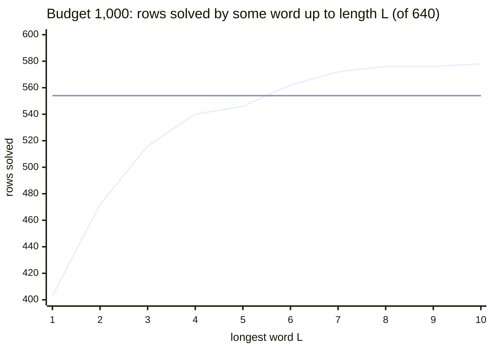

# AC-triviality, stable AC-triviality, and the 2- and 3-generator baselines

**TL;DR.** Sections 1 and 2 define Andrews-Curtis (AC) moves, stable AC moves and the greedy search all our experiments
use. Section 3 proves the fact behind the 3-generator search: adding a generator $z$ with the relator $z^{-1}w$ gives a
presentation that is AC-trivial whenever the original is, and whose AC-triviality proves the original stably
AC-trivial. Sections 4 and 5 are the two baselines on MS640 (LENGTH priority, relator cap 24):

- **Two generators:** the greedy solves 554 rows at 1,000 pops, 606 at 10,000 and all 640 at $10^6$.
- **Three generators:** at 1,000 pops, some word of length at most 10 solves 578 rows, 24 more than two generators.
  This counts only if the right word is known for each row in advance. No single word matches two generators: the best,
  chosen with hindsight, solves 528. At 10,000 pops the gain shrinks to 608 against 606. Two or three added generators
  do worse.

The rank-n sweep's code is in [RANK3.md](RANK3.md), and every stored number is in
[results/stable_ac/rank3_bf/](../results/stable_ac/rank3_bf/README.md).

---

## 1. Presentations and AC moves

**Words.** Let $X = \{x_1, \dots, x_n\}$ and let $F(X)$ be the free group on $X$. A word over $X^{\pm 1}$ is *freely
reduced* if it contains no factor $x x^{-1}$ or $x^{-1} x$. It is *cyclically reduced* if every cyclic permutation of it
is freely reduced. $|w|$ is the length of the freely reduced form of $w$. In the code and tables, a capital letter is an
inverse: `xxxYYYY` is $x^3 y^{-4}$.

**Definition 1.1 (balanced presentation).** A *presentation* is a pair $P = \langle X \mid R \rangle$ with
$R = (r_1, \dots, r_m)$ a tuple of cyclically reduced words. It presents the group
$G_P = F(X) / \langle\!\langle R \rangle\!\rangle$, where $\langle\!\langle R \rangle\!\rangle$ is the normal closure of
$R$. $P$ is *balanced* if $m = n$; $n$ is its *rank*. Its *total length* is $\lambda(P) = \sum_i |r_i|$. The
*trivial presentation* of rank $n$ is $T_n = \langle x_1, \dots, x_n \mid x_1, \dots, x_n \rangle$.

**Definition 1.2 (AC moves).** Let $P = \langle X \mid r_1, \dots, r_n \rangle$ be balanced. An *AC move* replaces one
relator $r_i$ and leaves the others unchanged:

| move | replacement | condition |
|---|---|---|
| AC1 | $r_i \mapsto r_i^{-1}$ | |
| AC2 | $r_i \mapsto r_i\, r_j$ | $j \ne i$ |
| AC3 | $r_i \mapsto u\, r_i\, u^{-1}$ | $u \in F(X)$ |

Each new relator is freely and cyclically reduced again. Every move is invertible by moves of the same kinds:
$r_i \mapsto r_i r_j^{-1}$ is AC1 on $r_j$, AC2, then AC1 on $r_j$ again. Two relators can be swapped by AC1 and AC2
alone. So the relation
$$P \sim_{AC} Q \iff Q \text{ is reached from } P \text{ by finitely many AC moves}$$
is an equivalence relation. $P$ is **AC-trivial** if $P \sim_{AC} T_n$.

**Lemma 1.3 (invariants).** If $P \sim_{AC} Q$, then:

1. $G_P \cong G_Q$; in fact, $\langle\!\langle R_P \rangle\!\rangle = \langle\!\langle R_Q \rangle\!\rangle$ in $F(X)$.
2. $|\det M(P)| = |\det M(Q)|$. Here $M(P) \in \mathbb{Z}^{n \times n}$ is the *exponent-sum matrix*: $M_{ij}$ is the
   exponent sum of $x_j$ in $r_i$.

In particular, an AC-trivial presentation presents the trivial group and has $|\det M| = 1$.

*Proof.* (1) Each move replaces $r_i$ by an element of the normal closure of the old relators, and the move is
invertible. (2) Abelianization sends $r_i$ to row $i$ of $M$. AC1 negates a row, AC2 adds row $j$ to row $i$, and AC3
changes no row. Each multiplies $M$ on the left by a unimodular matrix. Finally, $M(T_n) = I$. $\square$

Both invariants are necessary conditions for AC-triviality, not sufficient ones. Every verifier in the repository checks
$|\det M| = 1$ independently of the solver ([METHODS.md](METHODS.md) section 2).

**Conjecture 1.4 (Andrews-Curtis, 1965).** Every balanced presentation of the trivial group is AC-trivial.

The conjecture is open. It is widely believed to be false, and families of potential counterexamples are known.

**Example 1.5.**

- **Akbulut-Kirby.** $\mathrm{AK}(n) = \langle x, y \mid x^n y^{-(n+1)},\; xyx\,y^{-1}x^{-1}y^{-1} \rangle$ presents the
  trivial group for every $n \ge 2$. $\mathrm{AK}(2)$ is AC-trivial. $\mathrm{AK}(3)$
  (`xxxYYYY, xyxYXY`) is the standard test case.
- **Miller-Schupp.** For $n \ge 1$ and a word $w \in F(x, y)$ whose exponent sum in $x$ is 0,
  $$\mathrm{MS}(n, w) = \langle x, y \mid x^{-1} y^{n} x\, y^{-(n+1)},\; x^{-1} w \rangle$$
  presents the trivial group. Our benchmark **MS640** (`data/ms640_solved.txt`) is the 640 presentations of the
  1,190-row Miller-Schupp benchmark that the length greedy (section 2) solves at $10^6$ pops. All of them are
  therefore AC-trivial. Row 0 is $\mathrm{MS}(1, y)$, stored as `YYXyx, Yx`.

## 2. Stable AC moves

**Definition 2.1 (stable AC moves).** Let $z \notin X$. Besides AC1 to AC3, allow:

| move | effect | condition |
|---|---|---|
| AC4 (stabilize) | $\langle X \mid R \rangle \mapsto \langle X \sqcup \{z\} \mid R,\; z \rangle$ | |
| AC5 (destabilize) | $\langle X \sqcup \{z\} \mid R,\; z \rangle \mapsto \langle X \mid R \rangle$ | $z$ does not occur in $R$ |

$P \sim_{s} Q$ if $Q$ is reached from $P$ by finitely many moves AC1 to AC5. $P$ is **stably AC-trivial** if
$P \sim_s T_n$ for its rank $n$. Since $T_n$ destabilizes to the empty presentation, this is the same as
$P \sim_s T_m$ for any $m$.

Lemma 1.3(2) still holds: AC4 and AC5 change $M$ to $M \oplus (1)$ and back. AC-trivial implies stably AC-trivial, and
whether the converse holds is open. The stable form of Conjecture 1.4 is open as well.

**Lemma 2.2 (automorphisms).** Let $\varphi \in \mathrm{Aut}(F(X))$ and $\varphi(P) = \langle X \mid \varphi(r_1),
\dots, \varphi(r_n) \rangle$. Then $P$ is AC-trivial if and only if $\varphi(P)$ is.

*Proof.* $\varphi$ commutes with every move, since $\varphi(r_i r_j) = \varphi(r_i)\varphi(r_j)$ and
$\varphi(u r u^{-1}) = \varphi(u)\varphi(r)\varphi(u)^{-1}$. So a path $P \to T_n$ maps to a path
$\varphi(P) \to \langle X \mid \varphi(x_1), \dots, \varphi(x_n) \rangle$. The tuple $(\varphi(x_i))_i$ is a basis of
$F(X)$. By Nielsen's theorem, it is carried to $(x_i)_i$ by elementary Nielsen transformations (inverting an entry,
multiplying one entry by another, permuting entries), and these are AC1, AC2 and relator swaps. Apply the same argument
to $\varphi^{-1}$ for the converse. $\square$

The code uses Lemma 2.2 to *transport* a path found in another basis back to the row as written ([METHODS.md](METHODS.md)
section 8).

## 3. Greedy best-first search

All experiments below run the same search, in the S-moves of the paper's Definition 2.1. On rank $n$, an **S-move**
$(i, j, s, k_1, k_2)$ with $j \ne i$ and $s = \pm 1$ is
$$r_i \;\longmapsto\; \mathrm{rot}_{k_1}(r_i)\cdot \mathrm{rot}_{k_2}\big(r_j^{\,s}\big),$$
freely and cyclically reduced. $\mathrm{rot}_k$ moves the last $k$ letters to the front, and the move is generated only
if the two factors cancel at the seam. A rotation is a conjugation, so an S-move is a composite of AC3, AC1 and AC2 moves.

**States.** A state is a balanced presentation up to rotating or inverting a relator and reordering the relators. It is
stored in a canonical form: each relator is the least rotation of itself or its inverse, and the tuple is sorted.

**The search.** Fix:

- a priority $\pi$ on states (**LENGTH**: $\pi = \lambda$, the total length);
- a budget $B$ (the number of heap pops);
- a relator cap $c$: a child with any relator longer than $c$ is discarded.

The search keeps a heap ordered by $(\pi(Q), \operatorname{depth}(Q), \operatorname{key}(Q))$, a strict total order
(the key is the packed state), together with the set of states already seen. It pops at most $B$ times. Each pop checks
whether every relator has length 1. If so, the state is a permutation of $T_n$ up to inverses, and the row is
**solved**. Otherwise the pop pushes every unseen child within the cap. The path is the chain of parents, a sequence of
S-moves, and is replayed independently on the input before it counts.

**Remark 3.1 (budget and cap).**

- *Budget.* A search at budget $B$ performs exactly the first $B$ pops of the same search at any $B' > B$. So the set of
  rows solved, $\mathcal{S}_B$, grows with $B$, and a row that fails spends all $B$ pops.
- *Cap.* Every search records whether a child dropped by the cap would ever have been popped: its heap key is no larger
  than that of a later pop. If none would have been, the search is identical under every larger cap
  ([CAP.md](CAP.md)).

## 4. Baseline 1: two generators

**Setup.** MS640, LENGTH priority, cap $c = 24$; the rank-2 search of section 3 on $\mathrm{MS}(n, w)$ as given. We call
this the **control**.

| budget $B$ (pops) | $\lvert\mathcal{S}_B\rvert$ (of 640) | notes |
|---:|---:|---|
| 100 | 455 | read from the rank-3 study's control |
| 1,000 | **554** | mean path 12.09 S-moves; 122,208 pops in total |
| 10,000 | **606** | mean path 19.97, median 8 |
| 50,000 | 628 | |
| 1,000,000 | 640 | by definition of MS640 |

**Cost is two-humped.** At $10^6$ pops, the nodes per row are:

| min | median | mean | max | total |
|---:|---:|---:|---:|---:|
| 3 | 11 | 4,963.0 | 574,959 | 3,176,297 |

- The 529 easiest rows (difficulty bins 0 to 3) use 0.69% of all nodes.
- The 6 hardest rows use 66.8%, and the 20 hardest use 86.2%.
- Cost is not an invariant of the Aut($F_2$) orbit: one orbit spans 14,415 to 272,953 nodes.
- Cost and path length disagree. Rows 634 and 635 need about 574,000 nodes for an 80-move path. Row 623 needs 59,710
  nodes for 708 moves.

**A stronger 2-generator priority.** **S20_MK2**, $\pi = \lambda + 20S + 2\,\mathrm{MK}$, adds two block and knot
features ([METHODS.md](METHODS.md) section 6). It solves 574 rows at 1,000 pops and 626 at 10,000. At 10,000 pops its
solved set strictly contains LENGTH's (20 rows to 0). At $10^6$ it uses 994.8 nodes per row on average against 4,963.0.
The 3-generator search below exists only for LENGTH, so **LENGTH is the control throughout**.

Sources: [RESULTS.md](RESULTS.md) sections 1 and 2, `benchmark/difficulty_bins.csv`.

## 5. Baseline 2: three generators

### 5.1 The stabilized start

**Definition 5.1.** For a balanced $P = \langle X \mid R \rangle$ and words $w_1, \dots, w_k \in F(X)$, let
$z_1, \dots, z_k \notin X$ and
$$P_{w_1, \dots, w_k} = \big\langle X \sqcup \{z_1, \dots, z_k\} \;\big|\; R,\; z_1^{-1} w_1,\; \dots,\; z_k^{-1} w_k \big\rangle.$$
For $k = 1$, $P_w = \langle x, y, z \mid r_1, r_2, z^{-1} w \rangle$ is the **rank-3 start** (written `Z.w` in the code).
It presents the same group, since $z_i = w_i$ eliminates each $z_i$.

**Proposition 5.2.** For every $w_1, \dots, w_k$:
$$P \text{ AC-trivial} \;\Longrightarrow\; P_{w_1, \dots, w_k} \text{ AC-trivial} \;\Longrightarrow\; P \text{ stably AC-trivial}.$$

*Proof.* Take $k = 1$; the general case is the same argument repeated. Let $\varphi \in \mathrm{Aut}(F(X, z))$ fix $X$
and send $z \mapsto w^{-1} z$. It is an automorphism, with inverse $z \mapsto w z$. Let
$P^{+} = \langle X, z \mid R, z \rangle$. Since $\varphi$ fixes $R$ and $\varphi(z) = w^{-1} z$, the presentation
$\varphi(P^{+})$ is $P_w$ after one AC1 on its last relator. By Lemma 2.2, $P_w$ is AC-trivial if and only if $P^{+}$ is.

- *First implication.* If $P$ is AC-trivial, the same moves take $P^{+}$ to $T_{n+1}$.
- *Second implication.* If $P^{+} \sim_{AC} T_{n+1}$, then $P \xrightarrow{\text{AC4}} P^{+} \sim_{AC} T_{n+1}
  \xrightarrow{\text{AC5}} T_n$. $\square$

So a solve of $P_w$ is a certificate of **stable** AC-triviality of $P$, not of AC-triviality. The sweep counts these
solves and writes no certificate. To produce one, the n-generator package lifts the solve to elementary stable moves
([RANK3.md](RANK3.md), "The lift").

**Remark 5.3 (two cases).**

- *Null stabilization.* For $w = 1$, $P_1 = \langle X, z \mid R, z^{-1} \rangle$. Its extra relator already has
  length 1. In every row and at both budgets, the search on $P_1$ agrees pop for pop with the rank-2 control: same
  solved flag, same pops, same path length. This is checked on every run.
- *Inverse words.* $P_{w^{-1}}$ is the image of $P_w$ under $z \mapsto z^{-1}$, up to AC1, so the two are AC-trivial
  together (Lemma 2.2). Greedy breaks ties by letter, which is not invariant under this renaming. Up to $|w| \le 6$,
  80.3% of the pairs agree on solved flag and pops, and 0.6% differ in the flag. The sweep keeps one word from each pair
  $\{w, w^{-1}\}$.

### 5.2 The experiment

**Word families.** Let $\mathcal{W}_n$ contain one word from each pair $\{w, w^{-1}\}$ of nonempty freely reduced words
of length $n$ over $\{x, y\}^{\pm 1}$, in a fixed order. There are $4 \cdot 3^{n-1}$ such words. Since $F_2$ is
torsion-free, $w \ne w^{-1}$ for $w \ne 1$, so
$$|\mathcal{W}_n| = 2 \cdot 3^{n-1}, \qquad |\mathcal{W}_{\le L}| = \sum_{n=1}^{L} 2 \cdot 3^{n-1} = 3^{L} - 1 .$$
For $L = 10$, that is 59,048 words, or $640 \times 59{,}048 = 37{,}790{,}720$ searches at budget 1,000.

**Measures.** On a benchmark $D$ at budget $B$:
$$\mathcal{S}_B = \{P \in D : \text{the control solves } P\}, \qquad
\mathcal{F}_B(w) = \{P \in D : \text{the search solves } P_w\},$$
$$\mathcal{O}_B(\mathcal{W}) = \bigcup_{w \in \mathcal{W}} \mathcal{F}_B(w) \quad \text{(the oracle: the best word for each row, known in advance)},$$
$$\textit{gained} = \mathcal{O}_B \setminus \mathcal{S}_B, \qquad \textit{lost} = \mathcal{S}_B \setminus \mathcal{O}_B,
\qquad \textit{best fixed word} = \max_{w} |\mathcal{F}_B(w)| .$$

$\mathcal{O}_B$ answers an existence question: does some word make the greedy succeed? It is not a method, and its
cost is the sum over all the words. $\max_w |\mathcal{F}_B(w)|$ is the best a single fixed policy could do, chosen with
hindsight.

### 5.3 Results (MS640, LENGTH, cap 24)

**Budget 1,000, every word up to length 10.** The control solves $|\mathcal{S}| = 554$.

| $\lvert w\rvert$ | words | a random word solves | $\lvert\mathcal{O}(\mathcal{W}_{\le n})\rvert$ | gained | lost |
|---:|---:|---:|---:|---:|---:|
| 1 | 2 | 60.1% | 403 | 0 | 151 |
| 2 | 6 | 68.4% | 472 | 0 | 82 |
| 3 | 18 | 69.8% | 516 | 0 | 38 |
| 4 | 54 | 68.6% | 540 | 4 | 18 |
| 5 | 162 | 67.3% | 546 | 8 | 16 |
| 6 | 486 | 66.8% | 562 | 16 | 8 |
| 7 | 1,458 | 66.5% | 572 | 20 | 2 |
| 8 | 4,374 | 66.2% | 576 | 22 | 0 |
| 9 | 13,122 | 65.9% | 576 | 22 | 0 |
| 10 | 39,366 | 65.7% | **578** | **24** | **0** |



*Rising line: the oracle $|\mathcal{O}(\mathcal{W}_{\le L})|$. Flat line: the control's 554.*

What the table shows:

1. **The oracle passes the control only from length 6.** The word count triples at each length, but the oracle gains
   only a few rows, and nothing between lengths 8 and 9.
2. **A random word hurts.** On the 554 rows the control solves, a random word fails within 1,000 pops on 24.0% and needs
   more pops on 75.4%. It needs fewer pops on only 0.6%. A longer random word is no better: 69.8% at length 3 falls to
   65.7% at length 10.
3. **No fixed word helps.** None of the 59,048 words solves as many rows as the control. The best, $w =$ `yXYYYxyyy`,
   solves 528. A word chosen on one half of MS640 and scored on the other solves 258 and 264 of 320, where the control
   solves 281 and 273.
4. **The 24 gained rows are within the control's reach.** The control solves all 24 at a larger budget (1,160 to 26,838
   pops; 20 of them within 10,000). Trying the words in shortlex order until one succeeds costs at least 41,711 pops on
   each of the 24.

**Budget 10,000, words up to length 7** (2,186 words; 1,399,040 searches). With more pops the oracle's edge almost
disappears.

| $\mathcal{W}_{\le 7}$ | $B = 1{,}000$ | $B = 10{,}000$ |
|---|---:|---:|
| control $\lvert\mathcal{S}_B\rvert$ | 554 | 606 |
| oracle $\lvert\mathcal{O}_B\rvert$ | 572 | 608 |
| gained / lost | 20 / 2 | 6 / 4 |

**One word for every row, at a large budget.** At 500,000 pops, the arms $w = r_1$, $r_2$, $x$ and $y$ solve 619, 602,
540 and 523 rows, against 638 for two generators.

### 5.4 More generators

Here $k = 2$ and $k = 3$ in Definition 5.1, every unordered tuple with repeats allowed, at budget 1,000. Each is
compared with rank 3 on the same pool of words.

| | rank 3, $\lvert w\rvert \le 3$ | rank 4, $\lvert w_i\rvert \le 3$ | rank 3, $\lvert w\rvert \le 2$ | rank 5, $\lvert w_i\rvert \le 2$ |
|---|---:|---:|---:|---:|
| starts per row | 26 | 351 | 8 | 120 |
| a random start solves | 68.7% | 59.1% | 66.3% | 53.6% |
| rows solved by some start (control 554) | 516 | 506 | 472 | 416 |
| gained / lost | 0 / 38 | 0 / 48 | 0 / 82 | 0 / 138 |
| best single start | 478 | 454 | 449 | 376 |

Each added generator makes every measure worse, even though there are many more starts.

### 5.5 How far the numbers can be trusted

- **The cap.** Across all 40,098,032 searches of the study (ranks 3 to 5, both budgets, both controls), the cap
  dropped a child in 2,331,711. In none of them could a dropped child have been popped. By Remark 3.1, every search is
  therefore the one any larger cap runs.
- **Relabeling noise.** MS640 contains each of 319 presentations two or four times, up to renaming $x, y$.
  - Renaming changes the pop count by more than 14 to 21% in one pair of copies in ten, and flips the solved flag in up
    to 1.8% of pairs.
  - So a single "fewer pops than the control" is weak evidence.
  - Counting each class once: the control solves 276 of 319, the oracle 288, with 12 gained and 0 lost.
- **Verification.**
  - Every stored path (over 120,000) was replayed by a separate implementation, and 2,570 stored results were re-run with
    the reference solver: 0 mismatches.
  - Seven checking scripts were written from a prose description by testers who were not shown the code they check. All
    seven found 0 mismatches.
  - acx's sweep reproduces the study cell for cell at lengths 1 to 4 (51,200 cells).
- **Cost.** Budget 1,000 with lengths 1 to 10 took 1,329 core-hours, about 0.13 core-seconds per search. Budget 10,000
  with lengths 1 to 7 took 354 core-hours.

### 5.6 Conclusion of the baselines

For the LENGTH greedy, a third generator $z = w$ helps only as an oracle. The right word exists for 24 rows that two
generators miss at 1,000 pops, but nothing in the search finds it. Every fixed choice of word, and every random one,
solves fewer rows than two generators. The gain shrinks as the budget grows, and more generators do worse. Section 4
gives the two-generator numbers that the next steps must beat at equal pops. The next steps are to choose $w$ from the
presentation (a change of variables, [METHODS.md](METHODS.md) section 11) and to let the rank change during the search
(the hybrid's define and eliminate steps).

## Reproduce

```bash
python run.py --config configs/greedy_fast.toml --set search.budget=1000 --set name=ms640_length_b1000   # the 2-generator control
python run.py --config configs/rank3_bf.toml                                       # rank 3, |w| <= 4, budget 1,000 (~2 core-hours)
python run.py --config configs/rank3_bf.toml --set rankn.max_len=7 --set search.budget=10000 --set name=rank3_bf_b10000
python run.py --config configs/rank4_bf.toml --set name=rank4_bf_full              # rank 4; rank5_bf.toml likewise
python -m acx.ngen.sweep --config configs/rank3_bf.toml --set name=rank3_bf_check --verify 30
```

Without `--set name=...`, the rank-n commands overwrite the tracked `results/rank3_bf/summary.*`. Lengths 9 and 10 are
cluster jobs. The study's raw arrays are listed with their sha256 in
[`results/stable_ac/rank3_bf/MANIFEST.json`](../results/stable_ac/rank3_bf/MANIFEST.json).
