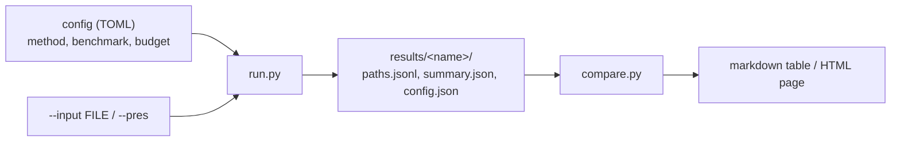

# Using `run.py` and `compare.py`

**TL;DR.** `python run.py --config <file.toml>` runs one method on a set of presentations and writes
`results/<name>/` (a record per row, a summary, the config). Running it again resumes. `python compare.py` puts
finished runs side by side. What each method does: [METHODS.md](METHODS.md); the relator cap: [CAP.md](CAP.md).



## Run

For a worked comparison from setup to retained evidence, see [EXPERIMENTS.md](EXPERIMENTS.md).

```bash
python run.py --config configs/greedy_fast.toml                                  # the config's benchmark (MS640)
python run.py --config configs/s20_mk2_fast.toml --set benchmark=bench60 --rows 0:10
python run.py --config configs/hybrid.toml --input examples/presentations.csv      # your own file
python run.py --config configs/hybrid.toml --pres "xxYYY, xyxYXY" --pres "YYXyx, Yx"
```

| flag | what it does |
|---|---|
| `--config FILE` | the run's config (required): one per method in `configs/`, every key in `configs/template.toml` |
| `--set KEY=VALUE` | override a config value, repeatable; a dotted key reaches a section (`--set search.cap=none`); the value is read as TOML, else as a plain string |
| `--input PATH` | run every presentation of your own file instead of the config's `benchmark` and `rows` |
| `--pres "R1, R2"` | run a typed presentation, repeatable; saved as `<out>/<name>/input.txt`; prints one line each (id, solved, kind, cost, sub_moves, elem_moves) |
| `--rows SPEC` | a slice `a:b` or `a:b:c` (integers) of the row list, else ids `3, 17` (an id may hold a colon, `ms:1`) |
| `--solved-from RUN_DIR` | only the rows `RUN_DIR/paths.jsonl` marks solved, in its order (not with `--rows`); see [Faster runs](#faster-runs) |
| `--out DIR` | the results root (default `results`) |
| `--fresh` | delete this run name's earlier results first |

## Inputs

`--rows ""` clears the config's selection. A TOML list such as `rows = ["one,two", "0:1"]` selects literal ids,
including commas, surrounding whitespace or slice-like names; `--solved-from` preserves these ids literally too.

**Shipped sets**, by name (`--set benchmark=<name>`; [benchmark/README.md](../benchmark/README.md) describes them).
`python -c "import acx.data as d; print(*d.DATASETS, *d.BENCHMARKS, *d.SPLITS)"` lists them.

| names | row id |
|---|---|
| `ms640`, `1190ms`, `ms_unsolved`, `ac19`, `ac19_extended`, `ac1m` (the datasets in `data/`) | the line number, from 0 |
| `bench10`, `bench20`, `bench40`, `bench60` | the `pres_id` column (the MS640 line) |
| `ladder20` .. `ladder500`, `ladder20_s20hard` .. `ladder300_s20hard`, `ac19_autmin`, `ac1m_autmin`, `u124` | the `name` column |
| `ac1m_hard_holdout60` | `idx` (the AC1M line) |

**Your own file** (`--input PATH` or `benchmark = "PATH"`): UTF-8, optionally gzipped (`.txt.gz`, ...). Generators
are `x y z a b c ... w`, upper case the inverse, then `g27`, `g28`, ... (`G27` the inverse).

| format | one presentation | row id |
|---|---|---|
| `.txt` | relators separated by commas or spaces, `xxYYY, xyxYXY`; `#` starts a comment; a line of integers (`x = 1`, `y = 2`, negative = inverse, two zero-padded halves, the layout of `data/*.txt`) also loads | position, from 0 |
| `.csv` | a header with relator columns `r1, r2, ... rN` (empty cells skipped) | `id`, else `name`, else `pres_id`, else position |
| `.jsonl` | `{"id": "ak2", "relators": ["xxYYY", "xyxYXY"]}` | `id`, else position |

Other CSV columns and JSON keys become the row's `meta`. A bad line stops the run with `<file>:<line>: <what is
wrong>`; a repeated id, a file that is not UTF-8 and a broken gzip stop it too.

**What each method takes.** `greedy` with `length` and `ngen`: any number of generators. `s20_mk2`, `aut`, `cov`,
`hybrid`, `rl`: two generators and two relators (`rl` also at most 24 letters each). A row a method cannot take, or
with `|det| != 1` (never AC-trivial), is written unsolved with an `error` and the run goes on. `rankn` refuses the
whole run, before writing, if any row is not two generators and two relators.

## Run names, resume and `--fresh`

The run folder is `<out>/<name>/`. `name` is the config's `name` key, else the config file's stem; with `--input` or
`--pres` and no name it is `<config name>_<file stem>` or `<config name>_pres`. A name is one directory component (no
separators, `.` or `..`); run folders and result files may not be symlinks.

- **Resume.** Rows already in `paths.jsonl` are skipped; another `--rows` adds rows to the same folder. A record
  counts only for the presentation in its `pres`: a changed row is solved again, a row gone from the input is dropped
  (records without `pres` count by id). A row recorded with an `error` is not retried. A cut-off last line is dropped;
  a bad earlier line stops the run (`<file>:<line>: not a record ...`). `summary.json` is rewritten each time and
  covers every record. Configs, summaries and rewritten record files are replaced atomically. One writer per folder;
  `workers` parallelises inside it.
- **Refusals.** Another config under the same name (`holds a run with another config: pass --fresh or another name`;
  `rows` and `workers` aside), another `--pres` set, a `paths.jsonl` without `config.json`, and a run of fewer rows
  into a published folder (`holds a published summary of N rows: a run of M would replace it`).
- **`--fresh`** deletes the name's `paths.jsonl`, `config.json` and `summary.json` first (rank-n: `rows/` and its
  result files, keeping `input.txt`). **Never `--fresh` a shipped folder in `results/`**: pick `--set name=mine` or
  another `--out`. Rank-n resume checks every stored row against the whole current input; a changed row needs
  `--fresh` or a new name.

New runs write **`provenance.json`** with source content and Python/dependency identity plus each invocation's git,
host, thread, backend, worker and selection context. Source/runtime drift refuses resume before result files change;
use another name after changing code or dependencies. `--fresh` replaces the history. Older folders without it may
resume with `prior_results_untracked: true`: their earlier results cannot be attributed to the current source.
Duplicate record ids are rejected consistently by resume and reporting. Details: [EXPERIMENTS.md](EXPERIMENTS.md).

## The config

Top-level keys, then one section per part of the method; [`configs/template.toml`](../configs/template.toml) lists
every key with its default. An unknown key, a section the method does not read, or a bad value is an error before
anything is written. Types are checked: a switch is TOML `true`/`false` (`--set path=False` is a string, an error);
`name` and `benchmark` are strings (quote a number or date: `--set 'name="123"'`); budgets, `workers`, `rl.width` and
`rl.steps` are ints >= 1; `rl.alpha` is finite and `hybrid.dyn_ratio` a finite number >= 0; `rankn.extra` is 1, 2 or 3 and `rankn.sample`
in [0, 1].

| top-level key | default | meaning |
|---|---|---|
| `name` | the file's stem | the run folder |
| `method` | required | `greedy`, `aut`, `cov`, `hybrid`, `ngen`, `rl` or `rankn` |
| `benchmark` | required | a shipped name or a file path |
| `rows` | every row | as `--rows` |
| `workers` | 1 | processes solving rows in parallel |
| `decode` | true | count each S-move path in elementary moves too (`elem_moves`); the hybrid and aut give it either way |
| `path` | true | keep and replay each path; false is faster ([Faster runs](#faster-runs)) |
| `fields` | every key | write only these record keys |

| section | methods | keys |
|---|---|---|
| `[search]` | greedy, aut, cov, ngen, rankn | `priority` (`length`, `s20_mk2`), `cap` (24; an int or `"none"`), `budget` (pops, 10,000), `backend` (`fast`, numba, in a run; `spec`, the pure-Python reference at 32x the CPU, is set only by `baseline_spec.toml`), `cyclic` |
| `[cov]` | cov | `total_budget` (pops a row over all images), `control`, `cap_headroom`, `max_len`, `until`, `family` (`"subnc2pxysb"`, the default of every published run, or the exhaustive `"suballpxyb8"`; [METHODS.md](METHODS.md) section 11) |
| `[ngen]` | ngen | `sac`: transform to relators of length at most 3 first |
| `[hybrid]` | hybrid | `budget` (work units), limits `r2_cap`, `dyn_cap`, `slack` (int or `"none"`; `r2_cap` also `"parent"`), `penalty` (int >= 0), `min_uses` (int >= 1), `dyn_ratio`, `backend` |
| `[rl]` | rl | the beam's `width`, `steps`, `alpha`, `cap` |
| `[rankn]` | rankn | `extra`, `min_len`, `max_len`, `inverse`, `sample` ([RANK3.md](RANK3.md)) |

## What a run writes

`config.json` is the config the records were made with. `paths.jsonl` has one record per row:

| field | meaning |
|---|---|
| `id`, `pres`, `solved` | the row, its presentation (`xxYYY, xyxYXY`; resume compares it), solved or not |
| `kind` | `ac_path` (AC moves on the row) or `stable_cert` (AC4/AC5 moves or a change of variables); null if unsolved |
| `aut_assisted` | an `ac_path` found in another basis and carried back to the row |
| `cost` | what the row spent, solved or not: heap pops, hybrid work units or rl network evaluations |
| `sub_moves` | substitution moves (S-moves) of the path |
| `elem_moves` | elementary AC moves on the row; null without `path`, for a CoV `stable_cert`, and without `decode` (except hybrid and aut) |
| `path` | the S-moves, `[i, j, s, k1, k2]` each (`acx.core.moves.decode_path`) |
| `elementary` | the elementary moves, packed (`acx.verify.pack.unpack`): aut-assisted, hybrid, n-generator and CoV paths |
| `verified` | the path was replayed on the row before the record was written; false with `path = false` |
| `error` | only on a row not searched or whose method failed: `Type: message` |
| `seconds`, `cpu_seconds` | wall and CPU time of the row, replay and decoding included |
| `cap`, `cap_dropped`, `cap_dropped_min_total`, `cap_would_pop`, `cap_first_bind`, `cap_needed` | cap counters ([CAP.md](CAP.md)); the hybrid adds `dyn_cap_*` and `slack_*`, CoV `cap_legs_bound` |
| extras | `rep` (aut: the form searched), `image` (cov), `steps` (cov `stable_cert`, hybrid), `stage` (hybrid: `terminal`, `B`, `C`, `H`), `rank` (ngen), `skipped` (rl: why not searched) |

`summary.json`:

| key | meaning |
|---|---|
| `name`, `method`, `benchmark`, `config` | what ran (`config` without `rows` and `workers`) |
| `rows`, `solved`, `errors`, `skipped` | counts over the records |
| `ac_path`, `aut_assisted`, `stable_cert` | solves by kind (`ac_path` counts the plain ones) |
| `cost`, `cost_unit`, `cost_mean`, `cost_median` | `unit`, `total`, `on_solved`; `pops`, `units` or `evaluations`; mean and median per row over all rows |
| `path_length` | per kind, `sub_moves` and `elem_moves`: `n`, `sum`, `mean`, `median`, `max` |
| `caps` | the cap counters over the rows, one block per limit ([CAP.md](CAP.md)) |
| `wall_seconds`, `row_seconds`, `cpu_seconds`, `us_per_cost` | this invocation's wall time; summed row wall and CPU; CPU microseconds per pop, unit or evaluation (null without `cpu_seconds`) |

The rank-n sweep writes `rows/<id>.npz` and its own summary instead ([RANK3.md](RANK3.md)).

## Faster runs

- **`path = false`**: no parent links, action history or elementary path; nothing is decoded, transported, replayed
  or stored (CoV still checks orbit membership to type a solve). Records keep `solved`, `kind`, `cost`,
  `sub_moves` and the cap counters; `path`, `elementary` and `elem_moves` are null and `verified` is false. CPU saved
  per method: [PERFORMANCE.md](PERFORMANCE.md#recording-the-path).
- **Decode later.** `--solved-from RUN_DIR` runs only the rows that run solved. The search is deterministic, so the
  same config with `path = true` finds the same solves at the same cost, now decoded and replayed. Use the same input
  and another name; a folder without `paths.jsonl` (a shipped one) or with no solve stops with one line, and an id
  whose stored `pres` differs is refused.

  ```bash
  python run.py --config configs/hybrid.toml --set path=false --set name=ms640_fast
  python run.py --config configs/hybrid.toml --set path=true --solved-from results/ms640_fast --set name=ms640_fast_paths
  ```

- **`fields = ["solved", "cost", "sub_moves"]`** keeps records small (`id`, `pres`, `solved`, `error` are always
  written); the summary counts only what is written (no `kind`: every kind 0; no `cpu_seconds`: null timings).
- **`workers = 4`** solves rows in four processes; keep `NUMBA_NUM_THREADS=1`. Each worker first solves AK(2),
  unrecorded, so compiling and loading are not timed; time a method over many pops.
- **`cap = "none"`** drops and counts nothing but searches a larger graph (more CPU and memory per pop; see
  [PERFORMANCE.md](PERFORMANCE.md#relator-cap)). When the cap matters: [CAP.md](CAP.md).

## Compare runs

```bash
python compare.py results/greedy_fast_presentations results/hybrid_presentations
python compare.py results/greedy_fast_presentations results/hybrid_presentations --common --html compare.html
```

One markdown row per run: rows, solved (%), mean and median cost of the solved rows in the run's unit, mean
`sub_moves` and `elem_moves` (`n=k` when only k solved rows have one), CPU seconds per row, CPU µs per pop or unit
(`us_per_cost`, verification included), raise-cap rows (exact when one cap counter binds, a lower bound when several
do and a `raise_ids` list was cut at 100) and errors. Two runs of one benchmark also get a head-to-head line (solved
by only one, both, neither).

- **Units.** greedy, aut, cov and ngen count heap pops; the hybrid counts work units (pops of its two queues plus the
  automorphisms, Nielsen images and S-moves of its cascade and gates); rl counts network evaluations. Compare cost
  only within one unit; compare solve rates across all.
- **`--common`** averages over the rows every run solved, so solving only easy rows does not look cheap.
  Head-to-head and `--common` refuse shared ids whose `pres` differ.
- **`--html FILE`** also writes one page: the table and bar charts of solve rate, mean cost per solved row (log
  scale) and CPU µs per pop or unit, a panel per unit.
- Values marked `*` are wall-clock seconds from runs that predate `cpu_seconds`. The folders shipped in `results/`
  have no `paths.jsonl`: their row comes from `summary.json` (`-` for median and CPU), and they take no part in
  `--common` or head-to-head ([RESULTS.md](RESULTS.md) section 0 has each command to rerun).

## From Python

```python
from acx import replay, search
from acx.data import parse_presentation, rows

p = parse_presentation("xxYXY, xyyXY")
res = search(p, backend="fast", budget=1000)      # any SearchConfig field; cap=None is uncapped
res.solved, res.pops, res.path_length             # (True, 7, 5)
replay(p, res.path)                               # raises ReplayError unless the path reaches <x, y | x, y>
res.stats["cap_would_pop"]                        # 0: the cap (24) did not change this search
rows("bench60")[0]                                # Row(id, pres, meta)
```

To check a finished run again, replay its records ([METHODS.md](METHODS.md) section 14).
