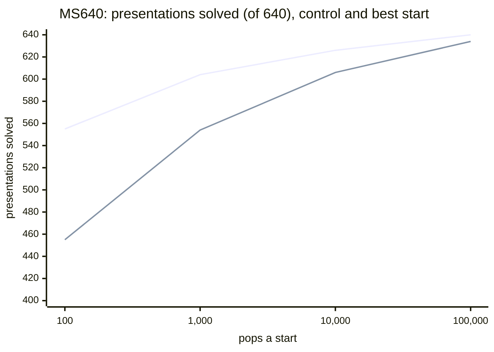

# Exhaustive CoV sweep (`suballpxyb8`) on MS640

**TL;DR.** The baseline LENGTH greedy (here `acx.search` with `priority = "length"`) searched all 640 rows of
`data/ms640_solved.txt` from the untransformed presentation (the control, cap 24) and from every distinct
change-of-variables class of the family `suballpxyb8` (114,042 starts, each at its own cap), at **100, 10,000 and
100,000 pops a start** (1,000 is read off the 100,000 run). The **best start** (an oracle, known in advance) solves
**555 / 604 / 626 / 640** presentations against the control's **455 / 554 / 606 / 634**, but its real price, summed
over every start of a presentation, is a mean of 5,328 to 657,198 nodes, and a random start is cheaper than the
control in only 26.2% to 33.7% of cases. Every presentation a start gains over the control also has a solving start in
its own Aut(F2) orbit. Made on `cov/all-subsets-sweep` (tip `fb84a588`, 10 to 12 Oct 2026).



*Upper line: the best of a presentation's starts (an oracle); lower line: the control. The oracle's edge falls from
100 presentations at 100 pops to 6 at 100,000.*

`pres_id` is the 0-based line of `data/ms640_solved.txt`; subset 60's `pres_id`s are the rows of `bench60`
(`benchmark/subsets/benchmark_subset_60.csv`). The source's starts come from
`cov/all-subsets-sweep:experiments/stable_ac/cov/cov_all.py` and run at cap `res.cap`; the greedy is the source's
`run_baseline.greedy_search`, unchanged.

## In this checkout

- **Here**: the summaries of all three budgets, the per-presentation table, the control-versus-start tables and plots,
  the runner logs, and the 100,000 file `cov_all_suballpxyb8_ms640_b100000.jsonl.gz` (4.1 MB, every start of every
  row with its transform). It is the only raw file kept: the 100 and 10,000 files repeat its rows up to their budget.
- **Not here**, listed in [`MANIFEST.json`](MANIFEST.json) (size, sha256, source commit, S3 prefix): the raw 100 and
  10,000 files (`.jsonl.gz`, 4.4 and 4.1 MB) and the three uncompressed `.jsonl` (88 to 96 MB each, S3 only; each the
  gunzip of its budget's `.jsonl.gz`). Fetch one with `git show fb84a588:results/stable_ac/cov_all/<file> > <file>`.
  Raw files are in `s3://acsolver-u124-205558941715/cov_all/b<budget>/results/` (the 100,000 prefix confirmed; the 100
  and 10,000 ones follow the same pattern, not listed).
- **acx reproduces it**: `acx.cov` enumerates exactly the 114,042 MS640 starts (`enumerate_images(pres,
  family="suballpxyb8")`, or `--set cov.family=suballpxyb8`; pinned by `tests/test_cov.py`); `acx.search` (LENGTH, the
  row's cap and budget) gives a row's `nodes_explored` and `path_length` again (checked on 100 random rows); `acx.cov`
  and `acx.verify` check the stored certificates and paths ([below](#reproduce-and-verify-with-acx)).
  `tests/test_cov_all_study.py` pins the headline numbers, the csv sums, the file counts, the best-start split by kind
  and the caps.
- **No acx command** for the per-start driver (`run_cov_all.py`), the `--counts` checks of `verify_cov_all.py`, or the
  summary, table and plot scripts ([below](#the-code-on-the-source-branch)). `python run.py --config configs/cov.toml
  --set benchmark=ms640 --set cov.family=suballpxyb8` is a different experiment (the one-shot method: first solving
  start, 1,000 pops a start, 10,000 a row).

| file | what | where |
|---|---|---|
| `cov_all_suballpxyb8_ms640_b100.jsonl.gz` | budget 100: 114,682 rows (640 controls + 114,042 CoV), every solved path stored as `path_moves` | manifest |
| `cov_all_suballpxyb8_ms640_b10000.jsonl.gz` | budget 10,000: the same rows; `path_moves` on a 2% hash sample of solved rows (`--path-sample 0.02`), others keep `path_length` and `nodes_explored` | manifest |
| `cov_all_suballpxyb8_ms640_b100000.jsonl.gz` | budget 100,000: the same rows, same 2% path sample | here |
| `*.jsonl` (three, uncompressed) | the three files above unpacked | manifest, S3 |
| `cov_all_suballpxyb8_ms640_b10000_subset60_summary.*` | the budget 10,000 statistics on subset 60's 60 `pres_id`s | here |
| `*_control_vs_cov.png` / `.md` | nodes from a random CoV start against the control's, with y = x (`plot_cov_all_control_vs_cov`; budgets 10,000 and 100,000) | here |
| `cov_all_suballpxyb8_ms640_b100000_per_presentation.csv` | per presentation: the control, its number of starts, the best start and its substitution, the cheaper / equal / dearer / unsolved split (`table_cov_all_per_presentation`); its node counts answer every smaller budget | here |
| `*_summary.md` / `*_summary.json` | per-presentation statistics aggregated (`summarize_cov_all`) | here |
| `*.log` | runner log: start, enumeration, progress, wall time | here |
| `MANIFEST.json` | the raw files with size and sha256, the source commit, the S3 prefix | here |

Each row records how its start was made: `z_word`, `pattern` (chosen occurrences `[start, ±1]` of w / w⁻¹ in the
cyclically reduced r1 and r2), `r1_substituted`, `r2_substituted` (generator 3 = z), `defining_relator` (Z·w),
`iso_gen` (the eliminated generator), `iso_index` (0 = solved from r1′, 1 = from r2′) and `iso_expr`. CoV path lengths
are in transformed coordinates: a solve certifies stable AC-triviality. `path_moves` are the baseline's
`target_jsign_k1_k2` strings, which `acx.core.moves.decode_path` reads as they are.

## Reproduce and verify with acx

`acx.cov.check_cert` replays a row's transform (define `z`, substitute, eliminate) and then its stored path on the
start it made; `acx.verify.replay` replays a control's path on the row. This checks every sampled row of the 100,000
file (2,251 CoV certificates and 12 control paths, a few seconds; the test runs this block):

```python
import gzip
import json
from collections import Counter

from acx.core.moves import decode_path
from acx.core.words import Presentation, parse
from acx.cov import check_cert
from acx.verify import replay

FILE = "results/stable_ac/cov_all/cov_all_suballpxyb8_ms640_b100000.jsonl.gz"
checked = Counter()
with gzip.open(FILE, "rt") as rows:
    for line in rows:
        row = json.loads(line)
        if "path_moves" not in row:               # only a 2% sample of the solved rows keeps its path
            continue
        start = Presentation.parse(row["r1_orig"], row["r2_orig"])
        path = decode_path(row["path_moves"])
        if row["is_control"]:                     # the control searched the row itself
            replay(start, path, cyclic=row["cyclic_reduce"], cap=row["max_relator_length_cap"])
        else:                                     # a start: replay the transform, then the path on its image
            steps = ({"op": "define", "word": parse(row["z_word"])},
                     {"op": "substitute", "rels": (tuple(row["r1_substituted"]), tuple(row["r2_substituted"]))},
                     {"op": "eliminate", "gen": parse(row["iso_gen"])[0], "target": row["iso_index"] + 1,
                      "expr": tuple(row["iso_expr"])})
            check_cert(start, steps, path, cap=row["max_relator_length_cap"], cyclic=row["cyclic_reduce"])
        checked["control" if row["is_control"] else "cov"] += 1
print(dict(checked))                              # {'cov': 2251, 'control': 12}
```

The slow tests of `tests/test_cov_all_study.py` go further: `acx.cov.apply_steps` rebuilds `r1`, `r2` from the
transform of all 114,042 CoV rows, and `acx.search` (LENGTH, fast backend, the row's cap and budget) pops as many
states and finds as long a path as the sweep on 100 random solved rows (at most 20,000 pops each); the search path of
the 98% of rows without `path_moves` regenerates that way.

| source branch | acx |
|---|---|
| `run_cov_all --budget B --workers N --path-sample P` | no command: enumerate with `acx.cov.enumerate_images(..., family="suballpxyb8")`, search each start with `acx.search` |
| `verify_cov_all FILE` | the snippet above for transforms and stored paths; nothing for the `--counts` class checks |
| `summarize_cov_all`, `table_cov_all_per_presentation`, `plot_cov_all_control_vs_cov` | none; their output is the summaries, csv and plots here |
| `aws_cov_all_box.sh` | none (size the workers by memory, see the checks) |

## The code on the source branch

Not in this checkout; on `cov/all-subsets-sweep` (`fb84a588`), e.g. `git show
cov/all-subsets-sweep:experiments/stable_ac/cov/cov_all.py`: the enumerator `experiments/stable_ac/cov/cov_all.py`, the
runner `run/run_cov_all.py`, the checker `verify/verify_cov_all.py`, `run/summarize_cov_all.py`,
`run/plot_cov_all_control_vs_cov.py`, `run/table_cov_all_per_presentation.py`, the box script
`run/aws_cov_all_box.sh` (EC2 user-data, one autonomous box per attempt; settings at its top), and the tests
`tests/stable_ac/test_cov_all.py` (`run/` and `verify/` under `experiments/stable_ac/cov/`). From the repo root,
`PYTHONPATH=.`, gunzip first:

    python3 -m experiments.stable_ac.cov.run.run_cov_all --budget 100 --workers N --path-sample 1
    python3 -m experiments.stable_ac.cov.verify.verify_cov_all FILE.jsonl --counts --dataset data/ms640_solved.txt --path-sample 1
    python3 -m experiments.stable_ac.cov.run.summarize_cov_all FILE.jsonl
    python3 -m experiments.stable_ac.cov.run.plot_cov_all_control_vs_cov FILE.jsonl
    python3 -m experiments.stable_ac.cov.run.table_cov_all_per_presentation FILE.jsonl

## Checks (on the source branch; logs are the `*.log` files here, box logs in S3)

| budget | rows | one-pattern | solved | paths replayed to the trivial presentation | failures | notes |
|---:|---:|---:|---:|---:|---:|---|
| 100 | 114,682 | 14,051 | 90,234 | 90,234 (through `greedy_tests/spec`) | 0 | |
| 10,000 | 114,682 | 14,051 | 106,843 | 2,147 sampled | 0 | 64 workers on a c7a.16xlarge, code `99968da`; on the box and the downloaded file (`--counts --dataset data/ms640_solved.txt --path-sample 0.02`); every row solved within 100 nodes equals the 100 file; 47.5 min wall (19.0 subset 60 first, 28.5 the other 580), 49.8 CPU-hours |
| 100,000 | 114,682 | 14,051 | 111,878 | 2,263 sampled | 0 | code `f2ffd98`; on the box and the downloaded file; every row solved within 10,000 nodes equals the 10,000 file and no other row solves within 10,000; 335.2 CPU-hours |

**Size the workers by memory at 100,000.** 192 workers on a c7a.48xlarge (384 GB) returned 113,040 rows, then stalled
with 1,642 never returned (more chunks of 4 than workers: lost, not slow). Resumed from the same file with 96 workers on
an r7i.24xlarge (768 GB), those rows peaked at about 560 GB, 5.8 GB a worker for the path-recording greedy, which 192
workers cannot have in 384 GB, and a `multiprocessing.Pool` never returns a killed worker's chunk. (Inferred, not
observed: no console access.)

## Results

Presentations solved (of 640; subset 60 in brackets), oracle = the best start of the family:

| budget a start | control | oracle, all starts | oracle, one-pattern starts |
|---|---|---|---|
| 100 | 455 (17) | 555 (34) | 555 (34) |
| 1,000 | 554 (29) | 604 (45) | 604 (45) |
| 10,000 | 606 (40) | 626 (52) | 626 (52) |
| 100,000 | 634 (54) | 640 (60) | 640 (60) |

- No presentation changes outcome because of a start outside the one-pattern set, at any budget; the best such start
  is 1 or 2 nodes cheaper on 19 presentations, and at 100,000 it beats the best one-pattern start on 21, by at most 59
  nodes.
- At 10,000 the 20 presentations solved only from a CoV start are `pres_id` 568, 570, 573, 575, 578, 583, 584, 588,
  596, 603, 604, 605, 610, 613, 628, 629, 630, 633, 634, 635, and the 14 no start solves are 616-625 and 636-639.
- At 100,000 every presentation is solved from some start; the control fails 6 (`pres_id` 634-639, each solved by 16
  or 17 of its starts); 2,804 rows in 140 presentations are still unsolved.
- Searches solved (of 114,682): 90,234 at 100 (455 control + 89,779 CoV), 101,108 at 1,000, 106,843 at 10,000 (606 +
  106,237), 111,878 at 100,000 (634 + 111,244). 178 starts a presentation on average, 5 to 10,740.
- **The oracle's price** is the sum over all starts of a presentation: a mean of 5,328 nodes at 100, 164,759 at 10,000
  and 657,198 at 100,000 (1.1, 49.8 and 335.2 CPU-hours of search), against 16 to 1,663 for the control's own search.

A random start against the control (`*_control_vs_cov`; each presentation weighted equally; a start is cheaper when it
solves and the control does not). The cheaper share stays near a third whatever the control costs:

| budget a start | cheaper | equal | dearer | unsolved |
|---|---:|---:|---:|---:|
| 100 | 26.2% | 9.5% | 31.6% | 32.7% |
| 1,000 | 30.9% | 9.6% | 41.8% | 17.7% |
| 10,000 | 33.0% | 9.6% | 48.2% | 9.2% |
| 100,000 | 33.7% | 9.6% | 52.4% | 4.2% |

(The source README printed 48.3 at 10,000; the stored value is 0.4825 and the summaries print 48.2.)

**AC path or stable AC.** The files do not type a solve. By acx's typing ([the main
README](../../../README.md#ac-path-or-stable-ac)), a start whose Aut(F2)-canonical form `aut_canon_cov` equals
`aut_canon_orig` is in the row's orbit and its solve carries back to an aut-assisted `ac_path`; a start outside the
orbit gives a `stable_cert`. 7,206 starts are in the orbit; of the 111,244 solved starts at 100,000, 6,856 are and
104,388 are not. The best start of a presentation (the cheapest solving search, ties to the control):

| budget a start | control (`ac_path`) | in the orbit (`ac_path`, aut-assisted) | outside (`stable_cert`) | unsolved |
|---|---:|---:|---:|---:|
| 100 | 0 | 269 | 286 | 85 |
| 1,000 | 1 | 304 | 299 | 36 |
| 10,000 | 3 | 323 | 300 | 14 |
| 100,000 | 3 | 329 | 308 | 0 |

Every presentation the control fails but some start solves (100, 50, 20 and 6 at the four budgets) also has a solving
start in its orbit, so no gain over the control needs a `stable_cert`. The six rows 634 to 639, unsolved by the
control at 100,000 pops and cap 24, stay unsolved at cap 64 and uncapped: not a cap artifact.

**Cap.** The sweep predates the cap counters ([docs/CAP.md](../../../docs/CAP.md)): a row records only its cap, never
whether the cap dropped a child, so these files cannot show that the cap decided no pop. The control ran at cap 24, a
start at `max(24, its longer relator + 16)`, 24 to 91 (109,336 of the 114,042 starts above 24). The caps differ
between control and start, as in [docs/RESULTS.md](../../../docs/RESULTS.md) section 5, which compares this sweep with
the default family of `acx.cov`.

Subset 60 is `pres_id` 0, 43, 48, 77, 141, 155, 201, 203, 217, 228, 247, 265, 288, 323, 327, 331, 333, 367, 380, 455,
496, 505, 521, 533, 538, 543, 544, 546, 548, 549, 565, 568, 573, 575, 578-581, 583, 586, 589, 596, 602, 605, 606, 609,
610, 622-625, 628, 632-639.
