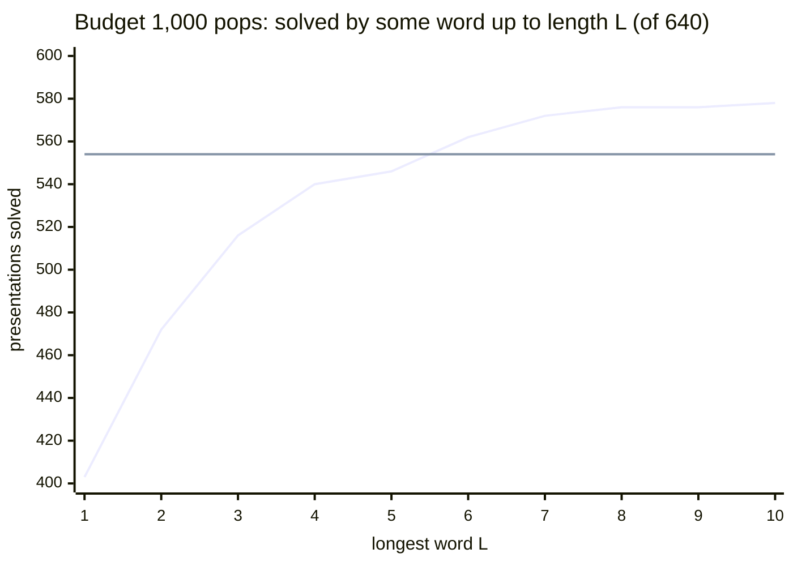

# 3-, 4- and 5-generator brute-force baseline on MS640

**TL;DR.** Adding a generator `z` and a relator `Z·w` helps the length greedy only if the right word is known for
each presentation in advance. At **budget 1,000 pops**, over all 59,048 words of length 1 to 10 (37,790,720
searches), some word solves **578** of 640 against the control's **554**, but a random word solves fewer (it fails
24.0% of the presentations the control solves), the best single word picked with hindsight solves 528, words tried in
shortlex order cost more than the control, and two or three added generators do worse (506, 416). At **budget 10,000**
(lengths 1 to 7) the oracle's edge shrinks to 608 against 606. **Final at cap 24 (13 Oct 2026)**: every sweep passed
its verifier, and in none of the 40,098,032 searches could the cap have changed the search.

*Rising line: the oracle (the best word for each presentation, known in advance); flat line: the control's 554. Three
times as many words at each length buy a few presentations, and the oracle passes the control only from length 6.*

## In this checkout

This folder is `results/stable_ac/rank3_bf/` of `rank3/brute-force-baseline` at `f2d53ced` without its raw
per-search files. This README is rewritten for this checkout from the source's; its tables and numbers are the
source's.

- **Here** (3.8 MB): the summaries, class views, per-presentation and per-word tables, the graphs, the cap tables
  (`cap/`) and the check logs, 90 files byte for byte the source's.
- **Not here:** the 102 raw files (`*.npz`, `*.jsonl`, `*.jsonl.gz`, 70.5 MB), listed with size and sha256 in
  [`MANIFEST.json`](MANIFEST.json). Fetch one from a clone with the source branch,
  `git show f2d53ced:results/stable_ac/rank3_bf/<file> > <file>`; git ignores it here, and `tests/test_rank3_study.py`
  checks it against the manifest.
- **Not on this branch either:** the per-block partial files and machine logs
  (`s3://acsolver-u124-205558941715/cov_all/rank3_bf/`), the study's `PLAN.md` (every `PLAN §n` below is a section of
  `rank3/brute-force-baseline:experiments/stable_ac/rank3/PLAN.md`) and its code (`experiments/stable_ac/rank3/`,
  `solvern*.py`, `tests/stable_ac/`), cited as `rank3/brute-force-baseline:<path>`.
- **Rerun with acx:** `python run.py --config configs/rank3_bf.toml` searches lengths 1 to 4 at budget 1,000 again
  (about 2 core-hours) and equals this study cell for cell (51,200 cells); without `--set name=...` it rewrites the
  tracked `results/rank3_bf/summary.*`. [Reproduce with acx](#reproduce-with-acx) lists the other commands.

## Setup and terms

| term | meaning |
|---|---|
| **MS640** | the 640 Miller–Schupp presentations `<x,y \| r1,r2>` of `data/ms640_solved.txt`; a capital letter is an inverse |
| **Greedy** | the published baseline `run_baseline.greedy_search`: best-first over AC moves by total relator length; **nodes** = states popped (the cost unit); **budget** 1,000 or 10,000 nodes; a child with a relator over 24 letters is dropped (**cap 24**) |
| **Control** | the greedy on the presentation as given, 2 generators |
| **Rank-3 start** | the same greedy, children, canonical form and tie-break (`solvern_fast.search_n_fast`, its n-generator port) from `<x, y, z \| r1, r2, Z·w>`, w a freely reduced word in x, y; a solve certifies **stable** AC-triviality only |
| **Brute-force family** | every freely reduced word of length 1 to L, one of each pair {w, w⁻¹}: 2·3^(n−1) of length n, 59,048 up to length 10 |
| **Rank 4, rank 5** | two or three new generators, one word each |
| **Some word (oracle)** | a presentation counts if one word of the pool solves it: an existence statement, not a method. **Gained**: solved by some word, not by the control; **lost**: solved by the control and by no word |
| **Shortlex price** | the total nodes spent trying words by length, then list order, until one solves |
| **CoV** | ([`cov_all`](../cov_all/README.md)) the same z = w with w a **proper subword** of a relator (cyclic, length at least 2, not the whole relator), substituted and then x or y eliminated, so the greedy runs on 2 generators again |
| **Random-word shares** | the share of a presentation's words, averaged over presentations (each presentation weighs the same) |

## Result (budget 1,000, lengths 1 to 10)

| a random word, against the control | all 640 presentations | the 554 the control solves |
|---|---|---|
| fewer nodes | 0.5% (0.3% by more than 17%) | 0.6% |
| the same nodes | 0.0% | 0.0% |
| more nodes | 65.3% | 75.4% |
| not solved within 1,000 nodes | 34.2% | 24.0% |

- In the first column a solve where the control fails counts as fewer nodes (the graphs' convention); on the 86
  presentations the control misses, a random word solves 0.1%. The 17% is a yardstick (the 90th percentile of the node
  gap between two relabeled copies of one search at lengths 1 to 5, PLAN §11 item 10; in the final tables 15.4% for the
  control and 1.1 to 20.5% by length), not a bound.
- **The main cost is lost solves** (24.0% of control-solved presentations). When a word does solve, the extra nodes
  are few: the median over presentations of the median extra is 1 to 7, by length. "More nodes" is 100.0% on the 295
  presentations the control solves in under 10 nodes: 46 of the 65.3 points.

| choice of word (the control solves 554) | presentations solved |
|---|---|
| one fixed word for all, best of 59,048 picked with hindsight (`yXYYYxyyy`) | 528 |
| one fixed word picked on half of MS640, scored on the other half (two ways) | 258 and 264 of 320, where the control solves 281 and 273 |
| some word (oracle) | 578: 24 gained, 0 lost |

- 0 of the 59,048 words solve as many presentations as the control.
- With the right word the start is cheaper than the control on 201 of 640 presentations (177 of the 554 plus the 24
  gained), 191 by more than 17% (167 plus 24): minima over 59,048 draws each.
- The 24 gained are within the control's reach at a larger budget: it solves all 24 with 1,160 to 26,838 nodes, 20
  within 10,000 (read from the CoV sweep's 100,000-node control rows); the best word solves them in 51 to 849.
- Shortlex order costs 41,711 nodes or more on each of the 24, more than the control needs, and beats the control on 0
  of the 554 (a failing word costs the full 1,000; the two words of length 1 are never faster).
- Cut back to 100 nodes, the oracle leads further, 519 against 455; the best fixed word is still behind (453).

### By word length (budget 1,000, all 640 presentations)

| \|w\| | words | solved | fewer nodes than control | more nodes | unsolved | solved by some word up to this length | gained | lost |
|---|---|---|---|---|---|---|---|---|
| 1 | 2 | 60.1% | 0.0% | 60.1% | 39.9% | 403 | 0 | 151 |
| 2 | 6 | 68.4% | 1.1% | 67.2% | 31.6% | 472 | 0 | 82 |
| 3 | 18 | 69.8% | 0.6% | 69.2% | 30.2% | 516 | 0 | 38 |
| 4 | 54 | 68.6% | 1.1% | 67.4% | 31.4% | 540 | 4 | 18 |
| 5 | 162 | 67.3% | 0.9% | 66.5% | 32.7% | 546 | 8 | 16 |
| 6 | 486 | 66.8% | 0.7% | 66.1% | 33.2% | 562 | 16 | 8 |
| 7 | 1,458 | 66.5% | 0.6% | 65.9% | 33.5% | 572 | 20 | 2 |
| 8 | 4,374 | 66.2% | 0.6% | 65.6% | 33.8% | 576 | 22 | 0 |
| 9 | 13,122 | 65.9% | 0.5% | 65.3% | 34.1% | 576 | 22 | 0 |
| 10 | 39,366 | 65.7% | 0.5% | 65.2% | 34.3% | 578 | 24 | 0 |

A longer random word is no better (69.8% at length 3 down to 65.7% at 10). The oracle grows up to length 8, gains
nothing at 9 and 2 presentations at 10.

### Budget 10,000 (lengths 1 to 7, 2,186 words a presentation, 1,399,040 searches)

The control solves 606. A random word: fewer nodes 0.9%, same 0.0%, more 80.0%, unsolved 19.1% (all 640); on the 606
the control solves: faster 0.8%, slower 84.5%, lost 14.7%. With the same 2,186 words, the oracle's edge shrinks from 18
presentations to 2 as the budget grows:

| words of length 1 to 7 | budget 1,000 | budget 10,000 |
|---|---|---|
| control | 554 | 606 |
| some word (oracle) | 572 (20 gained, 2 lost) | 608 (6 gained, 4 lost) |

The control solves all 6 gained at 10,000 within 100,000 nodes. Full tables:
[`rank3_bf_ms640_b1000_cap24_summary.md`](rank3_bf_ms640_b1000_cap24_summary.md),
[`rank3_bf_ms640_b10000_cap24_summary.md`](rank3_bf_ms640_b10000_cap24_summary.md) (their "faster / slower / lost"
columns are over control-solved presentations only).

### Graphs (same layout as the CoV graph in [`cov_all`](../cov_all/README.md))

Top: nodes of a random stabilized start (vertical) against the control's (horizontal), with the diagonal. Bottom: the
fewer / same / more / unsolved split, grouped by the control's cost. Each `.png` has a `.md` with its numbers.

| | budget 1,000 | budget 10,000 |
|---|---|---|
| rank 3, all lengths | [`..._b1000_cap24_control_vs_start_L1-10.png`](rank3_bf_ms640_b1000_cap24_control_vs_start_L1-10.png) | [`..._b10000_cap24_control_vs_start_L1-7.png`](rank3_bf_ms640_b10000_cap24_control_vs_start_L1-7.png) |
| rank 3, lengths 1 to 4 | [`..._b1000_cap24_control_vs_start_L1-4.png`](rank3_bf_ms640_b1000_cap24_control_vs_start_L1-4.png) | [`..._b10000_cap24_control_vs_start_L1-4.png`](rank3_bf_ms640_b10000_cap24_control_vs_start_L1-4.png) |
| rank 4 | [`rankn_..._r4_control_vs_start.png`](rankn_bf_ms640_b1000_cap24_r4_control_vs_start.png) | |
| rank 5 | [`rankn_..._r5_control_vs_start.png`](rankn_bf_ms640_b1000_cap24_r5_control_vs_start.png) | |

## Rank 4 and rank 5 (budget 1,000)

Start `<x,y,z1..zk | r1, r2, Z1·w1, .., Zk·wk>`. Rank 4: every unordered pair of words up to length 3, repeats allowed
(351 starts a presentation); rank 5: every unordered triple up to length 2 (120). Each is compared with rank 3 on the
same pool (rank 4 against rank 5 is not like for like):

| | rank 3, \|w\| <= 3 | rank 4, \|w\| <= 3 | rank 3, \|w\| <= 2 | rank 5, \|w\| <= 2 |
|---|---|---|---|---|
| starts per presentation | 26 | 351 | 8 | 120 |
| a random start solves | 68.7% | 59.1% | 66.3% | 53.6% |
| a random start has fewer nodes than the control | 0.6% | 0.2% | 0.8% | 0.0% |
| presentations solved by some start (control 554) | 516 | 506 | 472 | 416 |
| gained over the control | 0 | 0 | 0 | 0 |
| lost by every start | 38 | 48 | 82 | 138 |
| best single start, picked with hindsight | 478 | 454 | 449 | 376 |

On the same words a second or third generator is worse on every row but gained (all 0), despite many more starts. The
rank-3 percentages are the per-length rows weighted by word counts, before rounding.

## Against CoV: why eliminate the generator

Rank 3 and CoV add the same relator z = w; CoV then removes a generator. The matched comparison uses CoV's word set in
rank 3: every proper subword of a relator (59,486 starts over MS640). CoV's 100,000-node rows are cut back to each
budget (exact: a search at a budget is the first part of a larger one).

| presentations solved by some start (of 640) | budget 1,000 | budget 10,000 |
|---|---|---|
| control | 554 | 606 |
| rank 3, proper relator subwords | 544 | 592 |
| CoV, starts built from the same words | 604 | 626 |
| rank 3, brute-force family (a different, larger pool) | 578 (\|w\| <= 10) | 608 (\|w\| <= 7) |

- Every presentation the rank-3 subword starts solve, CoV solves too; CoV solves 60 more at 1,000 and 34 more at
  10,000.
- A random start at 10,000. CoV: fewer nodes than the control 33.0%, the same 9.6%, more 48.3%, unsolved 9.2% (all
  640). Rank 3 with a random proper subword: solves 80.9%, fewer nodes than the control 1.3% (control-solved
  presentations). The denominators differ, so only sign and size compare.
- Word for word: 9,759 of the 59,486 (presentation, proper subword) pairs have a CoV row under the same word (CoV keeps
  one row per class of equal outputs). Rank 3 against the best CoV start from that word:

| | rank 3 fewer nodes | same | CoV fewer nodes | only rank 3 solves | only CoV solves | neither |
|---|---|---|---|---|---|---|
| budget 1,000 | 602 | 456 | 4,832 | 33 | 1,576 | 2,260 |
| budget 10,000 | 725 | 456 | 6,018 | 36 | 1,350 | 1,174 |

Two biases favour CoV: several CoV starts can share a word and the best is taken, and CoV ran at cap max(24, longest
relator + 16) (median 33; PLAN §11 item 6 estimated 32) against 24. The cap does not hold rank 3 back: none of the
69,816 relator-subword searches could bind at cap 24 at either budget, so each is the search rank 3 runs at CoV's cap.

The plan expected any gain to concentrate in relator subwords. Per start it does, slightly (budget 1,000, lengths 1 to
10): words that are a cyclic subword of a relator of their presentation (whole rotations included) solve 70.5% and beat
the control 1.0% of the time (control-solved presentations), other words 65.8% and 0.6%. As a pool it does not: the
proper subwords solve 544, fewer than the control. A whole rotation of a relator is the control in disguise (one move
turns `Z·w` into `Z`): 7,210 such pairs, 6,536 solved, none faster than the control.

## Relabeling classes: the same presentation more than once

MS640 is 319 presentations, each listed two or four times up to renaming x, y, X, Y (318 pairs and one class of four:
318 + 6 = 324 pairs of copies). The greedy breaks ties by letter, so two copies are not identical runs. Each row pairs a
search with the same search after the renaming (the word renamed too, when the renamed word is in the family):

| searches (budget 1,000) | pairs | solved flag differs | both solve | same nodes | node gap, 90th percentile | 99th |
|---|---|---|---|---|---|---|
| control | 324 | 0 | 281 | 65.8% | 15.4% | 30.4% |
| starts, word length 5 | 10,884 | 74 (0.7%) | 7,262 | 56.1% | 14.3% | 74.3% |
| starts, word length 9 | 743,364 | 12,385 (1.7%) | 484,629 | 49.8% | 20.0% | 81.9% |
| starts, word length 10 | 2,178,252 | 38,722 (1.8%) | 1,416,277 | 48.1% | 20.5% | 81.3% |

Node gap = |a − b| / max(a, b) over pairs where both solve. A renaming alone moves the node count by more than 14 to
21% in one pair out of ten and can flip the solved flag, so a single "fewer nodes" is weak evidence and "cheaper by
more than 17%" is not a significance test (the 17% was fixed from lengths 1 to 5; at 6 to 10 the 90th percentile is 18
to 21%).

Counting each class once (budget 1,000, up to length 10; solved if any copy is): the control solves 276 of 319, some
word 288; 12 gained, 0 lost. None of the 24 gained presentations has a copy the control solves. Tables:
[`rank3_bf_ms640_b1000_cap24_class_view.md`](rank3_bf_ms640_b1000_cap24_class_view.md) and the other
`*_class_view.md`.

**One word per pair {w, w⁻¹}.** The two starts differ by renaming z, Z, and the tie-break is not invariant under it.
Both were run up to length 6 (465,920 pairs): 374,326 (80.3%) agree in solved flag and nodes, the flag differs on 2,806
(0.6%), and when both solve the nodes differ by 6.4 on average (99th percentile 119). Smaller than the relabeling noise
but not zero, so one word per pair is a sampling choice (half of the 118,096 words up to length 10), and every "some
word" count is over that half.

## Relator-length cap

Control and starts run at cap 24 (a child with a relator over 24 letters is never pushed), the repo's baseline
setting; every stored path was replayed against it. Three measurements; none found a search the cap changed.

**1. The cap never ended a search.** A search stops below its budget only when the cap dropped every child it had
left. Of the 40,098,032 searches stored here (both controls, every rank-3 length, the inverse words, the relator
subwords, ranks 4 and 5; 13,516,429 unsolved), 0 stopped below the budget
([`cap/cap_exhaustion_all_cap24.md`](cap/cap_exhaustion_all_cap24.md), `cap_exhaustion.py`;
`indep_words_classes.py` reports the same 0 for the 25 result arrays).

**2. Every rerun records what the cap dropped, and in none could it matter.** The baseline was run again at cap 24
(commit `64b41ff`) with three counters per search (`run_rank3_bf.CAP_DOC`):

| field | meaning |
|---|---|
| `cap_dropped` | children not pushed because one of their relators is longer than the cap |
| `cap_dropped_min_total` | the smallest total length among them (empty when there are none) |
| `cap_first_bind` | the first pop (1 = the start) at which a child dropped earlier had a heap key (total length, depth) no larger than the popped state's; empty when there is none |

The heap is ordered by (total length, depth, state). With `cap_first_bind` empty every dropped child sorts after every
popped state, so any larger cap pops the same states in the same order (same flag, nodes, path).
`tests/stable_ac/test_solvern_fast.py` tests this at seven caps, including caps that bind.

| rerun at cap 24 | searches | the cap dropped a child | it could bind |
|---|---|---|---|
| budget 1,000: control | 640 | 14 | 0 |
| budget 1,000: relator subwords | 69,816 | 10,630 | 0 |
| budget 1,000: words of length 1 to 8 | 4,198,400 | 23,509 | 0 |
| budget 1,000: words of length 9 | 8,398,080 | 540,604 | 0 |
| budget 1,000: words of length 10 | 25,194,240 | 1,740,815 | 0 |
| budget 1,000: inverse words of length 1 to 6 | 465,920 | 216 | 0 |
| budget 10,000: control | 640 | 26 | 0 |
| budget 10,000: relator subwords | 69,816 | 10,708 | 0 |
| budget 10,000: words of length 1 to 5 | 154,880 | 212 | 0 |
| budget 10,000: words of length 6 | 311,040 | 782 | 0 |
| budget 10,000: words of length 7 | 933,120 | 4,195 | 0 |
| budget 1,000: rank 4 | 224,640 | 0 | 0 |
| budget 1,000: rank 5 | 76,800 | 0 | 0 |
| all | 40,098,032 | 2,331,711 | 0 |

The cap dropped a child in 5.8% of the searches (6.9% at length 10) and could bind in none, so each is the search every
larger cap runs, cap 64 included. Per file: [`cap/cap_counters_cap24.md`](cap/cap_counters_cap24.md). The rerun equals
the first run search for search ("Checks"), so the tables and graphs above stand. Where the counters are stored:
control rows `n2_cap_dropped`, `n2_cap_dropped_min_total`, `n2_cap_first_bind` (and `null_*` for the empty-word
start); relator-subword and sampled rows `cap_dropped`, `cap_dropped_min_total`, `cap_first_bind`; every word of a
length `..._L<n>_capcount.npz` (and `..._L<n>_inv_capcount.npz`) beside the result array; ranks 4 and 5 the arrays
`cap_dropped`, `cap_dropped_min_total`, `cap_first_bind` [640, C] in the result file, with `base_cap` and `null_cap`
[640, 3].

**3. Runs at other caps are the same searches** (no counters in those runs). Budget 1,000 at caps 20, 32 and 48: the
control, the relator subwords and every word of length 1 to 6, 536,376 searches a cap; budget 10,000 at cap 32: the
control, relator subwords and lengths 1 to 4, 121,656 searches. At every cap 0 searches differ from cap 24 in solved
flag, nodes or path length ([`cap/cap_compare_b1000.md`](cap/cap_compare_b1000.md),
[`cap/cap_compare_b10000.md`](cap/cap_compare_b10000.md)); against the counters
([`cap/cap_bind_b1000_cap24.md`](cap/cap_bind_b1000_cap24.md), [`cap/cap_bind_b10000_cap24.md`](cap/cap_bind_b10000_cap24.md))
no search with an empty `cap_first_bind` differs at cap 32 or 48.

**Not covered.** The counters prove "the same at every larger cap", not at a smaller one; cap 20 was run on the short
words only. Above cap 24 at budget 10,000 only cap 32 was run, and no word longer than 6 (4 at budget 10,000) was run at
another cap: there the counters are the evidence.

## Checks

All on AWS against the files here: the reference re-check on the rank-4/5 machine (commit `8b3a51d` plus
`rankn_checks.py`, PLAN §11 item 9), the rest on the post-processing machine (commit `a27bf4e`); logs `post_*.txt`.

- **Repo tests**: 33 passed (`tests/stable_ac/test_rank3_bf.py`, `test_rankn_class_view.py`; `post/run.log` in S3).
- **Verifier** (`verify_rank3_bf --recheck 30`, [`post_verify.txt`](post_verify.txt)): the 2-generator greedy, the
  n-generator solver at 2 generators and the empty-word start `<x,y,z | r1,r2,Z>` agree node for node on all 640 at
  both budgets and equal the CoV sweep's control rows; every stored path (120,389, every solved subword row included)
  replayed by a separate pure-Python implementation, 0 failures; 690 stored results (30 draws a file) re-run with the
  unoptimized `solvern.search_n`, all equal.
- **Reference re-check** ([`checks_reference.json`](checks_reference.json)): 2,570 stored results re-run with the
  reference solver (1,660 rank 3 at lengths 1 to 7, 300 rank 4, 300 rank 5, 80 controls, 80 empty-word starts, both
  sides of 75 relabeled pairs whose flags differ): 0 mismatches.
- **Independent checks** (`rank3/brute-force-baseline:experiments/stable_ac/rank3/indep/`): seven scripts written from
  a prose brief by testers not shown the code they check, each read by a second tester, run with `python3 -I`: 0
  mismatches in all seven.

| script | what it did | compared | mismatches |
|---|---|---|---|
| `indep_search.py` | re-ran searches with its own best-first search (solved, nodes, path length): all 640 controls and 640 empty-word starts, 28,280 rank-3 results, 3,000 inverse words, 3,000 + 3,000 for ranks 4 and 5 and 100 + 100 of their empty-word starts, 2,100 at budget 10,000 | 40,860 searches | 0 |
| `indep_replay.py` | replayed every stored path with its own move code (legal moves, cap 24 at every step, trivial end, stored lengths) | 123,894 paths ([log](post_indep_replay.txt)) | 0 |
| `indep_words_classes.py` | rebuilt each word family from the definition (23 files); value ranges of 26,491,203 solved results; a search at 1,000 is the first part of the same search at 10,000 (1,408,266 results) | 6 checks with an expected value, 2 report-only ([log](post_indep_words_classes.txt)) | 0 |
| `indep_stats_rank3.py` | recomputed the two summaries from the raw arrays | 58 checks, 4,383 values ([log](post_indep_stats_rank3.txt)) | 0 |
| `indep_stats_rankn_fig.py` | recomputed the rank-4/5 summaries and every table behind a graph | 20 checks, 1,934 values ([log](post_indep_stats_rankn_fig.txt)) | 0 |
| `indep_class_view.py` | rebuilt the 319 classes and the pairs of copies, recomputed every number of the four class views | 3,078 values ([log](post_indep_class_view.txt)) | 0 |
| `indep_relsub_cov.py` | rebuilt every relator's subword set (139,632 rows, proper flag included), read the CoV sweep's 114,682 rows, recomputed the relator-subword block, the CoV comparison and the control's cost on the gained presentations | 34 checks, 222 summary values ([log](post_indep_relsub_cov.txt)) | 0 |

`indep_words_classes.py` also reports, without an expected value, the same 319 classes (318 of two, one of four) as
`class_view`, and 117,612 starts (58,806 pairs) that duplicate another start of their own presentation, of the
37,790,720 at lengths 1 to 10.

- **Counted rerun** (the files here; AWS box at commit `50d26d3`, `aws_rank3_check_box.sh`; logs `cap/check_*.txt`):
  `tests/stable_ac` passes (502 tests, 1 skipped), including the repo-wide replay of every solved row under
  `results/stable_ac`. `verify_rank3_bf --recheck 10` exits 0: 121,549 stored paths replayed, every file's counters
  consistent with its node counts, 250 stored results re-run with the reference solver, counters included. Its 25
  result files (39,957,120 searches) equal the first run's array for array ([`cap/check_arrays.txt`](cap/check_arrays.txt)),
  and its 1,280 control rows and 139,632 relator-subword rows have the same flag, nodes and path length
  ([`cap/same_b1000.md`](cap/same_b1000.md), [`cap/same_b10000.md`](cap/same_b10000.md)). The box that merged the last
  length checked its own files first (`aws_rank3_arm_main_box.sh`, commit `64b41ff`): the verifier with 20 draws a file
  exits 0 at both budgets (121,549 paths, 500 results re-run;
  [`cap/main_verify_b1000.txt`](cap/main_verify_b1000.txt), [`cap/main_verify_b10000.txt`](cap/main_verify_b10000.txt)),
  and `rankn_checks.py` re-ran 3,860 stored results with the reference solver, counters included (2,860 rank 3, 300
  rank 4, 300 rank 5, 80 controls, 80 empty-word starts, both sides of 120 relabeled pairs whose flags differ): 0
  mismatches ([`cap/checks_reference_counted.json`](cap/checks_reference_counted.json)).

**Not independently recomputed**: one derived count per budget (on how many gained presentations the shortlex cost is
below the control's; both columns it compares are checked) and the CoV sweep's own searches, taken from its file. The
`skipped` field of each `indep_*.json` and the notes in `indep/*.md` list what each script left out.

## Files

The first seven rows are raw files, not in this checkout (listed in [`MANIFEST.json`](MANIFEST.json)); the
`_summary.json` beside each rank-4 and rank-5 array is here, as are the other rows.

| file | what |
|---|---|
| `rank3_bf_ms640_b<B>_cap24_control.jsonl` | 640 control rows, with the n-generator solver's copy (`n2_*`) and the empty-word start (`null_*`), their cap counters, and `path_moves` on every solved row |
| `..._L<n>.npz` | every word of length n on every presentation: `pres_ids` [640], `words` [K], `nodes` uint16 [640, K], `path_len` int16 (-1 = unsolved), `min_total`, `block_seconds`, `meta` |
| `..._L<n>_inv.npz` | the same for the inverse words, n <= 6, budget 1,000 |
| `..._L<n>_capcount.npz`, `..._L<n>_inv_capcount.npz` | the cap counters of the same searches: `cap_dropped` uint32, `cap_dropped_min_total` int16 (-1 = none), `cap_first_bind` int32 (-1 = never), each [640, K], with `pres_ids`, `words`, `meta` |
| `..._L<n>_sample.jsonl`, `..._sample_paths.jsonl` | 769 to 1,694 solved (presentation, word) rows per length with full move paths (PLAN §5 said about 2,000, counting unsolved rows too) |
| `..._relsub.jsonl.gz`, `..._relsub_paths.jsonl.gz` | every cyclic subword of a relator as w (69,816 rows a budget, 59,486 proper), every solved row with its path |
| `rankn_bf_ms640_b1000_cap24_r4.npz`, `..._r5.npz` | ranks 4 and 5: `pres_ids`, `combos` [C, k] (word indices), `nodes`, `path_len` [640, C], `base` (control), `null` (empty words), the cap counters (`cap_dropped`, `cap_dropped_min_total`, `cap_first_bind` [640, C]; `base_cap`, `null_cap`), `meta`; `_sample_paths.jsonl` and `_summary.json` beside each |
| `*_summary.md` / `.json`, `*_per_word.csv`, `*_per_presentation.csv` | `summarize_rank3_bf` |
| `*_control_vs_start*.png` / `.md` | `plot_rankn_vs_control` |
| `*_class_view.md` / `.json` | `class_view` |
| `indep_*.json`, `post_*.txt`, `checks_reference.json` | check results and logs |
| `cap/` | cap tables: searches ended by the cap, the counters per file, the comparisons with caps 20, 32 and 48, the rerun check's logs (`check_*.txt`), and the last box's verifier logs and reference re-check (`main_verify_*.txt`, `checks_reference_counted.json`) |

Reproduce / check on `rank3/brute-force-baseline` (repo root, `PYTHONPATH=.`; `D=results/stable_ac/rank3_bf`,
`C=results/stable_ac/cov_all/cov_all_suballpxyb8_ms640_b100000.jsonl.gz`; the independent scripts read plain
`.jsonl`, so gunzip the four subword files first):

    python3 -m experiments.stable_ac.rank3.run_rank3_bf --budget 1000 --max-len 4 --inv-max-len 4 --workers N --out-dir OUT
    python3 experiments/stable_ac/rank3/rankn_bf.py OUT N            # ranks 4 and 5
    python3 -m experiments.stable_ac.rank3.verify_rank3_bf --dir $D --cov-control $C --recheck 30
    python3 -m experiments.stable_ac.rank3.summarize_rank3_bf --dir $D --budget 1000 --cov $C
    python3 -m experiments.stable_ac.rank3.plot_rankn_vs_control --rank3 $D --budget 1000 [--lengths 1-4]
    python3 -m experiments.stable_ac.rank3.plot_rankn_vs_control --rankn $D/rankn_bf_ms640_b1000_cap24_r4.npz
    python3 -m experiments.stable_ac.rank3.class_view --rank3 $D --budget 1000
    python3 -m experiments.stable_ac.rank3.cap_exhaustion --dir $D --out OUT.json    # cap tables
    python3 -m experiments.stable_ac.rank3.cap_compare --base $D --other OTHER_CAP_DIR --budget 1000 --out OUT.json
    python3 -I experiments/stable_ac/rank3/indep/indep_search.py $D data/ms640_solved.txt OUT.json 8 40

## Reproduce with acx

`python run.py --config configs/rank3_bf.toml` ([docs/RANK3.md](../../../docs/RANK3.md)) searches the same starts for
the lengths asked and, at lengths 1 to 4, equals this study's cells (51,200, checked against the source arrays). A run
writes `results/<name>/` (`config.json`, `summary.json`, `summary.md`, `rows/`). Lengths 1 to 4 at budget 1,000 take
about 2 core-hours (5,850 core-seconds in the tracked run); longer runs are cluster jobs (1,329 core-hours for budget
1,000, lengths 1 to 10). Under the config's own name a command rewrites the tracked `summary.*` of
`results/rank3_bf/` (or `rank4_bf/`, `rank5_bf/`), so every command below sets a new name.

| source branch | acx |
|---|---|
| `run_rank3_bf --budget 1000 --max-len 4 --workers N` | `python run.py --config configs/rank3_bf.toml --set workers=N --set name=rank3_bf_rerun` |
| `--inv-max-len L` (run in the same command there; on its own here) | `--set rankn.inverse=true --set rankn.max_len=L --set name=rank3_bf_inv` |
| `--max-len 10`, or one length | `--set rankn.max_len=10 --set name=rank3_bf_L10`, or `--set rankn.min_len=9 --set rankn.max_len=9 --set name=rank3_bf_L9` |
| `--budget 10000 --max-len 7` | `--set search.budget=10000 --set rankn.max_len=7 --set name=rank3_bf_b10000` (budget up to 65,535: pops are uint16) |
| `--cap 32` | `--set search.cap=32 --set name=rank3_bf_cap32` |
| `rankn_bf.py OUT N` (ranks 4 and 5) | `python run.py --config configs/rank4_bf.toml --set name=rank4_bf_full`, `configs/rank5_bf.toml` likewise |
| `verify_rank3_bf --recheck 30` | `python -m acx.ngen.sweep --config configs/rank3_bf.toml --set name=rank3_bf_check --verify 30` (runs the config first; the control is the empty-word start; paths replayed; 30 cells re-run on both backends; no CoV-control comparison) |
| `summarize_rank3_bf`, `plot_rankn_vs_control`, `class_view`, `cap_exhaustion`, `cap_compare`, `indep_*.py` | no acx equivalent: the tables, graphs and logs here are their output |

acx does not port the relator-subword arm, the block shards of the long lengths, the shortlex price, the
cross-validation, the class views or the comparison with CoV.

## Cost

Budget 1,000, lengths 1 to 10: 1,329 core-hours, 0.13 core-seconds a search. Budget 10,000, lengths 1 to 7: 354
core-hours, 0.91 core-seconds a search. Ranks 4 and 5: 0.075 core-seconds a search. The control's wall time was not
recorded, so the cost per node of the third generator is not reported (machines and settings: PLAN §11). The counted
rerun: lengths 9 and 10 at budget 1,000 took 1,008 core-hours on Graviton4 (c8g), 0.11 core-seconds a search; lengths
6 and 7 at budget 10,000 took 303 core-hours on c7a, 0.88 core-seconds a search.
